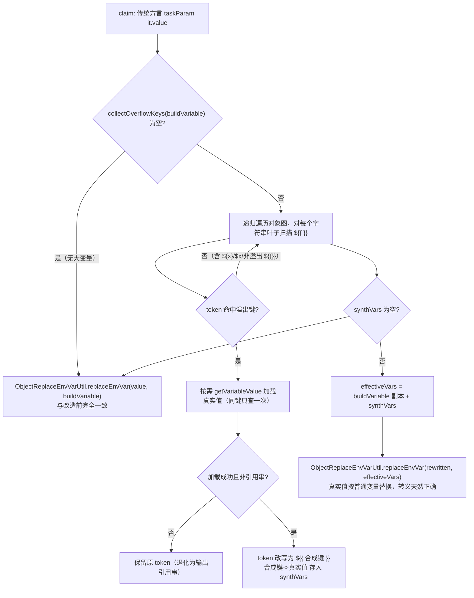

# 传统方言插件入参/脚本大变量按需解析 —— 合成唯一键方案

> 关联需求：支持超过 4K 的流水线变量（大变量溢出存储 + 按需加载）#12636
> 涉及代码：
> - `com.tencent.devops.process.service.BuildVarExprOverflowHelper#replaceEnvVarWithOverflow`
> - `com.tencent.devops.process.engine.service.vmbuild.EngineVMBuildService#claim`

## 1. 背景

大变量（>4K，最大 4M）在主表 `T_PIPELINE_BUILD_VAR` 中只存**引用串** `__BK_OVF__:<len>`，真实值存于溢出表 `T_PIPELINE_BUILD_VAR_OVERFLOW`，按需加载。

流水线有两种方言：

| 方言 | 插件入参 / 脚本里的 `${{ }}` 在哪里替换 |
| --- | --- |
| PAC / 制约（`supportUseExpression() == true`） | **worker 端**表达式引擎替换；`claim` 下发时参数原样（`it.value`），worker 用 `LazyStringContextData` 懒加载真实值 |
| 传统 / CLASSIC（默认） | **引擎侧 `claim` 派发前**用 `ObjectReplaceEnvVarUtil.replaceEnvVar` 替换 |

传统方言的替换发生在 `EngineVMBuildService.claim`：

```kotlin
params = task.taskParams.map {
    val obj = if (!dialect.supportUseExpression()) {
        ObjectReplaceEnvVarUtil.replaceEnvVar(it.value, buildVariable) // ← 传统方言在这里替换
    } else {
        it.value                                                       // ← PAC 原样下发
    }
    it.key to JsonUtil.toJson(obj, formatted = false)
}
```

`buildVariable` 中大变量是引用串，因此 `${{ 大变量 }}` 在这一步被替换成 `__BK_OVF__:<len>`，worker 拿到的已是引用串字面量。这正是"传统方言插件入参引用大变量拿不到真实值"的根因。

## 2. 需求约束

修复必须同时满足以下约束，缺一不可：

1. **只有 `${{ key }}`（双花括号）引用的大变量才替换成真实值**；
2. `${key}` / `$key`（旧语法）以及**未被引用**的大变量，保持引用串不变（向后兼容 + 内存安全）；
3. 真实值可能含任意字符（`"`、`\`、`{`、换行、甚至 `${...}`），替换后不得破坏参数的 JSON 结构；
4. **按需加载**：只加载本次参数实际引用到的大变量，不得批量拉全部大变量进内存；
5. **对历史逻辑零影响**：无大变量、或未引用大变量的构建，行为必须与改造前逐字节一致。

## 3. 为什么朴素方案都不行

### 方案 A：把变量表里的大变量值直接换成真实值再替换 —— ❌

即 `effectiveVars[key] = 真实值`，再 `replaceEnvVar`。

问题：`EnvUtils.parseEnv` 的正则同时匹配 `${single}` 和 `${{double}}`，二者从**同一个 map** 取值。把 map 里的值换成真实值后，`${key}` / `$key` 也会一起变成真实值 —— **违反约束 2**。

### 方案 B：在字符串里把 `${{ 大变量 }}` 直接内联成真实值 —— ❌

在 `replaceEnvVar` 之前，把 `${{key}}` 直接替成真实值。

问题：
- 真实值若含 `${x}`，会被后续 `replaceEnvVar` **二次展开**（把真实值内容当变量解析）；
- 真实值若含 `"`/`{`，在"内嵌 JSON 串"的参数里会直接**破坏 JSON 结构**，因为此时还没经过统一转义。

### 方案 C：哨兵占位 + 事后还原 —— ❌（边界不可靠）

先把 `${{key}}` 换成随机哨兵，`replaceEnvVar` 跑完后再把哨兵替回真实值。

问题在"**内嵌 JSON 串**"参数：`ObjectReplaceEnvVarUtil` 对形如 `{"a":"${{key}}"}` 的字符串会**先反序列化成对象、再序列化回字符串**。哨兵还原发生在序列化**之后**，此时把含特殊字符的真实值原样塞回，会得到非法 JSON：

```
期望： {"a":"\"x\"y\""}      // 真实值 x"y 被正确转义
实际： {"a":"\"x"y\""}       // 还原时未转义，JSON 损坏
```

（早期用 `\u0000` 做哨兵还有额外坑：`\u0000` 会被 JSON 序列化转义成字面量 `\u0000`，导致 `contains(哨兵)` 匹配失败、根本还原不了。）

## 4. 合成唯一键方案（采用）

### 4.1 核心思想

**不自己做真实值的替换与转义，而是把真实值伪装成一个"普通变量"，让 `ObjectReplaceEnvVarUtil` 用它久经验证的既有逻辑去替换。**

具体：把命中的 `${{ overflowKey }}` **改写**成 `${{ 合成唯一键 }}`，并把 `合成唯一键 -> 真实值` 放进变量表的一份**副本**。于是：

- `${{ 合成唯一键 }}` 对 `replaceEnvVar` 而言就是"一个值恰好等于真实值的普通变量引用"，它会走**与任何普通小变量完全相同**的替换 / JSON 转义 / 内嵌反序列化路径 —— 转义天然正确；
- `${key}` / `$key` 未被改写，仍从原始 `buildVariable` 取到引用串 —— 满足约束 2；
- 只对文本里实际出现的 `${{ }}` 溢出键触发加载 —— 满足约束 4；
- 无命中时直接走原 `replaceEnvVar` —— 满足约束 5。

### 4.2 合成键的构造

```
合成键 = "bkovf" + <runToken> + "n" + <序号>
runToken = UUID.randomUUID().toString().replace("-", "")   // 32 位小写十六进制
```

合成键的三个必要性质：

| 性质 | 原因 |
| --- | --- |
| 纯小写字母数字，不含 `$ { }` | 能被 `EnvUtils` 的 `${{ }}` 正则正常识别为变量名 |
| 带随机 `runToken` | 与真实变量名、真实值内容零冲突概率 |
| 每次调用新建、按 `rawKey` 去重 | 同一参数里同键只加载一次真实值 |

### 4.3 处理流程



### 4.4 关键代码

```kotlin
fun replaceEnvVarWithOverflow(
    value: Any?, variables: Map<String, String>,
    buildVariableService: BuildVariableService, projectId: String, buildId: String
): Any {
    val overflowKeys = BuildVarOverflowUtils.collectOverflowKeys(variables)
    if (overflowKeys.isEmpty()) return ObjectReplaceEnvVarUtil.replaceEnvVar(value, variables) // 档① 零影响

    val loader: (String) -> String? = { key ->
        val loadKey = if (key.startsWith("variables.")) key.removePrefix("variables.") else key
        buildVariableService.getVariableValue(projectId, buildId, loadKey) // 按需、单键查询
    }
    val runToken = UUID.randomUUID().toString().replace("-", "")
    val synthVars = LinkedHashMap<String, String>()
    val keyToSynth = HashMap<String, String>()
    val rewritten = rewriteOverflow(value, overflowKeys, loader, synthVars, keyToSynth, runToken)

    if (synthVars.isEmpty()) return ObjectReplaceEnvVarUtil.replaceEnvVar(value, variables) // 档② 零影响

    val effectiveVars = HashMap(variables).apply { putAll(synthVars) } // 仅追加合成键
    return ObjectReplaceEnvVarUtil.replaceEnvVar(rewritten, effectiveVars) // 档③ 走普通变量路径
}
```

`rewriteText` 只处理双花括号（`doubleBracePattern = Regex("\\$\\{\\{([^{}$]+)}}")`），单花括号 / `$x` 不匹配，天然保持引用串。

## 5. 分场景推演（正确性验证）

设大变量 `k = jobs.j.steps.s.outputs.testResult`，真实值 `V`（可能含 `"`、`{`）。

### 场景 1：纯表达式入参 `desc = "${{k}}"`

1. 改写：`desc = "${{bkovf<token>n0}}"`，`synthVars[bkovf<token>n0] = V`；
2. `replaceEnvVar`：把 `${{bkovf...n0}}` 当普通变量替换成 `V`，与"desc 引用一个值为 V 的小变量"**完全等价**；
3. 最终 `JsonUtil.toJson` 对 `V` 做统一转义。✅ 正确。

### 场景 2：内嵌 JSON 串入参 `config = "{\"a\":\"${{k}}\"}"`

1. 改写：`config = "{\"a\":\"${{bkovf<token>n0}}\"}"`（合成键是字母数字，仍是合法 JSON）；
2. `replaceEnvVar` 识别其为 JSON 串 → 反序列化为 `{a: "${{bkovf...n0}}"}` → 递归把值替换为 `V` → **重新序列化**，此时 `V` 中的 `"`/`{` 被 Jackson 正确转义；
3. 与"`config` 内嵌一个值为 `V` 的小变量"**完全等价**。✅ 正确。

> 对比：方案 C（哨兵）在本场景会因"还原发生在序列化之后、未转义"而产出非法 JSON。合成键方案把替换交给序列化**之前/之中**的既有逻辑，故天然正确。

### 场景 3：混用 `desc = "${{k}} - ${k} - $k"`

- `${{k}}` → 改写为合成键 → 替换成真实值 `V`；
- `${k}` / `$k` → 未改写 → 从原始 `buildVariable` 取到引用串 `__BK_OVF__:<len>`。
- 结果：`V - __BK_OVF__:<len> - __BK_OVF__:<len>`。✅ 满足约束 2。

### 场景 4：真实值自身含 `${x}`

`V = "cost=${money}"`。改写后 `${{合成键}}` → `V`；`EnvUtils.parseEnv` 的 `parseTokenTwice` 会对变量值再展开一层——**这与任何普通变量的既有行为一致**（普通小变量值含 `${x}` 时同样会被展开）。故不引入新的语义差异。✅ 行为一致。

## 6. 内存与性能

- **按需加载**：只对参数文本里实际出现的 `${{ 溢出键 }}` 调 `getVariableValue`；未引用的大变量不加载。
- **同键去重**：`keyToSynth` 保证同一参数里同键只查一次溢出表。
- **不放大下发包**：下发给 worker 的 `BuildTask(buildVariable = buildVariable)` 仍是引用串，只有被引用的真实值进入 `params`。
- **额外开销**：每个传统方言参数多一次 `collectOverflowKeys` 的 map 扫描（微秒级），仅在有大变量时才进入改写逻辑。

## 7. 边界与降级

| 情况 | 行为 |
| --- | --- |
| 溢出表 miss / 加载返回 null 或仍是引用串 | 保留原 `${{ }}` token，后续按普通替换退化为"输出引用串"（不报错、不阻断构建） |
| 加载抛异常 | 记 `CLASSIC_OVERFLOW_LOAD_FAIL` 警告日志，按上一行降级 |
| `variables.xxx` 前缀 | loader 去前缀后按落库 key 查询 |

## 8. 兼容性结论（对历史逻辑的影响）

| 场景 | 走的分支 | 与改造前对比 |
| --- | --- | --- |
| 构建无大变量（含所有历史构建） | 档① 直接 `replaceEnvVar` | **逐字节一致** |
| 有大变量但本参数未用 `${{ }}` 引用 | 档② 用原始 value 直接 `replaceEnvVar` | **逐字节一致** |
| 引用了 `${{ 大变量 }}` | 档③ 合成键替换 | 仅该 token 变为真实值；其余 token / 变量行为不变 |

- 原始 `buildVariable` 不被修改（改写产生新对象、真实值写入 `HashMap` 副本）；
- 合成键带 UUID，不与真实变量名冲突；
- 只改动传统方言分支，PAC 分支（`else { it.value }`）一字未动。

## 9. 日志与排查

| 日志 | 含义 |
| --- | --- |
| `CLASSIC_OVERFLOW_RESOLVED\|buildId=...\|count=N` | 本次成功把 N 个 `${{ 大变量 }}` 替换成真实值 |
| `CLASSIC_OVERFLOW_LOAD_FAIL\|key=...` | 加载某个大变量真实值异常（降级为引用串） |
| `VAR_OVERFLOW_MISS\|key=...`（`BuildVariableService`） | 主表是引用但溢出表无值 → 写入路径漏写 |

## 10. 相关但独立的说明

- 大变量真实值内联进 **shell 脚本** 时，仍可能因值含特殊字符触发 shell 语法错误——这是文本替换进 shell 的固有限制，与本方案无关；**插件入参**写入 `input.json`、不过 shell，不受此限制。
- PAC 方言不走本方案：其 `${{ }}` 在 worker 端由 `LazyStringContextData` 懒加载，逻辑独立。
