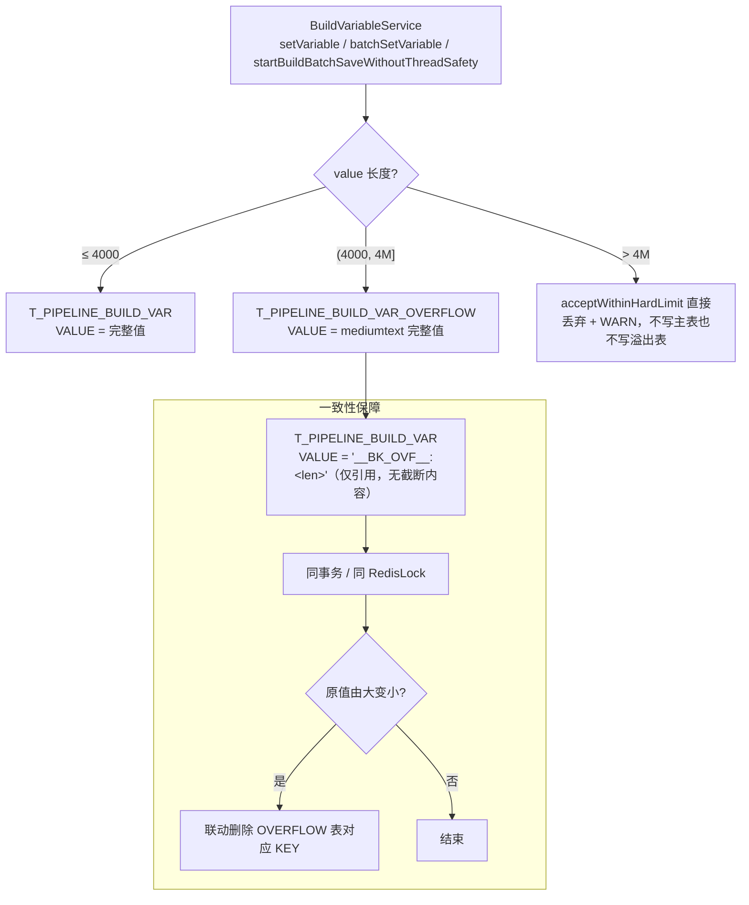
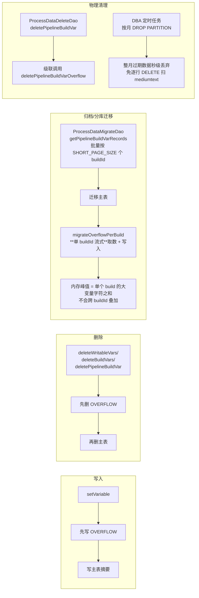
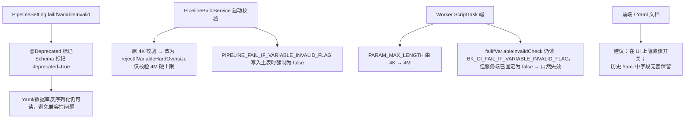
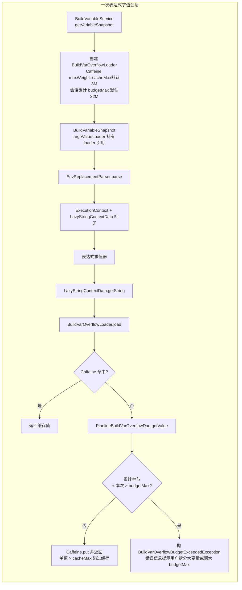

# 流水线大变量按需加载方案设计

> **总览请先读**：[`PIPELINE_LARGE_VARIABLE_TECHNICAL_DESIGN.md`](./PIPELINE_LARGE_VARIABLE_TECHNICAL_DESIGN.md)（含启动参数、表达式接入、前端契约与上线计划）。  
> 本文为运行期 `T_PIPELINE_BUILD_VAR` 溢出存储的分册细节。
>
> 关联代码模块：`src/backend/ci/core/process`、`src/backend/ci/core/common/common-pipeline`、`src/backend/ci/core/common/common-expression`、`src/backend/ci/core/worker/worker-common`、`src/backend/ci/core/misc`
>
> 关联 DDL：[`T_PIPELINE_BUILD_VAR_OVERFLOW_MIGRATION.sql`](./T_PIPELINE_BUILD_VAR_OVERFLOW_MIGRATION.sql)

---

## 1. 背景与目标

### 1.1 现状

`T_PIPELINE_BUILD_VAR` 表结构：

```sql
CREATE TABLE `T_PIPELINE_BUILD_VAR` (
  `BUILD_ID`    varchar(34)  NOT NULL,
  `KEY`         varchar(255) NOT NULL,
  `VALUE`       varchar(4000) DEFAULT NULL,    -- 4K 上限
  `PROJECT_ID`  varchar(64)  DEFAULT NULL,
  `PIPELINE_ID` varchar(64)  DEFAULT NULL,
  `VAR_TYPE`    varchar(64)  DEFAULT NULL,
  `CREATE_TIME` datetime(3)  NOT NULL DEFAULT CURRENT_TIMESTAMP(3),
  `READ_ONLY`   bit(1)       DEFAULT NULL,
  `SENSITIVE`   bit(1)       DEFAULT NULL,
  PRIMARY KEY (`BUILD_ID`,`KEY`,`CREATE_TIME`),
  KEY `idx_BUILD_ID` (`BUILD_ID`,`PROJECT_ID`,`KEY`,`READ_ONLY`)
);
```

`VALUE` 列长度 4000，导致变量值超过 4K 时：

- `PipelineBuildVarDao.batchSave` 直接 **丢弃** 数据（`ABANDON_DATA` 警告日志）；
- 流水线设置层的 `failIfVariableInvalid` 让用户在 **立即报错** / **忽略错误** 之间二选一，仍然无法正常入库；
- Worker 端 `TaskDaemon.PARAM_MAX_LENGTH=4000` 在上报前就丢弃，问题进一步前置。

### 1.2 需求

| 需求项 | 描述 |
| --- | --- |
| 1 | 自动识别变量值长度，**> 4K** 时标记并独立存储，主表只保留**引用** |
| 2 | 变量值上限由 4K 提升到 **4M** |
| 3 | 大变量按需加载，**仅** `${{ xxx }}` 表达式可解析；`$xxx` / `${xxx}` 因与 bash 冲突且系统已有限制，不再支持 |
| 4 | 删除「超过 4K 长度」的流水线设置（即 `failIfVariableInvalid`） |
| 5 | 优雅可扩展，不破坏现网流水线运行逻辑 |

### 1.3 非目标

- 不改造 `T_PIPELINE_BUILD_VAR` 主表的列结构，避免存量大表 ALTER 风险；
- 不改造已有的 `${{ xxx }}` 表达式语法和现有方言判定逻辑；
- 不在本次需求中清理已经持久化的 `failIfVariableInvalid=true` 配置（仅令其在运行时无效）。

---

## 2. 总体方案

### 2.1 关键决策

| 维度 | 选项 | 决策 | 理由 |
| --- | --- | --- | --- |
| 主表 VALUE 扩容 | 改 mediumtext / 增加 OVERFLOW 列 | **保持原结构** | 现网数据量大，ALTER 风险高；mediumtext 默认查询会增加内存压力；改列还需配套 jOOQ 重新生成 |
| 大值识别 | 主表新增 OVERFLOW 列 / VALUE 引用前缀 | **纯引用前缀 `__BK_OVF__:<len>`** | 主表零侵入；不带任何截断的真实内容（避免敏感数据"半泄漏"）；解析开销 O(1) |
| 大值存储 | 同表 longtext / 新表 mediumtext | **新增 `T_PIPELINE_BUILD_VAR_OVERFLOW`，VALUE = mediumtext** | 与主表读写解耦；mediumtext 上限约 16M 留有冗余 |
| 表达式按需加载 | 一次性 fetch 所有大值 / 表达式访问时再 fetch | **表达式访问时再 fetch（`LazyStringContextData`）+ `BuildVarOverflowLoader`（**Caffeine 字符加权 LRU + 会话级总字节预算**）** | 内存峰值可控；同会话避免 N+1；总字节超预算抛错而不是 OOM |
| 本地缓存实现 | 自研 LinkedHashMap LRU / Guava / Caffeine | **统一使用 Caffeine** | 与项目其他模块（auth、store、dispatch、worker 等）保持一致；W-TinyLFU 替换策略更准确；线程安全内置 |
| `$xxx` / `${xxx}` 风格 | 抓取大值 / 看到引用串 | **看到引用串** | 与 bash 冲突，需求明确不支持；引用串 ≤ 25 字符，零内存放大 |
| `failIfVariableInvalid` | 物理删除字段 / 标记 `@Deprecated` 并失效 | **保留字段、运行时失效** | 兼容存量 Yaml/Setting；后续可在前端先隐藏，再后端清理 |
| 超 4M 处理 | 抛异常 / 截断 / 丢弃 | **丢弃 + WARN** | 接近"`failIfVariableInvalid=false`"的语义；与 worker 端过滤一致；防御 16G/Pod 内存被一条异常变量击穿 |

### 2.2 数据模型

#### 主表 `T_PIPELINE_BUILD_VAR`（不改）

存储所有变量。当真实值 > 4000 字符时：

```
VALUE = "__BK_OVF__:<原始长度>"
```

> 注意：主表**不再**保存任何"截断的真实内容"，即不带 `:<truncated>` 字段。
>
> 这样有两个好处：
>  - **避免敏感数据半泄漏**：哪怕值是 token、SSH 私钥的部分明文，截断后仍可能被恶意还原；纯引用串杜绝了该风险；
>  - **内存放大归零**：原来 4000 字符的截断内容意味着上千万行主表数据可能多保留几 GB 字节；新协议下大变量在主表内只占 25 字节左右。

字段语义保持不变；旧调用方读到的也是合法字符串，长度可控（≤ 25 字符），不会触发任何下游 IO。

#### 新表 `T_PIPELINE_BUILD_VAR_OVERFLOW`

```sql
CREATE TABLE `T_PIPELINE_BUILD_VAR_OVERFLOW` (
    `BUILD_ID`     varchar(34)  NOT NULL,
    `KEY`          varchar(255) NOT NULL,
    `VALUE`        mediumtext   NOT NULL,                -- 4M 满足
    `VALUE_LENGTH` int          NOT NULL DEFAULT 0,
    `PROJECT_ID`   varchar(64)  NOT NULL,
    `PIPELINE_ID`  varchar(64)  NOT NULL,
    `VAR_TYPE`     varchar(64)           DEFAULT NULL,
    `READ_ONLY`    bit(1)                DEFAULT NULL,
    `SENSITIVE`    bit(1)                DEFAULT NULL,
    `CREATE_TIME`  datetime(3)  NOT NULL DEFAULT CURRENT_TIMESTAMP(3),
    `UPDATE_TIME`  datetime(3)  NOT NULL DEFAULT CURRENT_TIMESTAMP(3)
                                          ON UPDATE CURRENT_TIMESTAMP(3),
    PRIMARY KEY (`BUILD_ID`,`KEY`,`CREATE_TIME`),       -- CREATE_TIME 进主键，满足分区约束
    KEY `idx_PROJECT_PIPELINE` (`PROJECT_ID`,`PIPELINE_ID`)
) ENGINE=InnoDB DEFAULT CHARSET=utf8mb4
  COMMENT='流水线大变量溢出存储表'
PARTITION BY RANGE COLUMNS(`CREATE_TIME`) (                 -- 按月分区，DROP PARTITION 清理
    PARTITION p202601 VALUES LESS THAN ('2026-02-01 00:00:00'),
    -- ... 其余月份分区 ...
    PARTITION pmax    VALUES LESS THAN (MAXVALUE)
);
```

设计要点（**已更新：分区表 + CREATE_TIME 进主键**）：

- 主键 `(BUILD_ID, KEY, CREATE_TIME)`：**CREATE_TIME 进主键**是分区的硬性前提——
  MySQL 要求分区列必须包含在每一个唯一键 / 主键中；
- **按 `CREATE_TIME` 做 RANGE 月分区**：过期数据通过 `DROP PARTITION` 整月秒级丢弃，
  避免逐行 `DELETE` 扫 mediumtext 造成的大量 undo / binlog / IO 抖动；
- **逻辑唯一性仍然保证**：CREATE_TIME 进主键并不会引入"同变量多行"——
  写入路径（[`PipelineBuildVarOverflowDao.save`](#33-pipelinebuildvaroverflowdao)）改为
  **"先 UPDATE 命中则不再 INSERT"** 的 upsert 语义，保留首次 `CREATE_TIME`，分区归属稳定；
- 索引 `(PROJECT_ID, PIPELINE_ID)` 用于按流水线删除/统计；
- 分区维护（滚动新增下月分区 + DROP 过期分区）见
  [`T_PIPELINE_BUILD_VAR_OVERFLOW_MIGRATION.sql`](./T_PIPELINE_BUILD_VAR_OVERFLOW_MIGRATION.sql) 末尾示例，
  建议由独立定时任务 / DBA 平台执行；分库场景下所有分片库都需执行同样的分区 DDL。

### 2.3 写入流程



实现要点：

1. **顺序**：先写溢出表 → 再写主表，保证「主表能识别引用 ⇒ 溢出表必有数据」。
2. **由大变小回退**：变量被改回 4K 以内时，主动从溢出表删除该 KEY。
3. **由小变大**：直接覆盖溢出表（`ON DUPLICATE KEY UPDATE`）+ 主表写入新引用。
4. **硬上限**：`PIPELINE_VARIABLES_STRING_LENGTH_HARD_MAX = 4 * 1024 * 1024`。
   - 服务端 `BuildVariableService.acceptWithinHardLimit` **直接丢弃 + WARN**，
     既不写主表也不写溢出表；
   - Worker 端 `TaskDaemon.PARAM_MAX_LENGTH = 4M`，前置过滤；
   - 这是防止 16G/Pod 服务被一条异常大变量击穿的关键防线。

### 2.4 读取与表达式求值

```mermaid
flowchart TD
    A1[现存调用 BuildVariableService.getAllVariable] --> B1[读 T_PIPELINE_BUILD_VAR]
    B1 --> C1[Map&lt;String,String&gt;<br/>小变量真实值 + 大变量纯引用串]
    C1 --> D1[$xxx / ${xxx} 替换：看到引用串<br/>不会触发任何溢出表 IO]

    A2[新调用 BuildVariableService.getVariableSnapshot] --> B2[读 T_PIPELINE_BUILD_VAR + 识别引用前缀]
    B2 --> C2[BuildVariableSnapshot]
    C2 --> C3[创建会话级 BuildVarOverflowLoader<br/>带 LRU(8M) + 总字节预算(32M)]
    C3 --> D2["smallVars: Map&lt;String,String&gt;<br/>largeKeys: Set&lt;String&gt;<br/>largeValueLoader: (key) -> String?"]

    D2 --> E[EnvReplacementParser.parse 接收 overflowKeys + overflowLoader]
    E --> F[ExprReplacementUtil 构造 ExecutionContext]
    F --> G[把 overflowKeys 的叶子节点替换为 LazyStringContextData]
    G --> H[表达式 ${{ MY_BIG_VAR }} 求值时<br/>触发 lazyLoader → BuildVarOverflowLoader.load → 查溢出表]
    H --> I[只在真正需要时拉取 4M 值<br/>同会话相同 key 命中 Caffeine 缓存<br/>累计字节超 budgetMax 抛 BuildVarOverflowBudgetExceededException]
```

实现要点：

1. **`BuildVariableSnapshot`**（在 `api-process/pojo`）：聚合"小变量真实值 + 大变量纯引用 + 大变量键集合 + 懒加载器"。生命周期与"一次表达式求值会话"对齐，**不可长期持有**（持有会卡住 LRU 中的大对象不被 GC 回收）；
2. **`BuildVarOverflowLoader`**（在 `biz-base/service`，新增）：
   - 持有 Caffeine 字符加权 LRU 缓存（W-TinyLFU，默认 8M 字符），单值超过该上限直接跳过缓存写入；
   - 维护"会话级总加载字节计数"，**超过 [maxBudgetBytes]（默认 32M）抛 `BuildVarOverflowBudgetExceededException`**——
     这是新构建专用的 OOM 防线，把"用户脚本一次性引用过多大变量"从潜在 OOM 转为明确的用户错误；
   - **历史 build 对此预算完全无感**：历史变量最大 4K，全部走 `smallVars` 直读路径，根本不会进入 loader；
   - 两个阈值均通过 Spring `@Value` 由运营可配置（`pipeline.variables.lazyLoad.cacheMax` /
     `pipeline.variables.lazyLoad.budgetMax`）；
   - 内部通过 Caffeine 自身的并发模型 + `AtomicLong` 计数（先 add 再回滚的"预扣 + 越界 revert"模式）保证线程安全；
3. **`LazyStringContextData`**（在 `common-expression`）：继承 `PipelineContextData`（字符串类型），首访时调用 supplier 并本地缓存（per-instance），后续访问 O(1)；
4. **`ExprReplacementUtil.replaceOverflowLeaves`**：在 `fillContextByMap` 之后，只对**单层 key（不含 `.`）**的溢出键将叶子替换为 `LazyStringContextData`。复合点号路径（极少见）保持引用串降级，权衡简单性 vs 完备性；
5. **`$xxx` / `${xxx}` 风格**：依然走 `ObjectReplaceEnvVarUtil.replaceEnvVar(value, contextMap)`，使用引用串 Map → 旧脚本不会因变量超过 4K 而崩、也不会偶然展开 4M 大值；
6. **`BuildVarResourceImpl.getContextVariableByName`**（REST 单变量查询）：识别返回值是引用串后，调用 `getVariableValue` 走单条懒加载，**不**会走 LRU（避免在 REST 请求间共享缓存导致内存压力）。

### 2.5 生命周期与一致性



一致性策略：溢出表 `T_PIPELINE_BUILD_VAR_OVERFLOW` 已在现网建好，`delete*Overflow` / `migrate*Overflow` 路径直接使用 jOOQ 生成表（与主表 DAO 风格一致），不再对"表不存在"做 swallow，让异常按"快速失败"暴露，便于及时发现数据问题。

清理双通道：
- **业务级（按 build/pipeline）**：misc 服务 `ProcessDataDeleteDao.deletePipelineBuildVar` 级联删除溢出表，用于归档/分库后的精确清理；
- **运维级（按时间）**：溢出表已按 `CREATE_TIME` 月分区，DBA / 定时任务直接 `DROP PARTITION` 丢弃整月过期数据，秒级且几乎不产生 undo / binlog，是清理"已结束很久的构建大变量"的主力手段。两者互补，互不冲突。

### 2.6 流水线设置变更（去掉 4K 报错开关）



---

## 3. 详细实现

### 3.1 模块拓扑

```
common-expression
└── LazyStringContextData            // 字符串懒加载叶子（新）

common-pipeline
├── ExprReplacementOptions           // 增加 overflowKeys / overflowLoader
├── EnvReplacementParser             // parse / getCustomExecutionContextByMap 接受 overflow 参数
└── ExprReplacementUtil              // 构造 context 时把 overflowKeys 替换为 LazyStringContextData

process / api-process
├── utils/Constants.kt               // 新增 PIPELINE_VARIABLES_STRING_LENGTH_HARD_MAX、OVERFLOW_PREFIX、
│                                    //       PIPELINE_VARIABLES_LAZY_LOAD_BUDGET_MAX、PIPELINE_VARIABLES_LAZY_LOAD_CACHE_MAX
│                                    //       (附 *_KEY 常量暴露 Spring 配置键)
├── utils/BuildVarOverflowUtils.kt   // 引用协议（识别 / 构造）—— 仅引用串，无截断内容
└── pojo/BuildVariableSnapshot.kt    // 快照 POJO

process / biz-base
├── engine/dao/PipelineBuildVarOverflowDao.kt   // 复用 jOOQ 生成表 TPipelineBuildVarOverflow（表已建好）；
│                                                  CREATE_TIME 进主键后 save 改为"先 UPDATE 命中再 INSERT"
├── engine/dao/PipelineBuildVarDao.kt           // 写入路径接入引用协议
├── service/BuildVarOverflowLoader.kt           // **新**：Caffeine 字符加权缓存 + 会话级总字节硬上限（超出抛 BuildVarOverflowBudgetExceededException）
├── service/PipelineVarOverflowConfig.kt        // **新**：@RefreshScope 配置 Bean，集中三个可动态调整阈值
│                                                  （hardMaxLength / lazyLoad.cacheMax / lazyLoad.budgetMax）
├── service/BuildVariableService.kt             // snapshot / lazy 接口；联动溢出表写删；硬上限丢弃；
│                                                  注入 PipelineVarOverflowConfig 读取可动态调整阈值
└── service/pipeline/PipelineBuildService.kt    // 4K 校验 → 4M 硬上限校验；failIfVariableInvalid no-op

process / biz-process
└── api/builds/BuildVarResourceImpl.kt          // 单变量 REST 查询命中引用时走 lazy 路径

worker-common
└── task/TaskDaemon.kt               // PARAM_MAX_LENGTH 4K → 4M；新增 PARAM_MAX_LENGTH_WARN

misc / biz-misc
├── dao/process/ProcessDataDeleteDao.kt          // 增加溢出表删除
├── dao/process/ProcessDataMigrateDao.kt         // 增加溢出表迁移
└── strategy/impl/pipeline/PipelineBuildLinkedDataMigrationStrategy.kt
                                                 // 溢出表按 buildId 流式迁移，避免批量 mediumtext 内存峰值
```

### 3.2 引用协议（pure reference）

定义于 `BuildVarOverflowUtils`：

```
__BK_OVF__:<originalLength>
```

- `originalLength`：原始字符长度，仅作 UI / 日志展示与诊断；
- **不携带任何真实内容**——避免敏感数据被截断后还原泄漏；
- 该字符串恒定 ≤ 25 字符，远小于 `varchar(4000)` 上限，主表无需做任何额外校验；
- 用户主动构造冲突的概率极低；即便发生，按需查询溢出表得到 null → 回退到原引用串，行为与改造前的"4K 截断"对等，无副作用。

API（最小必要集，避免预设 API 造成的死代码膨胀）：

| 方法 | 用途 |
| --- | --- |
| `isOverflowReference(value)` | 是否带引用前缀 |
| `toMainTableValue(rawValue)` | 主表实际写入值（≤4K 直接返回，否则返回引用串） |
| `shouldOverflow(rawValue)` | 是否需要写溢出表 |

> 引用串如需在 UI / 日志里渲染"原始长度"，可由调用方自行 `value.substringAfter(":").toIntOrNull()`，没必要在此处暴露专门的解析方法。
> 历史方法名 `isOverflowSummary`/`parseOverflowSummary`/`buildOverflowSummary` 与"摘要"概念不再吻合（无截断内容），已统一为 `*OverflowReference`/`*MainTableValue`。该协议变更不会破坏 DDL，主表 VALUE 列长度恒为 ~25 字符，存量灰度无负担。

### 3.3 `PipelineBuildVarOverflowDao`

- **复用 jOOQ 生成代码**：溢出表已在现网建好，codegen 会生成 `TPipelineBuildVarOverflow` / `TPipelineBuildVarOverflowRecord`，DAO 通过 `with(T_PIPELINE_BUILD_VAR_OVERFLOW) { ... }` 操作，与主表 DAO 风格一致。
- **最小化方法集**（仅保留实际使用的方法，避免"待用 API"造成的死代码膨胀）：
  - `save(...)` / `batchSave(...)`：写入或更新；
  - `getValue(buildId, key)`：按需取单个真实值（懒加载主入口）；
  - `deleteByKey` / `deleteByBuildId` / `deleteByPipelineId`：与主表删除接口对齐。
- **upsert 语义（因 CREATE_TIME 进主键而调整）**：
  - 不能再用 `INSERT ... ON DUPLICATE KEY UPDATE`——CREATE_TIME（默认 `CURRENT_TIMESTAMP(3)`）
    进主键后，重复写入同一 `(BUILD_ID, KEY)` 会因新 CREATE_TIME 不冲突而**插入重复行**；
  - 改为 **"先 UPDATE（按 `BUILD_ID + KEY + PROJECT_ID`），命中 0 行再 INSERT"**：
    保证同变量逻辑唯一、保留首次 CREATE_TIME（分区归属稳定）；
  - 写入均在 `PipelineBuildVarLock(buildId[, key])` RedisLock 内串行，无并发竞态；
  - `getValue` 额外加 `ORDER BY CREATE_TIME DESC LIMIT 1` 防御历史脏数据，始终取最新值。
- **不提供 `getValues(...)` / `listKeys(...)`**：按需加载语义要求"逐键单点拉取"，批量接口反而会诱导调用方一次性聚合，违背设计初衷。`BuildVariableSnapshot.largeKeys` 直接通过主表 `__BK_OVF__:` 前缀识别，无需溢出表二次查询。

### 3.4 `BuildVariableService` 重要新增

| 方法 | 说明 |
| --- | --- |
| `getVariableSnapshot(...)` | 返回 `BuildVariableSnapshot`：smallVars 给真实值/引用串，大值通过 `largeValueLoader` 按需访问。`largeValueLoader` 内部由 [`BuildVarOverflowLoader`](#36-表达式按需加载核心) 提供 Caffeine 字符加权缓存 + 会话级总字节硬上限（超出抛错，可配置） |
| `getVariableValue(...)` | 单变量按需取真实值。每次调用新建一个一次性 Loader，**不**走跨调用缓存，避免 REST 间共享内存 |
| `acceptWithinHardLimit(...)`（私有） | 4M 硬上限保护：超出直接丢弃 + WARN，不写主表也不写溢出表 |

旧 API `getAllVariable(...)` 行为**不变**——仍返回 `Map<String,String>`，仅大变量的 value 从过去的"截断 4K 字符"变成"≤25 字符引用串"。对所有"打印 / 序列化整个 map"的调用方而言，内存占用都是减小的。

### 3.5 锁与事务

- 单变量写：原 `PipelineBuildVarLock(buildId, name)` 的 RedisLock 范围扩展到「先写溢出表 → 再写主表 → 必要时清理溢出表残留」，保证同一 KEY 不会出现"主表 = 摘要、溢出表 = 旧值"的脏组合；
- 批量写：原批量锁 `PipelineBuildVarLock(buildId)` 范围内增加 `pipelineBuildVarOverflowDao.batchSave` + 必要的逐键清理；
- 跨表事务：调用方一般传入同一个 `dslContext`（`commonDslContext` 或 `transaction { ... }` 内的 `DSL.using(t)`），溢出表写入与主表写入处于同一事务。

### 3.6 表达式按需加载（核心）



**`LazyStringContextData`**（per-instance 缓存）：

```kotlin
class LazyStringContextData(
    private val supplier: () -> String?,
    private val fallback: String = ""
) : PipelineContextData(PipelineContextDataType.STRING), IString {
    @Volatile private var resolved: String? = null
    private fun resolve(): String { ... }
    override fun getString(): String = resolve()
    override fun fetchValue(): Any = resolve()
}
```

**`BuildVarOverflowLoader`**（基于 **Caffeine** 的会话级缓存 + 硬上限预算）：

```kotlin
class BuildVarOverflowLoader(
    private val overflowDao: PipelineBuildVarOverflowDao,
    private val dslContext: DSLContext,
    private val projectId: String,
    private val buildId: String,
    private val maxCacheBytes: Long = PIPELINE_VARIABLES_LAZY_LOAD_CACHE_MAX.toLong(),   // 默认 8M，可被 BuildVariableService @Value 覆盖
    private val maxBudgetBytes: Long = PIPELINE_VARIABLES_LAZY_LOAD_BUDGET_MAX.toLong()  // 默认 32M，可被 BuildVariableService @Value 覆盖
) {
    private val cache: Cache<String, String> = Caffeine.newBuilder()
        .maximumWeight(maxCacheBytes)
        .weigher<String, String> { _, value -> value.length }
        .build()
    private val loadedBytes = AtomicLong(0L)
    fun load(key: String): String? {
        // 命中缓存直接返回；否则查 DB，加上本次后越过 maxBudgetBytes ⇒ 立即抛错（同时回滚预扣字节）。
    }
}

class BuildVarOverflowBudgetExceededException(
    val buildId: String, val key: String, val triedLength: Int, val budget: Long
) : RuntimeException(/* 提示用户拆分大变量或调大 pipeline.variables.lazyLoad.budgetMax */)
```

**预算可配置（Spring 配置项）**：

| 配置键 | 默认值 | 单位 | 说明 |
| --- | --- | --- | --- |
| `pipeline.variables.lazyLoad.cacheMax` | `8388608`（8M） | 字符数 | Caffeine maximumWeight；运维可根据 Pod 内存压力 / 命中率调整 |
| `pipeline.variables.lazyLoad.budgetMax` | `33554432`（32M） | 字符数 | 单会话总加载硬上限；超出抛 `BuildVarOverflowBudgetExceededException`，可视业务需要调大 |

> 运维示例：当业务确认"一次评估合理引用 ≥ 9 个 4M 大变量"时，
> 可将 `pipeline.variables.lazyLoad.budgetMax` 调到 `67108864`（64M）甚至更大。
> 调整对历史 build 完全无副作用——它们根本不会进入这一路径。

**为何采用硬抛错而非软告警**：
- 软告警虽然不会因为预算"误伤"用户，但也意味着 OOM 风险无法在懒加载这一层被截断；
- 单变量 4M 是另一道防线，但**N 个 4M 变量在一次会话叠加**就足以撑爆 Pod，
  此时必须主动终止本次表达式求值；
- 硬抛错的错误信息直接指引用户"拆分大变量或调大 budgetMax"，给出可执行的恢复路径；
- **历史 build 不会受影响**：历史变量最大 4K，全部走 smallVars 直读，根本走不到 loader。

为何选 Caffeine：
- 项目内 auth / store / dispatch / worker 等模块已经统一使用 Caffeine；
- W-TinyLFU 替换策略命中率显著优于纯 LRU；
- `maximumWeight + weigher` 支持按"字符数"约束总容量，避免一条 4M 大值挤占整个缓存；
- 线程安全 + 无锁热路径，省去手写 `synchronized` LRU 的复杂性。

**`ExprReplacementUtil.replaceOverflowLeaves`**：

```kotlin
overflowKeys.forEach { key ->
    if (key.contains('.')) return@forEach        // 复合 key 暂不替换
    if (root.containsKey(key)) {
        root[key] = LazyStringContextData(supplier = { loader(key) })
    }
}
```

**两层缓存的责任分配**：

| 层 | 范围 | 命中场景 |
| --- | --- | --- |
| `LazyStringContextData.resolved` | per-instance（一棵表达式 AST 中的某一节点） | 同一表达式内重复 `getString()`/`fetchValue()` |
| `BuildVarOverflowLoader` Caffeine | per-snapshot（一次表达式求值会话） | 同一会话内、跨多个 `LazyStringContextData` 实例（例如多个表达式同时引用同一大变量） |

兼容性：

- 旧调用 `EnvReplacementParser.parse(value, contextMap)` 不传 overflow 参数 → 默认空集 → 行为完全等同改造前；
- Java 调用方 `ExprReplaceEnvVarUtil.replaceEnvVar(...)` 通过 `@JvmOverloads` 见到 5 参构造器，无需修改。

### 3.7 Worker 端

| 字段 | 原值 | 新值 | 影响 |
| --- | --- | --- | --- |
| `PARAM_MAX_LENGTH` | 4000 | 4 \* 1024 \* 1024 | Worker 不再以 4K 丢弃变量值 |
| `PARAM_MAX_LENGTH_WARN` | 不存在 | 4000 | 新增"建议改用 ${{ key }} 引用"提示日志阈值 |
| `BK_CI_FAIL_IF_VARIABLE_INVALID_FLAG` | 由 setting 决定 true/false | 服务端固定写 false | 对应 worker 校验自然失效 |

---

## 4. 内存安全（针对 process / engine ×10 Pod, 16G/Pod）

### 4.1 问题域

- 现网部署：`process` 与 `engine` 各 10 Pod，每 Pod 16G 内存；
- 单变量上限 4M（字符），mediumtext 列实际字节最多约 16M；
- 单一会话扩展 N 个 4M 变量 ⇒ 4N M 内存峰值；
- 并发会话叠加 ⇒ 总占用是单会话的若干倍；
- 另需考虑 GC 抖动、JSON 序列化二次放大。

### 4.2 防线一览

| 层 | 控制项 | 默认值 | 触发后行为 |
| --- | --- | --- | --- |
| Worker 上传 | `TaskDaemon.PARAM_MAX_LENGTH` | 4M | > 4M：丢弃 + WARN |
| 服务端写入 | `BuildVariableService.acceptWithinHardLimit`（阈值来自 `PipelineVarOverflowConfig.hardMaxLength`，可动态调整） | 4M | > 4M：丢弃 + WARN（不入主表也不入溢出表） |
| 主表 | 引用串恒 ≤ 25 字符 | 0 内容 | 写入路径 toMainTableValue 自动产生引用 |
| 单条懒加载 | `LazyStringContextData.resolved` 缓存 | per-instance | 同节点二次访问 O(1) |
| 会话级懒加载 | `BuildVarOverflowLoader` Caffeine 缓存 | 8M 字符（可配置 `cacheMax`） | 超容量按 W-TinyLFU 字符加权逐出 |
| 会话级懒加载 | `BuildVarOverflowLoader` budget 硬上限 | 32M 字符（可配置 `budgetMax`） | 超预算抛 `BuildVarOverflowBudgetExceededException`，**只影响新构建大变量场景，历史 build 永远走不到** |
| 迁移服务 | 按 buildId 流式迁移 | 1 build / 批 | 内存峰值 ≤ 单 build 大变量字符之和 |

### 4.3 容量估算（最坏并发模型）

假设单 Pod 同时承载 N 个表达式求值会话：

- **累计加载吞吐硬上限**：`N × budgetMax`（默认 N × 32M）。注意 budget 计的是"会话内累计 *load* 过的字符数"，这些大字符串求值完即成垃圾，**并非常驻**；它真正约束的是"单会话别无限放大"，而不是峰值驻留。
- **真正的常驻峰值**：`N × cacheMax`（默认 N × 8M，且单值 > cacheMax 不进缓存避免独占）+ 各会话当前正在求值的瞬时工作集。以 cacheMax 估算更贴近现实：
  - 16G/Pod、堆 ~10.4G 固定（`-Xms=-Xmx`）下，N = 200 个会话的缓存常驻约 1.6G；
  - 叠加瞬时工作集与 JSON 序列化二次放大，仍处于安全区间（结合下方 JVM 实测：process Old Gen Last ~3.7G / Max ~6G）。
- ⚠️ **关键提醒**：4M 字符的字符串在 G1（10G 堆 region 约 4~8M）下属于 **humongous 分配**，直接进老年代、易碎片化；若把 `budgetMax` 调得很大并配合高并发，老年代增长与混合 GC 频率会显著上升。调大 `budgetMax` 时务必同步评估并发上限 N 与 GC 表现，**优先用 `cacheMax` 控制驻留**。
- 若实际业务确认需要更高 budget，可热调 `pipeline.variables.lazyLoad.budgetMax`，并按比例确认 N 不会让总峰值越界。

实际生产中 N 通常远小于 200，且大多数变量不会触发懒加载；该设计提供的是"最坏情况"防线，正常用法下额外开销几乎可以忽略。

### 4.4 与历史业务兼容性说明（关键）

升级前的语义：
- 单变量值由 `varchar(4000)` 强制截顶在 4K，**无法**写入更大的内容；
- 因此"一次构建总变量字节数"在升级前**没有显式上限**——但这是天然结果，
  并不是因为系统支持无限大值，而是因为单值上限阻止了大值进入；
- 历史 `T_PIPELINE_BUILD_VAR` 数据全部满足"单变量 ≤ 4K"，**完全不存在**需要走溢出表的场景。

升级后的语义：
- 单变量上限提升到 4M（写入路径通过 `acceptWithinHardLimit` 硬过滤）；
- `cacheMax`（默认 8M）是 Caffeine 内部 LRU 容量，超出**只是淘汰冷数据**，永不报错；
- `budgetMax`（默认 32M）是单会话总加载字节硬上限，超出抛
  `BuildVarOverflowBudgetExceededException`，作为新构建特有的 OOM 防线。

由此推论：
- **历史 build**：所有变量值都 ≤ 4K，进 `T_PIPELINE_BUILD_VAR.VALUE` 列时不会有
  `__BK_OVF__:` 前缀；`BuildVariableSnapshot.largeKeys` 为空；
  **整条懒加载链路（包括 budget 硬上限）根本不会被触发**，对老业务**完全零影响**；
- **新 build 的常见用法**：单次评估展开 ≤ 8 个 4M 变量（≤ 32M），在默认预算内顺畅运行；
- **新 build 的极端用法**：单次评估超过预算 ⇒ 抛错提示用户拆分大变量或调大 `budgetMax`，
  把潜在 OOM 转化为可执行的用户反馈。

> 简言之：**两个上限对老业务零影响、对新业务在合理用法下也不会触发，只对"启用大变量后的异常脚本"起防御作用**。
> 如果未来确实发现合理业务被误伤，调大 Spring 配置即可，**无需改动业务代码或重新部署**。

### 4.5 调参建议（**可动态调整，无需重启**）

三个内存阈值统一收敛到 `PipelineVarOverflowConfig`（`@RefreshScope` Bean）。
运营在 `application.yml` / 配置中心修改后，通过 `/actuator/refresh`（或配置中心 push）即可**热生效，无需重启 Pod**：

| 配置键 | 默认 | 语义 | 何时调小 | 何时调大 |
| --- | --- | --- | --- | --- |
| `pipeline.variables.hardMaxLength` | 4M | 单变量值硬上限（超过丢弃 + WARN） | 想更激进地拦截超大变量 | 确有合理的更大单值需求（注意同步评估 mediumtext 与内存） |
| `pipeline.variables.lazyLoad.cacheMax` | 8M | Caffeine 缓存字符上限（决定**单会话实际驻留**） | 内存压力大、单 Pod 会话数极高 | 重复读放大严重、命中率低 |
| `pipeline.variables.lazyLoad.budgetMax` | 32M | 单会话累计加载硬上限（超出抛错） | 担心异常脚本一次展开过多大变量 | 真实业务存在合理的"多大变量同次评估"需求，可调到 64M / 128M |

> - `Constants.kt` 中的同名常量仅作为这三个配置键的**默认值**，真实取值以 `PipelineVarOverflowConfig` 为准。
> - 注意 `cacheMax` ≤ `budgetMax`：缓存只是预算内的优化加速；调高 `budgetMax` 不需要同步调高 `cacheMax`。
> - **驻留内存的真实决定因素是 `cacheMax`**（budget 计的是"累计吞吐"，大字符串用完即成垃圾）：
>   单 Pod 峰值驻留 ≈ 并发会话数 × `cacheMax`，调参时优先以此估算 16G/Pod 余量。

### 4.6 监控建议

- `BuildVarOverflowLoader` 的命中率（如需可在构造时开启 `.recordStats()` 并暴露 `cache.stats()`）作为长期容量趋势观察；
- `VAR_OVERFLOW_BUDGET_EXCEEDED` 日志 / `BuildVarOverflowBudgetExceededException` 抛错频次——**高优先级告警**，
  排查脚本误用或评估是否需要调大 `pipeline.variables.lazyLoad.budgetMax`；
- 主表 `__BK_OVF__:` 前缀变量数 + 溢出表行数曲线，评估大变量增长趋势；
- 服务端 GC 日志关注大对象分配（4M 级别），异常时回查具体 buildId。

---

## 5. 兼容性与上线策略

### 5.1 兼容矩阵

| 场景 | 升级前 | 升级后 |
| --- | --- | --- |
| 变量 ≤ 4K | 入库主表 | 行为不变 |
| 变量 (4K, 4M] | 直接丢失 / 立即报错 | 自动写入溢出表 + 主表引用 |
| 变量 > 4M | 直接丢失 / 立即报错 | 服务端 acceptWithinHardLimit 丢弃 + WARN（双重保护：worker 端也丢弃） |
| 旧脚本 `$xxx` / `${xxx}` 引用大变量 | 看到空字符串或失败 | 看到引用串 `__BK_OVF__:<len>`（恒 ≤ 25 字符，零内存放大），日志提示改用 `${{ }}` |
| 表达式 `${{ MY_VAR }}` 引用大变量 | 之前有可能拿不到值 | 按需加载完整值，受 Caffeine 缓存 + 32M 预算硬上限双重保护（阈值可通过 `pipeline.variables.lazyLoad.budgetMax` 调整） |
| 流水线设置 `failIfVariableInvalid=true` | 启动构建报错 | **运行时无效**，仅做 4M 硬上限校验 |
| 已存量 `T_PIPELINE_BUILD_VAR` 数据 | / | **零影响**，不做迁移 |
| REST 单变量查询 `getContextVariableByName` | 看到截断值或空 | 看到引用串自动走 `getVariableValue` 懒加载，返回真实值 |

### 5.2 上线步骤

1. **DDL 阶段（非破坏性）**：DBA 在所有目标 DB 上执行 [`T_PIPELINE_BUILD_VAR_OVERFLOW_MIGRATION.sql`](./T_PIPELINE_BUILD_VAR_OVERFLOW_MIGRATION.sql)；
2. **服务灰度**：先灰度 process 服务（写入侧），验证：
   - `T_PIPELINE_BUILD_VAR_OVERFLOW` 出现合预期数据；
   - 主表存在 `__BK_OVF__:<len>` 形式的引用串；
   - `${{ xxx }}` 表达式能正确解析到真实值；
   - `BuildVarOverflowLoader` 命中率/预算告警是否在合理区间。
3. **Worker 灰度**：发布新版本 worker，确认 4M 上传通畅，旧 worker 仍按 4K 截断（不会出错，仅吞数据，与改造前一致）。
4. **misc 服务**：发布带溢出表清理/迁移逻辑的版本（注意按 buildId 流式迁移已默认开启）。
5. **前端**：流水线设置页面下线 `failIfVariableInvalid` 开关（仅做 UI 隐藏，模型字段保留）。

### 5.3 回滚策略

- 服务回滚：单纯回滚到旧版本即可。新写入的「主表引用 + 溢出表完整值」对旧服务**无害**——旧服务读到主表的引用串会按普通 `varchar(4000)` 字符串处理，最多影响 `${{ xxx }}` 表达式拿到引用串，不影响构建流转。
- DDL 不需要回滚；空 `T_PIPELINE_BUILD_VAR_OVERFLOW` 表对旧服务零影响。

### 5.4 风险点与缓解

| 风险 | 缓解 |
| --- | --- |
| 引用前缀被用户主动构造冲突 | 概率极低；即使发生，溢出表查 null 后返回引用串原文，行为退化为「与改造前一致」。可在监控里记录该 fallback 频次。 |
| 大量写入 4M 数据导致 IO 飙升 | 设硬上限 4M；引用 + 溢出双写均在 RedisLock 内串行；可加监控告警 `T_PIPELINE_BUILD_VAR_OVERFLOW.size` |
| 数据迁移时主表与溢出表不一致 | misc 模块按 buildId 流式迁移：先按 SHORT_PAGE_SIZE 批量迁移主表，再单 buildId 流式迁移溢出表；同一批次内异常即抛错，避免"主表已迁、溢出表丢失" |
| 表达式访问触发大量按需查询 | `LazyStringContextData` 内部 cache + `BuildVarOverflowLoader` LRU 双层缓存；超 32M 预算抛错而非 OOM |
| 单 Pod 同时被多个会话引用大变量爆内存 | 每个 snapshot 独立 loader（互相不共享缓存）但每个都受 32M 预算约束；最坏 N 会话峰值 ≤ N×32M，在 16G/Pod 限制下仍有充足冗余 |

---

## 6. 监控与可观测

| 指标 | 用途 |
| --- | --- |
| `T_PIPELINE_BUILD_VAR_OVERFLOW` 行数 / 字节数增长曲线 | 评估大变量出现频率与容量趋势 |
| `BuildVariableService` log: `VAR_HARD_OVERSIZE` | 4M 硬上限触发频率，提示用户脚本异常 |
| `BuildVarOverflowLoader` log: `VAR_OVERFLOW_BUDGET_EXCEEDED` | 单会话累计字节超过 `pipeline.variables.lazyLoad.budgetMax` 触发频率，**高优先级告警**——脚本误用或 budgetMax 需要调大 |
| `BuildVarOverflowBudgetExceededException` 抛错频次 | 与上同源；如果业务逻辑有兜底，建议保留对应业务异常监控 |
| Caffeine 缓存统计 | 如需精细指标，可在 `BuildVarOverflowLoader` 中开启 `.recordStats()` 后再上报，默认关闭以零开销 |
| `migrateOverflowPerBuild` 单 build 字节峰值 | 迁移服务侧 GC / 堆使用监控 |

---

## 7. 后续可扩展方向

- **更细粒度的懒加载**：当前实现仅替换"单层 key"。后续若有 `a.b.c` 形式的大变量，可扩展 `replaceOverflowLeaves` 走完整树形路径。
- **复用 `LazyStringContextData`**：凭据值、超大文件路径列表等场景同样适用。
- **溢出表压缩**：mediumtext 实际占用可观，未来可考虑 row format 压缩、归档时压缩备份。
- **冷热分离**：归档库专用一份只读溢出表，热库定期清理已结束构建。

---

## 附录 A：关键文件清单

### 新增

- `src/backend/ci/core/process/docs/T_PIPELINE_BUILD_VAR_OVERFLOW_MIGRATION.sql`
- `src/backend/ci/core/process/docs/PIPELINE_BUILD_VAR_OVERFLOW_DESIGN.md`（本文）
- `src/backend/ci/core/process/api-process/.../utils/BuildVarOverflowUtils.kt`
- `src/backend/ci/core/process/api-process/.../pojo/BuildVariableSnapshot.kt`
- `src/backend/ci/core/process/biz-base/.../engine/dao/PipelineBuildVarOverflowDao.kt`
- `src/backend/ci/core/process/biz-base/.../service/BuildVarOverflowLoader.kt`
- `src/backend/ci/core/process/biz-base/.../service/PipelineVarOverflowConfig.kt`（@RefreshScope 阈值配置）
- `src/backend/ci/core/common/common-expression/.../context/LazyStringContextData.kt`

### 修改

- `src/backend/ci/core/process/api-process/.../utils/Constants.kt`
- `src/backend/ci/core/process/biz-base/.../engine/dao/PipelineBuildVarDao.kt`
- `src/backend/ci/core/process/biz-base/.../service/BuildVariableService.kt`
- `src/backend/ci/core/process/biz-base/.../service/pipeline/PipelineBuildService.kt`
- `src/backend/ci/core/process/biz-process/.../api/builds/BuildVarResourceImpl.kt`
- `src/backend/ci/core/common/common-pipeline/.../EnvReplacementParser.kt`
- `src/backend/ci/core/common/common-pipeline/.../ExprReplacementOptions.kt`
- `src/backend/ci/core/common/common-pipeline/.../utils/ExprReplacementUtil.kt`
- `src/backend/ci/core/common/common-pipeline/.../pojo/setting/PipelineSetting.kt`
- `src/backend/ci/core/worker/worker-common/.../task/TaskDaemon.kt`
- `src/backend/ci/core/misc/biz-misc/.../dao/process/ProcessDataDeleteDao.kt`
- `src/backend/ci/core/misc/biz-misc/.../dao/process/ProcessDataMigrateDao.kt`
- `src/backend/ci/core/misc/biz-misc/.../strategy/impl/pipeline/PipelineBuildLinkedDataMigrationStrategy.kt`
- `src/backend/ci/core/process/biz-base/.../engine/service/BuildVariableServiceTest.kt`

## 附录 B：术语

| 术语 | 含义 |
| --- | --- |
| 主表 | `T_PIPELINE_BUILD_VAR`，所有变量的索引 + 引用存储 |
| 溢出表 | `T_PIPELINE_BUILD_VAR_OVERFLOW`，> 4K 大变量真实值存储 |
| 引用串 | 形如 `__BK_OVF__:<len>` 的主表存值，**不含**任何真实内容 |
| 大变量 / 溢出键 | 真实长度 > 4000 字符的变量 |
| 按需加载 | 表达式 `${{ key }}` 实际访问该 key 时，再去溢出表 fetch 完整值 |
| 会话级缓存 | `BuildVarOverflowLoader` 内部维护的 Caffeine 缓存（字符加权 LRU），生命周期 = 单次表达式求值会话 |
| 会话级预算 | `BuildVarOverflowLoader` 在单次会话内允许累计加载的字符数上限（默认 32M） |
| 引用协议 vs 摘要协议 | 改造迭代后已统一为"纯引用协议"（无截断内容）；旧文档可能仍出现"摘要"一词，按"引用串"理解即可 |
