# 流水线大变量（>4K）技术方案（制品库存储版）

> Issue：[#12636](https://github.com/TencentBlueKing/bk-ci/issues/12636) — perf：支持超过 4K 的流水线变量  
> 文档版本：2026-10-26（第 6 版：按执行次数回看的引用串写入 `T_PIPELINE_BUILD_RECORD_TASK.TASK_VAR`，点查参数为 `executeCount`；文件仍在 `variable` 仓库 `/{pipelineId}/{buildId}/{executeCount}/{sha256}`，无后缀）  
> 状态：后端（process / engine / worker / misc）改造完成，编译与单测通过；**达到灰度上线标准，上线前须完成 §13.2 的环境验证项**；前端 UI 待对接  
> 前端对接：[`FRONTEND_LARGE_VARIABLE_INTEGRATION.md`](./FRONTEND_LARGE_VARIABLE_INTEGRATION.md)

---

## 0. 一分钟看懂

> **一句话**：超过 4000 字符的运行期变量，**真实值以文件形式放进制品库的 `variable` 仓库**，数据库里只留一个几十字节的「取件码」（引用串）。  
> 谁要用真实值（`${{ xxx }}`），谁就拿着取件码去制品库取，而且尽量**在构建机上取**。

用快递柜来类比：

| 现实 | 本方案 |
|------|--------|
| 大件包裹放不进信箱（信箱只能塞 4000 字符） | `T_PIPELINE_BUILD_VAR.VALUE` 是 `varchar(4000)` |
| 包裹放进快递柜，信箱里只放一张取件码 | 值上传到制品库，VAR 表存 `__BK_OVF__:<长度>:<执行次数>:<sha256>` |
| 取件码印着包裹指纹，取到后核对，拿错了不算 | 下载后校验 sha256，不一致视为加载失败 |
| 只有真正要拆包裹的人才去取 | 只有 `${{ xxx }}` 才下载；列表、`$xxx` 只看到取件码 |
| 一次要取多件，就几个人同时去取 | 构建机并行下载（8 线程），互不等待 |
| 包裹放在本次订单、本次配送的格子里，订单清理时一起清 | 文件放在 `variable` 仓库的 `/{pipelineId}/{buildId}/{executeCount}/{sha256}`，清理构建时一并删除 |

阅读导航：

| 想了解 | 看 |
|--------|----|
| 整体长什么样 | §1 一个大变量的一生、§3 架构分层 |
| 文件放哪、怎么访问制品库 | §4 存储设计、§5 构建机对接制品库 |
| 谁写、谁读、怎么读 | §6 写入、§7 读取 |
| 能不能上线、上线做什么 | §13 上线评估 |

---

## 1. 一个大变量的一生

设想用户小王的流水线：插件 A 生成一份 200KB 的 JSON 报告写到输出变量 `REPORT`，下游插件 B 用 `${{ REPORT }}` 读取它，Job 条件里还判断了 `${{ REPORT }}` 是否包含某个关键字。

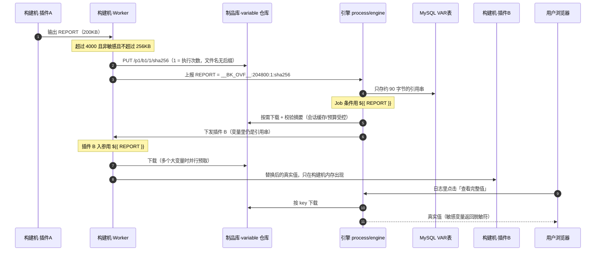

可以看到，**200KB 的内容一次都没有进过数据库**，也不会随着每次领任务被引擎反复下发；大部分搬运发生在构建机与制品库之间。

---

## 2. 背景与目标

### 2.1 为什么要改

| 问题 | 表现 |
|------|------|
| `T_PIPELINE_BUILD_VAR.VALUE` 是 `varchar(4000)` | 插件输出超过 4K 无法入库，只能报错或丢弃 |
| 大值进 MySQL（上一版方案：溢出表） | 数据库容量 / IO 增长；读写都经过 process，服务端内存与带宽被放大 |
| 传统方言参数在引擎 claim 时替换 | 每次领任务都在服务端做全量变量替换，占用引擎 CPU / 内存 |

> 上一版的两张溢出表及其 DAO、迁移、清理逻辑已全部移除（未上线，无存量数据）。  
> 分册文档 `PIPELINE_BUILD_VAR_OVERFLOW_DESIGN.md`、`PIPELINE_BUILD_STARTUP_PARAM_OVERFLOW_DESIGN.md`、  
> `ARCHIVE_BUILD_VARIABLE_MIGRATION_DESIGN.md` 均为旧方案，已过时；  
> `PIPELINE_LARGE_VARIABLE_TECHNICAL_SOLUTION.md` 是面向评审的当前方案摘要，与本文一致；  
> `CLASSIC_DIALECT_OVERFLOW_SYNTHETIC_KEY_DESIGN.md`（合成键重写）仍然有效。

### 2.2 目标与边界

| # | 目标 |
|---|------|
| 1 | 运行期变量超过 4000 自动识别：DB 只存引用串，真实值以文件存入项目 **`variable` 仓库** |
| 2 | 大变量单值上限 **256KB**（UTF-8 字节） |
| 3 | 保存流水线时各类变量（默认值）**不能超过 4000**；**启动参数值也不能超过 4000** |
| 4 | 按需下载；上传 / 下载在构建机完成，变量多时并行 |
| 5 | 传统方言插件参数的变量替换从引擎挪到构建机（兼容老构建机） |
| 6 | **仅** `${{ xxx }}` 能拿到真实值；`$xxx` / `${xxx}` 只见引用串 |
| UI | 插件输出默认不展示全文，点击实时查询 |

**不做的事**：不改 `T_PIPELINE_BUILD_VAR` 列结构、不新增表；启动参数（含重试 / 重放 / 子流水线传参）不支持大变量；不改 `${{ }}` 语法与方言判定框架；非 bkrepo 制品库保持 4K 历史行为；不回填历史已截断的数据。

> **为什么启动参数不支持大变量？** 启动参数在构建全程常驻内存：`BUILD_PARAMETERS` 整包 JSON、引擎上下文 `context.variables`。  
> 每次领任务下发给构建机的变量集合都完整持有它。外置之后每个环节都要"取件"，收益远小于复杂度，因此直接限制 4000。

---

## 3. 架构分层

### 3.1 全景

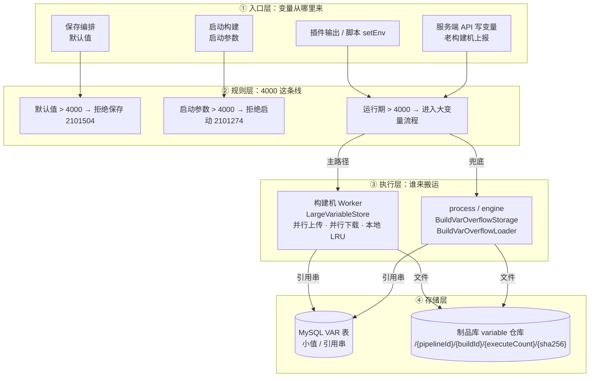

### 3.2 读写职责划分

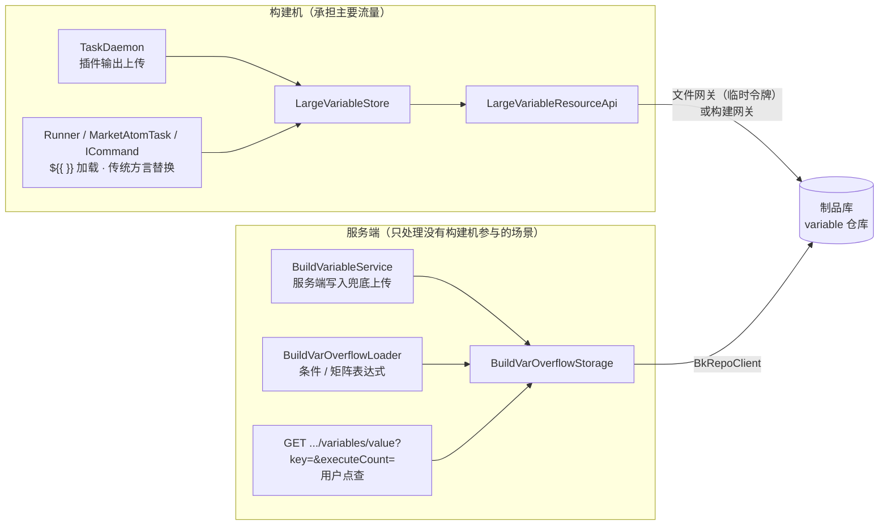

| 角色 | 什么时候碰大值 | 量级 |
|------|----------------|------|
| 构建机 | 插件输出上传；插件 / 脚本 `${{ }}` 加载 | 主要流量 |
| 引擎 | Stage/Job/Task 条件、矩阵 strategy/include/exclude 真正引用到大变量时；老构建机 claim 替换 | 少量、按需、有预算 |
| process | 服务端写入兜底（§6.2）；用户点查 | 少量 |

---

## 4. 存储设计

### 4.1 引用串协议（取件码）

| 项 | 说明 |
|----|------|
| 格式 | `__BK_OVF__:<原始字符长度>:<执行次数>:<sha256 hex>`，例：`__BK_OVF__:204800:2:9f86d0…（64 位）` |
| 解析 | `^__BK_OVF__:(\d{1,10}):([1-9]\d{0,5}):([0-9a-f]{64})$`；不符合格式的值（含旧的两段格式）一律按普通值处理 |
| 执行次数 | 写入该值时构建的 `executeCount`（重试一次 +1），决定文件所在子目录；引用串自带它，读取时**不需要**再查当前执行次数 |
| 内容寻址 | 文件名即内容摘要：同一执行次数内同值自动去重，覆盖写幂等；下载后校验摘要 |
| 作用域 | 只在**本构建目录**下解析：插件伪造引用也只能读到本构建自己的文件，不能跨构建 |
| 长度字段 | 用于引擎预算预占、构建机预取限量、日志展示 |

> **为什么执行次数要进引用串**：重试后插件可能输出不同的值，按执行次数分目录便于排查「哪次执行产生了哪个文件」，  
> 与日志仓库 `/{pipelineId}/{buildId}/{taskId}/{executeCount}.log` 的组织方式一致。  
> 重试后未被覆盖的变量仍指向上一次执行的文件（引用串里记着当时的执行次数），因此跨执行次数读取不会失效。

协议实现在 `api-process/.../utils/BuildVarOverflowUtils.kt`，引擎、process、Worker 共用。

### 4.2 放在哪：独立的 `variable` 仓库

```text
制品库项目 {projectId}
└── 仓库 variable                 ← display = false，不出现在制品库仓库列表
    └── {pipelineId}              ← 目录元数据 displayName = 流水线名称
        └── {buildId}             ← 目录元数据 displayName = 构建号
            ├── 1                 ← 执行次数（首次执行）
            │   ├── 9f86d081…a08  ← 文件名 = sha256，无后缀，内容 = 变量原值（UTF-8）
            │   └── 2c26b46b…ae
            └── 2                 ← 重试后的第 2 次执行
                └── 5feceb66…a1
```

| 规则 | 说明 |
|------|------|
| 仓库名 | `variable`，与 `pipeline` / `report` / `log` 一样是项目下的通用仓库。新建项目时由 `createBkRepoResource` 创建；已有项目在**服务端上传大变量文件时**补建（Caffeine 记住已确认的项目，创建用户为 `BKREPO_DEFAULT_USER`，仓库已存在则忽略） |
| 路径 | `/{pipelineId}/{buildId}/{executeCount}/{sha256}`。仓库本身就是种类，路径里不再加 `large-variables` |
| 后缀 | 不加。引用串只含摘要，下载靠摘要拼路径 |
| 目录展示名 | 上传成功后给 `/{pipelineId}`、`/{pipelineId}/{buildId}` 设置 `displayName`（流水线名 / 构建号）。构建机每个构建只设置一次，失败下次再试；服务端兜底上传后也会设置。失败只打 `LARGE_VAR_DISPLAY_NAME_FAIL`，不影响读写 |
| 文件元数据 | 不带 `pipelineId` / `buildId`。上传通道与报告归档 `BkRepoReportResourceApi.uploadReport` 相同：文件网关把整段路径 URL 编码，直连走构建网关 |
| 令牌 | 授在 `/{pipelineId}/{buildId}`，类型 `ALL`（还要下载）。这个仓库里只有大变量，不会扫到流水线仓库里的构建产物 |
| 清理 | CI 进程不删这些文件。删除流水线或按构建清理时，由 `ProcessRelatedPlatformDataClearService.cleanBuildData` 调用的远程接口删除 `/{pipelineId}` 或 `/{pipelineId}/{buildId}` |

文件名用摘要，是因为库里只存引用串，下载时没有变量名。变量名里还可能有 `.`、`/`，不能直接当路径。

### 4.3 关键阈值

| 配置 / 常量 | 默认 | 含义 |
|-------------|------|------|
| `PIPELINE_VARIABLES_STRING_LENGTH_MAX` | 4000 字符 | 直接入库上限；默认值、启动参数值上限；超过进入大变量流程 |
| `pipeline.variables.largeValueMaxBytes` | 256KB（UTF-8 字节） | 大变量单值上限，默认 `PIPELINE_VARIABLES_LARGE_VALUE_MAX_BYTES`。process / engine 用该配置，支持动态刷新；构建机用同名环境变量、JVM 参数或 `.agent.properties`，两边配成同一个值 |
| `pipeline.startParam.defaultValue.checkEnabled` | true | 保存编排时校验启动参数默认值 |
| `pipeline.startParam.value.checkEnabled` | true | 启动构建时校验流水线定义的启动参数值 |
| `pipeline.variables.lazyLoad.cacheMax` | 1M 字符 | 引擎会话缓存（Caffeine，按摘要） |
| `pipeline.variables.lazyLoad.budgetMax` | 2M 字符 | 引擎单会话累计加载硬上限 |
| Worker 本地缓存 | 8M 字符 | `LargeVariableStore` 按摘要 LRU，进程内共享；预取总量也不超过它 |
| Worker 并行度 / 上传重试 | 8 线程 / 3 次 | 上传与预取下载共用同一线程池，单任务超时 300 秒 |
| 临时令牌 | 4 小时，提前 10 分钟续期 | 文件网关模式下本构建目录 `/{pipelineId}/{buildId}`（覆盖所有执行次数）的读写令牌 |

`pipeline.*` 配置均支持 `@RefreshScope` 动态调整。

---

## 5. 构建机如何对接制品库

### 5.1 两条通道（与归档插件一致）

构建机上传与 `BkRepoReportResourceApi.uploadReport`（归档报告）同一套通道：**是否配置了 bkrepo 文件网关**决定走令牌还是直连。报告令牌只授上传；大变量还要下载，所以令牌类型是 `ALL`。

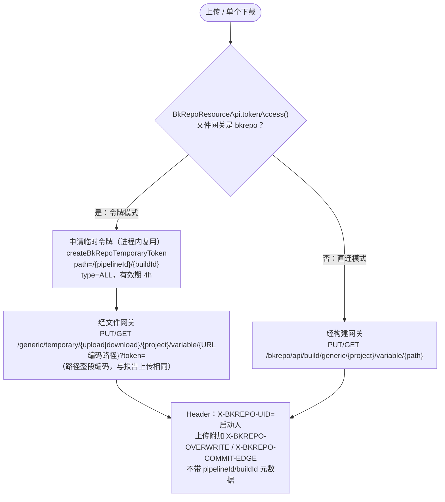

| 对比 | 令牌模式 | 直连模式 |
|------|----------|----------|
| 触发条件 | 配置了 bkrepo 文件网关 | 未配置 |
| 鉴权 | 临时令牌（只授权本构建大变量目录） | 构建网关的构建机身份 |
| 带宽 | 走文件网关，不占构建网关 | 走构建网关 |
| 令牌申请 | 每个构建机进程每构建只申请一次，临近过期才重申；申请失败重试 3 次 | — |

所有请求复用 Worker 统一的 OkHttp 客户端（`AbstractBuildResourceApi`）：与其它构建接口相同的证书策略、代理配置，网关 502/503/504 与连接失败自动重试。创建节点超时（制品库错误码 251030，在非 2xx 响应体里）与 `uploadFileByToken` 一样转成 `HttpRetryException`，由上传的 3 次重试吃掉。

### 5.2 并行预取

一次要用到多个大变量时，按 §5.1 的单文件通道并行下载，不使用制品库的 zip 批量下载接口：该接口没有临时令牌形态，必须由构建机自行拼装整段路径后经构建网关下发，访问范围收敛不到本构建目录。

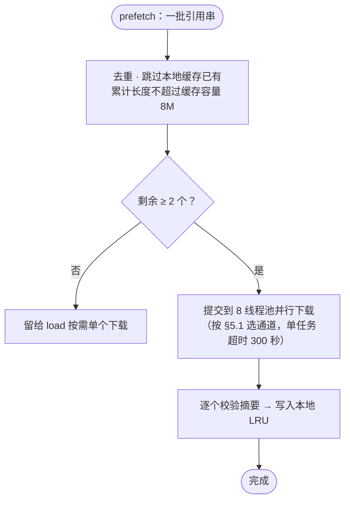

预取只是提前填缓存，失败的引用不单独处理：真正用到时 `load` 会再下载一次，仍失败才按「保留引用串」降级。因此预取的任何失败（超时、网关抖动）都只影响性能，不影响正确性。

单个引用直接跳过预取：预取和按需加载都只是一次下载，走线程池反而多一次切换。

---

## 6. 写入：变量怎么落地

### 6.1 插件输出（构建机上传，主路径）

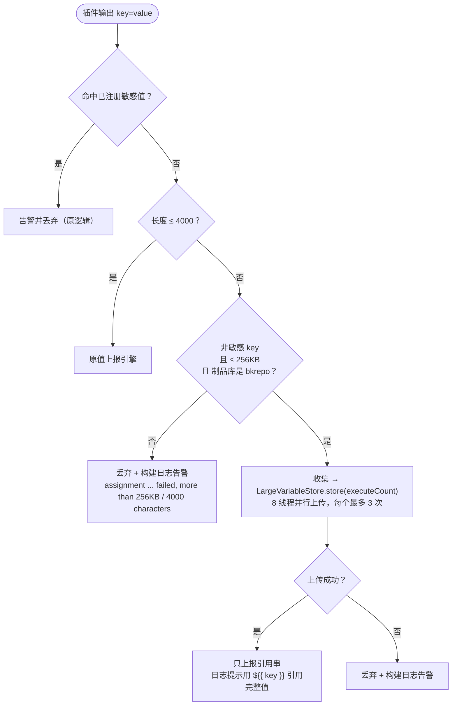

上报给引擎的都是不超过 4000 的字符串，服务端无需再处理大值。

开启「变量超长时失败」（`failIfVariableInvalid`）时，`ScriptTask` 在超过 4000 且（不支持大变量 或 超过 256KB）时判插件失败。

### 6.2 服务端写入（兜底）

**是什么**：新构建机上报的值都已经 ≤4000（大值已在构建机上传，只报引用串），但仍有一些写变量的入口**没有新构建机参与**，  
它们写进来的值可能超过 4000。改造前这些值会被直接丢弃（`ABANDON_DATA`）；现在由服务端代为上传，这就是「兜底」。

| 兜底入口（都汇聚到 `BuildVariableService`） | 典型来源 |
|------|------|
| `EngineVMBuildService.executeCompleteTaskBus` → `batchUpdateVariable` | **老版本构建机**上报的插件输出（新构建机不会超过 4000） |
| `TaskAtomService`（引擎侧插件） | 引擎执行的内置插件输出 |
| `PipelineRuntimeService.manualDealReview`、`PipelineStageService.stageManualStart`、`CheckPauseReviewStageCmd` | 人工审核 / Stage 审核时填写的参数 |
| `PipelineTaskPauseListener` | 插件暂停后继续时提交的参数 |
| `ServiceVarResourceImpl.setVariable` | 其它微服务通过 Service API 写变量 |
| `BuildStartControl` / `BuildEndControl` / `AgentReuseMutexCmd` → `setVariable` | 引擎内部写入的系统变量（通常很短，走快路径） |

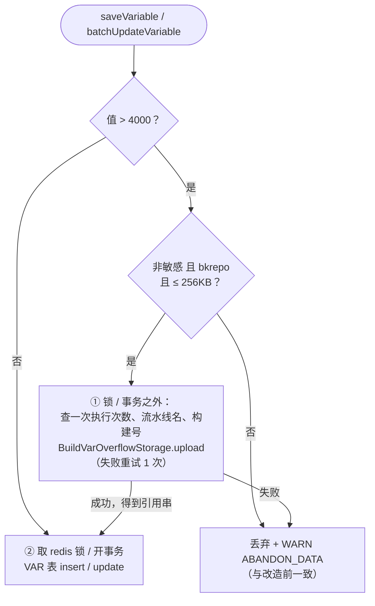

| 情况 | 结果 |
|------|------|
| 非敏感、bkrepo、≤256KB | 上传到 `variable` 仓库的 `/{pipelineId}/{buildId}/{executeCount}/{sha256}`，并给流水线、构建目录设置 `displayName`；VAR 表存引用串 |
| 敏感 / 非 bkrepo / >256KB / 上传失败 | 丢弃该值，WARN `ABANDON_DATA`（与改造前一致） |

服务端兜底的执行次数取自 VAR 表的 `BK_CI_RETRY_COUNT` + 1，与 `getBuildExecuteCount` 口径一致。

**为什么要在锁 / 事务之外调用 `toStoredValue`**：`toStoredValue` 内部会上传制品库，这是一次**最大 256KB、可能重试的网络 IO**（秒级）。

| 如果放在里面 | 后果 |
|--------------|------|
| `batchUpdateVariable` 的 `commonDslContext.transaction` 内 | 上传期间一直占着数据库连接和 VAR 表行锁，并发写同一构建变量的请求排队，连接池可能被耗尽 |
| `saveVariable` 的 `PipelineBuildVarLock(buildId, name)` / `batchSetVariable` 的 `PipelineBuildVarLock(buildId)` 内 | 同一构建的其它变量写入被阻塞；上传耗时超过锁过期时间时锁被提前释放，反而失去互斥保护 |

放在外面是安全的，因为：

- 上传是**内容寻址 + 覆盖写**，天然幂等：两个并发请求写同一个值，得到的是同一个文件、同一个引用串；
- 上传成功但随后入库失败，只会留下一个没有被引用的文件，它和所在构建目录一起被清理，不会造成数据错误；
- 锁 / 事务保护的是「VAR 表的读改写」，引用串计算好之后再进入临界区，临界区内的行为与改造前完全一样。

> 注意：`saveVariable` 使用调用方传入的 `dslContext`，若调用方本身处于外层事务中，上传仍会发生在外层事务之内。  
> 目前这类调用写入的都是短值（走 ≤4000 快路径，不会触发上传），新增调用点时需要留意。

构建启动时写 VAR 表的 `startBuildBatchSaveWithoutThreadSafety` **不做上传**：启动参数已被限制在 4000 以内（§6.3）。

### 6.3 启动参数与保存编排：4000 是硬线

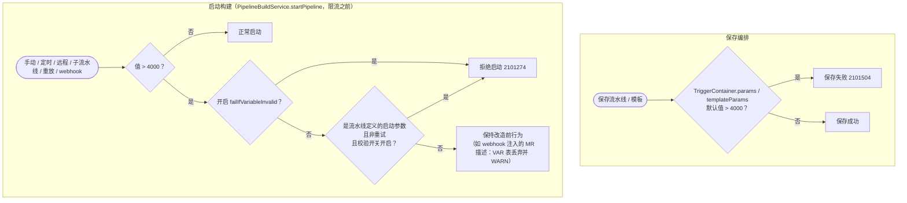

| 参数来源 | 值超过 4000 时 |
|----------|----------------|
| 流水线定义的启动参数（`TriggerContainer.params`），非重试 | **拒绝启动** `2101274`（`pipeline.startParam.value.checkEnabled=false` 可临时关闭） |
| 重试（同 buildId，`PIPELINE_RETRY_BUILD_ID`） | 沿用已接受过的参数，不再校验 |
| 触发器 / 系统注入的其它变量 | 仅开启 `failIfVariableInvalid` 时拒绝；否则 VAR 表丢弃并 WARN |

---

## 7. 读取：谁、何时拿到真实值

### 7.1 语义矩阵

| 场景 | 行为 |
|------|------|
| `getAllVariable` / 变量列表 | 小变量真值 + 大变量引用串，**一律不下载** |
| `${{ xxx }}`（构建机：插件入参、脚本、Job 环境变量） | 按需下载真值 |
| `${{ xxx }}`（引擎：Stage/Job/Task 条件、矩阵 strategy/include/exclude） | 按需下载真值（§7.6） |
| `${{ xxx }}`（引擎：互斥组名、超时、Agent 复用互斥、Job 构建环境版本等其它字段） | 只见引用串（保持改造前行为，§7.6） |
| `$xxx` / `${xxx}` | 只见引用串 |
| `GET .../variables/value?key=&executeCount=` 点查 | 下载真值；带 `executeCount` 时读该执行次数的内容；敏感值返回脱敏符 |
| 启动参数 Tab / 重试 / 重放 / 参数组合回填 | 启动参数不超过 4000，原样读写 |
| 子流水线传参 | `${xxx}` 传过去的是引用串（子构建无法解析）；`${{ xxx }}` 传真值会因超过 4000 被子流水线拒绝启动 |

### 7.2 引擎侧：懒加载 + 预算

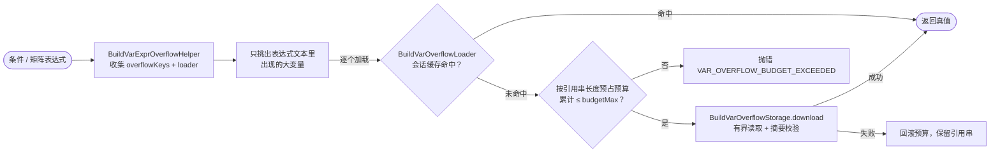

已接入（完整取舍见 §7.6）：

| 模块 | 说明 |
|------|------|
| `ControlUtils` + `CheckConditionalSkipStageCmd` / `CheckConditionalSkipContainerCmd` / `StartActionTaskContainerCmd` | Stage / Job / Task 自定义条件，只加载条件文本中出现的大变量 |
| `InitializeMatrixGroupStageCmd` | 矩阵 strategy / include / exclude（含 `fromJSON`），只在计算组合时使用还原后的上下文 |
| `EngineVMBuildService` | 老构建机的传统方言 claim 替换（§7.3） |
| `BuildVarResource.getContextVariableByName` / `ServiceVarResource` | 单变量查询命中引用则下载还原 |

条件求值统一走 `BuildVarExprSession` 传参：新增调用点漏接 loader 会编译报错，而不是静默把条件算错。

### 7.3 claim 握手：传统方言替换下放构建机

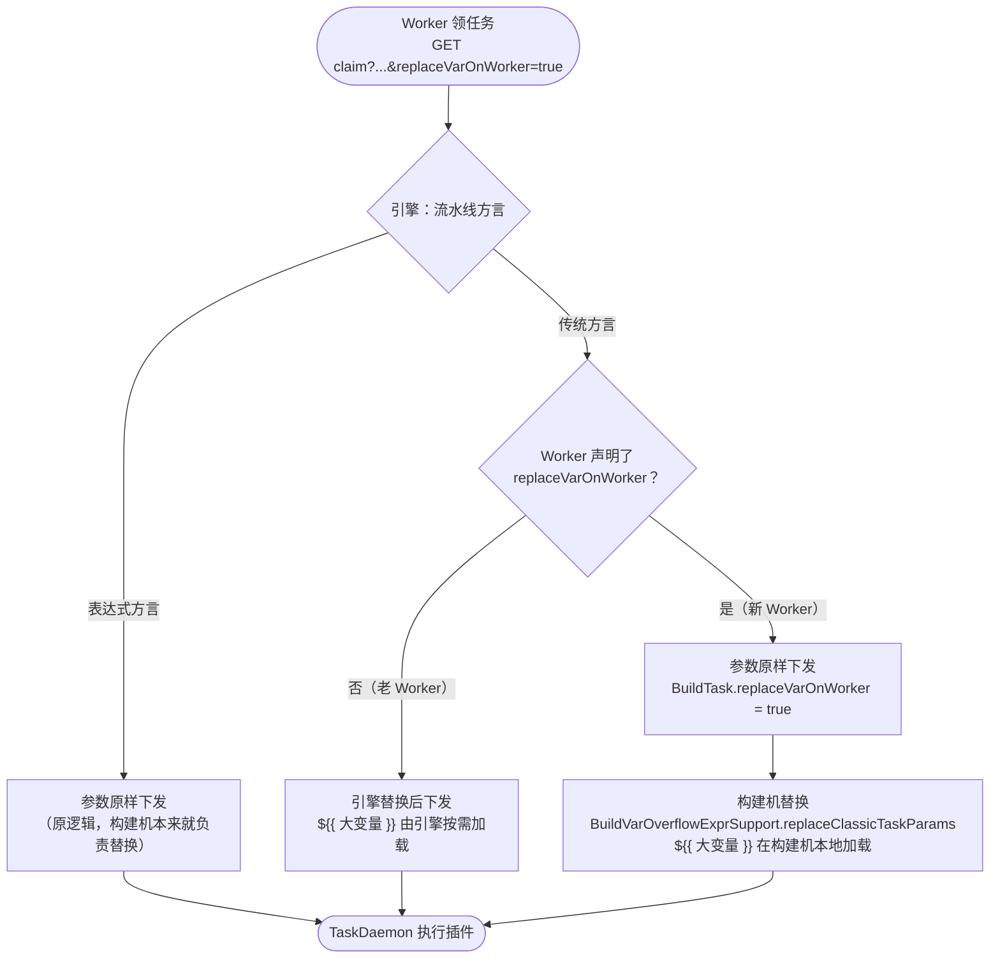

`replaceClassicTaskParams` 的等价性（有单测覆盖）：

- Map / List 参数（引擎压缩序列化下发）：反序列化后按结构递归替换，再压缩输出
- JSON 文本型字符串参数：同样按结构递归替换，但按**缩进**输出，与 `ObjectReplaceEnvVarUtil.handleNormalEnvVar`
  处理 JSON 字符串时的 `toJson(dataObj, true)` 保持一致
- 其余文本参数（脚本等）：按文本替换，与引擎 `ObjectReplaceEnvVarUtil` 一致
- `${{ 大变量 }}` 先用合成键重写再交给同一替换器，大值只在构建机内存出现
- 单个参数异常时退化为不加载大变量的文本替换，不影响领任务

> **为什么必须按结构替换。** 变量值一旦落到字符串叶子上，由 Jackson 统一序列化转义，值里的
> `"` `{` `\n` 都不会破坏外层参数 JSON。反之若按文本拼接，一个内容是 JSON 的大变量会把 `data`
> 直接拼坏，插件 `JsonUtil.toMutableMap(data)` 必然抛 `JsonParseException`。

> **解析口径必须与 `JsonUtil` 一致。** 判定"参数是不是 JSON 容器"只能用 `JsonUtil.getObjectMapper()`，
> 不能用 `JsonSchemaUtil.validateJson`：后者基于 fge 的严格解析器，会拒绝字符串值里的**裸控制字符**
> （换行、制表符），而 `JsonUtil` 显式开启了 `ALLOW_UNESCAPED_CONTROL_CHARS`。两者不一致时，
> 本该走结构化替换的参数会退化成文本拼接，正是上一条描述的故障。
> 同时必须开启 `FAIL_ON_TRAILING_TOKENS`，否则 `{"a":1}{"b":2}` 会被静默截断成第一个对象。

构建机侧带了一道体检：替换后的参数若"看着像 JSON 却解析不了"，会打 `CLASSIC_PARAM_JSON_BROKEN`
告警，并标注 `stage=CLAIM`（引擎下发时就已损坏）或 `stage=WORKER`（构建机替换损坏），
日志里带出错原因与参数开头 1000 字符。正常构建下零输出。

| 引擎 | Worker | 结果 |
|------|--------|------|
| 新 | 新 | 构建机替换 |
| 新 | 老 | 引擎替换（老 Worker 不带参数） |
| 老 | 新 | 引擎替换（老引擎忽略参数，不回传标记，Worker 不再替换） |

### 7.4 构建机侧加载

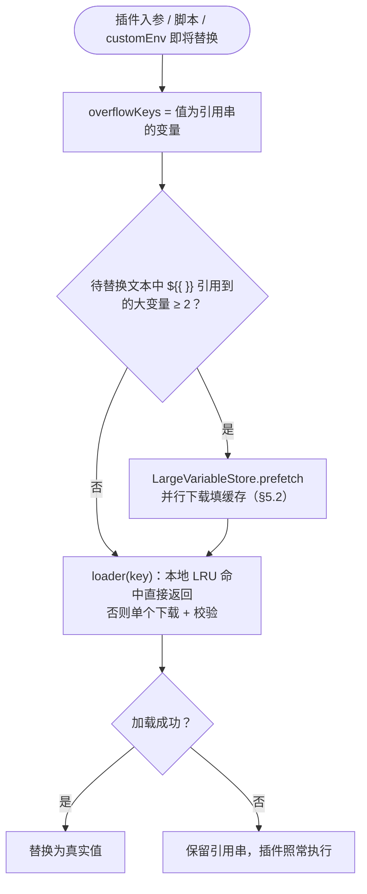

已接入：`Runner`（claim 参数替换、customEnv）、`TaskUtil`、`MarketAtomTask` 入参、`ICommand` 脚本（表达式 / 经典方言）。

构建日志约定（超过 4000 的非敏感值不打全文）：

```text
input(normal): (label)key=__BK_OVF__:{length}
output(overflow): {key}=__BK_OVF__:{length}
output(except):   {key}=__BK_OVF__:{length}
```

日志行只印长度占位，格式与上一版一致，构建机侧无改动。点查不依赖日志内容：前端传变量名和当前查看的执行次数即可（见 §7.5）。

### 7.4.1 按执行次数回看：引用串落在插件执行记录里

同一个 key 在多次执行里内容不同，而能回看哪一次，取决于按执行次数留存的引用串存在哪张表：

| 表 | 粒度 | 适用性 |
|---|---|---|
| `T_PIPELINE_BUILD_VAR` | 每个 key 一行，重试 `onDuplicateKeyUpdate` 覆盖 | ✗ 没有执行次数维度，分区表只留约四周 |
| `T_PIPELINE_BUILD_TASK` | 按任务，运行态 | ✗ 同为分区表 |
| `T_PIPELINE_BUILD_RECORD_TASK` | **按 (buildId, executeCount, taskId)** | ✓ 每次执行逐次留存，是构建记录的一部分 |

因此引用串随插件执行记录一起落库：

- **写**：`EngineVMBuildService.executeCompleteTaskBus` 从构建机上报的 `BuildTaskResult.buildResult` 里筛出引用串，
  经 `TaskBuildEndParam.largeVariables` 传给 `TaskBuildRecordService.taskEnd`，写进该任务 `TASK_VAR` 的
  `bkLargeVariables` 键（`变量名 -> 引用串`）。写入复用 `taskEnd` 已有的 `PipelineBuildRecordLock`
  （按 `buildId + executeCount` 加锁）和同一次 UPDATE，不新增数据库往返，也不引入并发竞争。
- **读**：`getLargeVariableReference(query)` 先按组件点查这一次执行的那一行。task1 的 `a` 和 task2 的 `a`
  是两条记录，矩阵每一组的插件 id 不同，也各留各的。组件记录里没有、或本来就不带组件 id 时，
  再查流水线记录 `MODEL_VAR` 的 `bkLargeVariables`，那是构建结束时快照的、属于这一次执行的引用串。
  不经插件产生的大变量（Stage 审核入参、Job 级互斥信息等）只在这份快照里，所以 Job、Stage 记录不单独配写入方。
  两处都没有（构建进行中、快照还没写）才退回变量表当前值。
- 引用串不进构建详情模型：`PipelineRecordModelService.generateFieldRecordModelMap` 合成详情模型时，
  会先从 `MODEL_VAR` / `STAGE_VAR` / `CONTAINER_VAR` / `TASK_VAR` 里摘掉 `bkLargeVariables`。
  `Model` / `Element` 上都没有这个字段，留着只会被整份序列化一遍再在反序列化时丢掉，
  而详情页是最热的读路径。摘除只作用于这份内存数据，记录行本身不动。

这样回看能力不绑定构建日志：日志点击、变量 Tab、按执行次数查的构建记录等任何场景，
用变量名、执行次数，再加上这个变量所属的插件、Job 或 Stage，就能取回那一次、那一个组件的内容。

### 7.4.2 矩阵

矩阵每一组是一个新 Job：`containerId = 父容器序号 * 1000 + 组内序号`，`jobId = 原jobId.组内序号`（`VMUtils.genMatrixJobId`），组内插件各换新 `taskId`，`stepId` 不变。引用串写在分裂后的插件记录上，不写在矩阵父 Job 上。点查要用日志 tag 上的新 `taskId`。

上下文键 `jobs.<原jobId>.<组内序号>.steps.<stepId>.outputs.<name>` 各组不共用。表达式解析把 `jobs.build.1.steps.s1.outputs.k` 收成 `jobs.build[1].steps.s1.outputs.k`，懒加载替换的是同一片叶子。短变量名在变量表里仍是全局一行，多组并行时后完成的覆盖先完成的。

### 7.4.3 后一个插件引用前一个插件

传递走变量表，不走执行记录。前一个插件把引用串写入变量表，后一个插件 `claim` 时 `getAllVariable` 重新读取。

- `${{ jobs.<jobId>.steps.<stepId>.outputs.name }}` 和短名还在时的 `${{ variables.name }}`：替换阶段按引用串下载真实内容。同一个 Job 的下一步、后面的 Job、矩阵组内的下一步都如此。
- `$name` / `${name}` 不下载，插件拿到引用串，不能用来传递大变量内容。
- 入参日志只印 `__BK_OVF__:{length}`，不表示插件没拿到正文。下载失败或超过本次加载预算时，替换结果留下引用串。


### 7.5 用户 / 服务 API

| API | 用途 |
|-----|------|
| `GET /user/builds/projects/{projectId}/pipelines/{pipelineId}/builds/{buildId}/variables/value?key=&executeCount=&taskId=&containerId=&stageId=&archiveFlag=` | **新增**。运行期变量真值（日志点击、变量 Tab 等通用场景）；**敏感变量返回脱敏符** |
| `GET /build/variable/get_build_context?contextName=` | 已有接口，命中引用串时由服务端下载还原（插件 SDK 按名取值走这里） |
| `GET /user/builds/{p}/{pl}/{b}/parameters` | 启动参数列表，**未改动** |

新增接口的路径与同一 Resource 中较新的接口（如 `/projects/{projectId}/pipelines/{pipelineId}/builds/{buildId}/...`）保持一致：资源层级逐级体现在路径中，只读操作用 `GET`。

点查的取值口径：

1. `PipelineBuildFacadeService` 校验 VIEW 权限；带了 `executeCount` 就先用 §7.4.1 的
   `getLargeVariableReference` 按组件 id 把该次执行、该组件的引用串取出来，取不到则为 null；
2. `BuildVariableService.getVariableValue` 按变量名读变量表那一行，**敏感则直接返回脱敏符**——
   脱敏判定始终走变量名，带了 `executeCount` 也绕不过去；
3. 第 1 步拿到引用串就按它下载，否则用变量表里的当前值；
4. 值是引用串就按需下载真值，下载不到时原样返回引用串（前端提示「内容已过期或暂不可用」）。

于是：**带 `executeCount` 和组件 id 可按执行次数、按组件回看**，且变量表那一行已被分区清理时仍能取到内容；不带 `executeCount` 时行为与上一版一致（取最后一次写入的值），老前端无需改动。引用串由后端自己从构建记录里取，不经前端回传。

覆盖范围：构建机上报的插件输出与脚本 `setEnv` 都走任务完成上报，因此都有按次引用串；
少数不经任务完成上报、由服务端直接写入的变量（如部分 API 直接 setVariable）只有变量表当前值，
此时带 `executeCount` 会自动退回当前值，不会报错。

越权读不成立：文件只在**本次构建目录**下解析（`blobPath` 由 pipelineId / buildId 拼出），而本接口已校验调用者对该流水线有 VIEW 权限；敏感值从不上传（`toStoredValue` 直接丢弃），摘要也不可枚举。

上一版新增的 `GET /build/variable/value` 与已有的 `get_build_context` 功能重复且没有调用方，已删除。

`archiveFlag=true` 时走归档权限校验并到归档库查引用串，文件仍从制品库下载。

### 7.6 构建流程中的表达式是否需要支持大变量（评估结论）

引擎在构建流程中有多处会对 `${{ }}` 求值。逐一评估「大变量出现在这里是否合理、支持它的代价有多大」后，只保留两类：

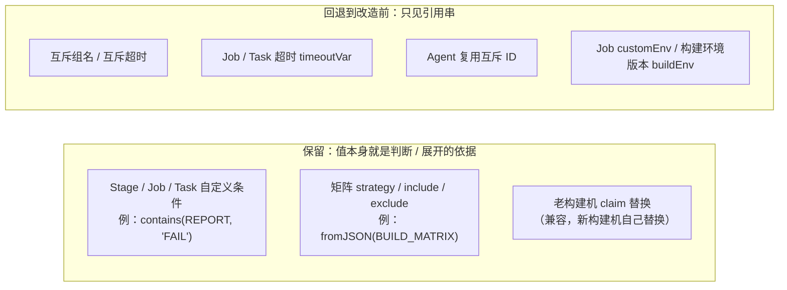

| 场景 | 结论 | 理由 |
|------|------|------|
| Stage / Job / Task 自定义条件 | **支持** | 「上游输出的报告里是否包含某个关键字」是真实需求，且条件只取一个布尔结果，大值不会被扩散 |
| 矩阵 strategy / include / exclude | **支持** | 用上游插件输出的 JSON 动态生成矩阵（`fromJSON`）是常见用法，矩阵 JSON 超过 4K 并不少见；还原后的上下文**只用于计算组合**，Job 名、互斥组等其它字段仍按原上下文解析 |
| 老构建机 claim 替换 | **支持（兼容）** | 老构建机不会自己替换，引擎不替换会导致插件拿到引用串，属行为回退 |
| 互斥组名、互斥 / Job / Task 超时、Agent 复用互斥 ID | 不支持 | 这些字段的合法值都是短字符串或数字，一个超过 4000 字符的值本身就不合法；支持它要在调度链路上增加制品库 IO，收益为零 |
| Job customEnv / buildEnv（引擎侧） | 不支持 | buildEnv 是构建环境版本号（短字符串）；customEnv 最终成为进程环境变量，单个值受操作系统限制（Linux 128KB、Windows 32K 字符），不适合承载大变量。构建机侧的 `${{ }}`（插件入参、脚本、Job 环境变量在构建机上的替换）**仍然支持** |

不支持的场景行为与改造前完全一致：表达式里拿到的是引用串（一个短字符串），不会出错，也不会产生额外 IO。
相关代码已整体回退到改造前（`MutexControl`、`CheckMutexContainerCmd`、`BuildCancelControl`、`ContainerControl`、`AgentReuseMutexCmd`、
`DispatchVMStartupTaskAtom`、`TaskAtomService`、`Timeout`、`TaskUtils`、`MatrixControlOption`），降低引擎调度主链路的改动面。

---

## 8. 内存与性能

| 风险 | 对策 |
|------|------|
| 大值占用 DB 与服务端带宽 | 值只进制品库；插件输出由构建机直传，不经过引擎 |
| 启动参数常驻内存 | 启动参数限制 4000，不进入大变量流程 |
| 引擎 claim 替换开销 | 传统方言参数替换下放构建机 |
| 表达式一次引用过多大变量 | 引擎 `budgetMax`（2M）硬上限；构建机本地 LRU 8M，预取总量不超过缓存容量 |
| 多个大变量串行等待 | 构建机按待替换文本并行预取，8 线程，耗时取决于最慢的一个而不是总和 |
| 构建网关带宽 | 配置文件网关时，上传 / 下载走文件网关（与归档构建产物同一通道） |
| 令牌申请开销 | 每构建每进程一个目录级令牌，复用到临近过期 |
| 下载内容被篡改 / 覆盖 | 摘要校验，失败按「保留引用串」降级 |

> **运行期大变量没有总量闸门**：插件输出 / `setVariable` 只受单值 256KB 约束，因此凡「按构建聚合读取真实值」的路径都必须按需加载；列表只读引用串，表达式求值受 `budgetMax` 约束。

---

## 9. 文件生命周期

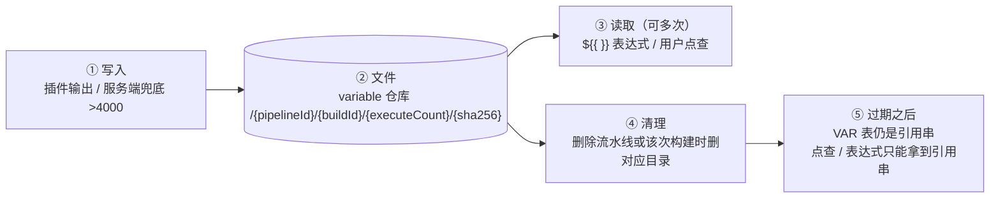

| 阶段 | 说明 |
|------|------|
| 写入 | 同一执行次数内写入相同的值，摘要相同，覆盖写幂等；重试后写入落在新的执行次数目录 |
| 读取 | 每次读取都校验摘要；不改变文件 |
| 清理 | CI 进程不删文件。`ProcessRelatedPlatformDataClearService.cleanBuildData` 的远程接口在删除流水线时删 `/{pipelineId}`，按构建清理时删 `/{pipelineId}/{buildId}` |

- 构建历史迁入归档库时，VAR 表（含引用串）随 `PipelineBuildLinkedDataMigrationStrategy.commonHandlers` 一并迁移。归档数据还在时文件仍可读；流水线被删除后文件一并删除。

---

## 10. 兼容性

| 对象 | 行为 |
|------|------|
| 历史构建（单变量 ≤4K） | 无引用串，快路径原样走，**零影响** |
| 用 `$xxx` 脚本 | 见引用串，不崩不 OOM；改成 `${{ }}` 才能拿大值 |
| 存量流水线启动参数默认值 / 启动值 >4000 | **上线后启动会被拒绝**（`2101274`）；如需过渡，临时设置 `pipeline.startParam.value.checkEnabled=false` |
| 老 Worker | 插件输出 >4000 在构建机侧被丢弃（改造前行为）；claim 由引擎替换 |
| 非 bkrepo 部署 | `isEnabled / isSupported=false`，运行期变量保持 4K 历史行为 |
| 构建制品列表 / 制品搜索 | 不受影响（大变量文件不带 `pipelineId` / `buildId` 元数据） |
| 引擎侧互斥 / 超时 / Agent 复用 / Job 构建环境中的 `${{ }}` | 与改造前一致（见 §7.6） |
| 服务回滚 | 旧服务把引用串当普通短字符串；构建可流转，表达式拿不到真值 |
| 上一版溢出表 | 未发布，DDL / 代码 / 分片配置已删除；若测试环境建过可直接 DROP |

---

## 11. 模块与关键文件

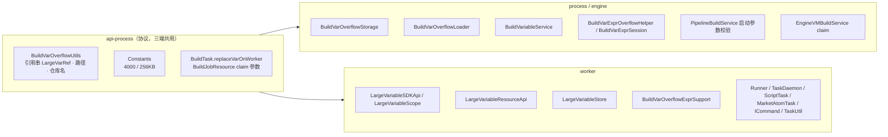

| 模块 | 文件 |
|------|------|
| 协议 / API | `api-process/.../utils/BuildVarOverflowUtils.kt`、`Constants.kt`、`pojo/BuildTask.kt`、`pojo/task/TaskBuildEndParam.kt`、`engine/api/BuildJobResource.kt`、`api/user/UserBuildResource.kt`、`constant/ProcessMessageCode.kt` + i18n |
| Process / Engine | `BuildVarOverflowStorage`、`BuildVarOverflowLoader`、`BuildVariableService`、`BuildVarExprOverflowHelper`、`BuildVarExprSession`、`PipelineVarOverflowConfig`、`PipelineBuildService`、`PipelineBuildFacadeService`、`EngineVMBuildService`、`TaskBuildRecordService`、`BuildJobResourceImpl`、`DefaultModelCheckPlugin`、`ControlUtils`、`CheckConditionalSkipStageCmd`、`CheckConditionalSkipContainerCmd`、`StartActionTaskContainerCmd`、`InitializeMatrixGroupStageCmd`、`BuildVarResourceImpl`、`UserBuildResourceImpl` |
| Worker | `LargeVariableSDKApi`、`LargeVariableResourceApi`、`LargeVariableStore`、`BuildVarOverflowExprSupport`、`EngineBuildResourceApi`、`Runner`、`TaskDaemon`、`ScriptTask`、`MarketAtomTask`、`ICommand`、`TaskUtil` |
| Misc | `PipelineBuildLinkedDataMigrationStrategy`（VAR 表归入 `commonHandlers`）、`ProcessDataDeleteDao`（归档库同步清理）、`support-files/sql/1001_ci_archive_process_ddl_mysql.sql`（归档库 `T_PIPELINE_BUILD_VAR`） |

---

## 12. 错误码与已知限制

| 码 | 场景 |
|----|------|
| `2101274` | 启动参数值超过 4000（定义的启动参数，或开启失败开关时的任意启动变量） |
| `2101504` | 保存编排时启动参数默认值超过 4000 |

| 限制 | 说明 |
|------|------|
| 启动参数 / 子流水线传参不支持大变量 | 设计约束；大内容请在构建内由插件产出，或作为制品传递 |
| 构建或流水线被清理后文件删除 | 点查和表达式只能拿到引用串 |
| `variable` 仓库 `display = false` | 不出现在制品库仓库列表，也不进入构建制品列表 |
| `condition.contains(key)` / 预取按文本包含判断 | 极短 key 名可能多加载；正确性优先 |
| 复合点号大变量 key | 懒替换仅单层 key（设计权衡） |
| 不经任务完成上报写入的大变量 | 没有按执行次数的引用串，点查带 `executeCount` 时退回变量表当前值（§7.5） |
| 前端 UI | 未改造，**完整交付的阻断项** |

---

## 13. 上线评估与计划

### 13.1 结论

- 代码：process / engine / misc / worker 全部编译通过；`BuildVariableServiceTest`、`TaskBuildRecordServiceLargeVarTest`（按执行次数取引用串）、`BuildVarOverflowReferenceTest`（引用串含执行次数、路径、非法格式拒绝）、`ControlUtilsTest`、`DefaultModelCheckPluginTest`、`StartActionTaskContainerCmdTest`、`MatrixControlOptionTest`、`EnvReplacementParserTest`、`BuildVarOverflowExprSupportTest`（构建机替换与引擎等价）通过。
- 引擎调度主链路（互斥、超时、Agent 复用、Job 启动环境）已回退到改造前，只保留条件、矩阵与老构建机兼容（§7.6）。
- 风险控制：非 bkrepo 环境、老 Worker、老引擎均自动回退到改造前行为；运行期加载失败降级为「保留引用串」，上传失败为「丢弃 + 告警」；预取失败由按需加载重试。
- 制品库对接与归档插件同一套方式（令牌模式 / 直连模式、相同网关与 HTTP 客户端），不引入新的网络通道。
- **后端可进入灰度**；上线前需完成 §13.2，前端完成对接后才算完整交付。

### 13.2 上线前必须在目标环境验证

- [ ] **令牌模式**（配置了文件网关）：构建机能申请本构建目录 `/{pipelineId}/{buildId}` 的临时令牌（类型 ALL），并经文件网关读写 `variable` 仓库。临时上传的路径是整段 URL 编码
- [ ] **直连模式**（未配置文件网关）：构建机经构建网关 `PUT/GET /bkrepo/api/build/generic/{project}/pipeline/...` 可用（与归档构建产物同一通道）
- [ ] 已有项目在服务端第一次上传大变量时能补建 `variable` 仓库（`display = false`，创建用户 `BKREPO_DEFAULT_USER`）；新建项目随 `createBkRepoResource` 一起创建
- [ ] process / engine 的 `BkRepoClient` 可读写 `variable` 仓库（服务端兜底、表达式求值、点查）
- [ ] 定时 / webhook 触发构建的启动人对 `variable` 仓库有读写权限
- [ ] 制品库仓库列表和构建制品列表里都看不到大变量文件
- [ ] 统计存量流水线中启动参数默认值 >4000 的数量（`T_PIPELINE_RESOURCE` 模型里 `params[].defaultValue`），决定是否先通知用户或临时关闭 `pipeline.startParam.value.checkEnabled`

### 13.3 发布顺序

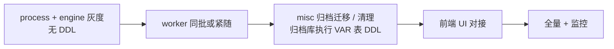

### 13.4 冒烟清单

- [ ] 插件输出 >4K：VAR 表为 `__BK_OVF__:<len>:<executeCount>:<sha>`，`variable` 仓库 `/{pipelineId}/{buildId}/{executeCount}/{sha}` 存在且无后缀；日志 `output(overflow):`
- [ ] 制品库 UI 中流水线目录显示流水线名、构建目录显示构建号（只有大变量、没有归档产物的构建也一样）
- [ ] 重试构建：新输出落在 `/{buildId}/2/`，未被覆盖的变量仍能读到第 1 次执行的文件
- [ ] 重试构建且同一 key 被覆盖：带 `executeCount=1` 点查得第 1 次的内容，带 `executeCount=2` 得第 2 次的
- [ ] VAR 表那一行已被分区清理（或手工删除）时，带 `executeCount` 点查仍能取到内容
- [ ] 插件 / 脚本 `${{ BIG }}` 得真值，`$BIG` 得引用串；同一插件引用多个大变量时并行下载且各自摘要校验通过
- [ ] 传统方言插件参数 `${xxx}` 替换结果与改造前一致；老 Worker 仍正常
- [ ] Stage / Job / Task 条件、矩阵 `fromJSON(BIG)` 解析正确；互斥组名、超时等字段行为与改造前一致
- [ ] `GET .../builds/{buildId}/variables/value?key=` 点查得真值；敏感变量脱敏（带 `executeCount` 也仍然脱敏）
- [ ] 256KB 以上插件输出：丢弃并告警；开启失败开关时脚本插件失败
- [ ] 启动参数值 >4000：启动被拒（`2101274`）；webhook 注入的超长变量不影响触发
- [ ] 保存编排时默认值 >4000 被拒（`2101504`）
- [ ] retry / replay 正常；构建制品列表不出现大变量文件
- [ ] 非 bkrepo 环境行为与改造前一致

### 13.5 监控

| 侧 | 日志关键字 |
|----|------------|
| process / engine | `LARGE_VAR_UPLOAD_RETRY`、`LARGE_VAR_DOWNLOAD_FAIL`、`LARGE_VAR_DIGEST_MISMATCH`、`LARGE_VAR_MISS`、`ABANDON_DATA`、`VAR_OVERFLOW_BUDGET_EXCEEDED` |
| 两端共有 | `LARGE_VAR_DISPLAY_NAME_FAIL`（目录展示名设置失败，不影响读写） |
| worker | `LARGE_VAR_REALM_FAIL`、`LARGE_VAR_UPLOAD_RETRY`、`LARGE_VAR_TASK_FAIL`、`LARGE_VAR_DOWNLOAD_FAIL`、`LARGE_VAR_DIGEST_MISMATCH`、`CLASSIC_PARAM_REPLACE_FAIL` |

另建议关注：上线初期 `2101274` 启动失败次数、`variable` 仓库容量增长、`LARGE_VAR_UPLOAD_RETRY` / `LARGE_VAR_UPLOAD_FAIL`、claim 接口耗时（应下降）。

### 13.6 回滚

- 应用回滚即可，无 DDL 需要回滚；已写入的引用串对旧版本无害（表达式拿不到真值）。
- Worker 与引擎可独立回滚（claim 握手双向兼容）。
- 启动参数 4K 校验可通过 `pipeline.startParam.value.checkEnabled=false` 单独关闭，无需发版。

---

## 14. 文档索引

| 文档 | 用途 |
|------|------|
| 本文 | 完整技术方案（当前实现） |
| `FRONTEND_LARGE_VARIABLE_INTEGRATION.md` | 前端对接 |
| `CLASSIC_DIALECT_OVERFLOW_SYNTHETIC_KEY_DESIGN.md` | 经典方言 `${{ }}` 合成键重写（仍有效） |
| `PIPELINE_LARGE_VARIABLE_TECHNICAL_SOLUTION.md` | 面向评审的当前方案摘要 |
| `PIPELINE_BUILD_VAR_OVERFLOW_DESIGN.md` / `PIPELINE_BUILD_STARTUP_PARAM_OVERFLOW_DESIGN.md` / `ARCHIVE_BUILD_VARIABLE_MIGRATION_DESIGN.md` | 旧方案（MySQL 溢出表 / 启动参数外置），已过时 |
