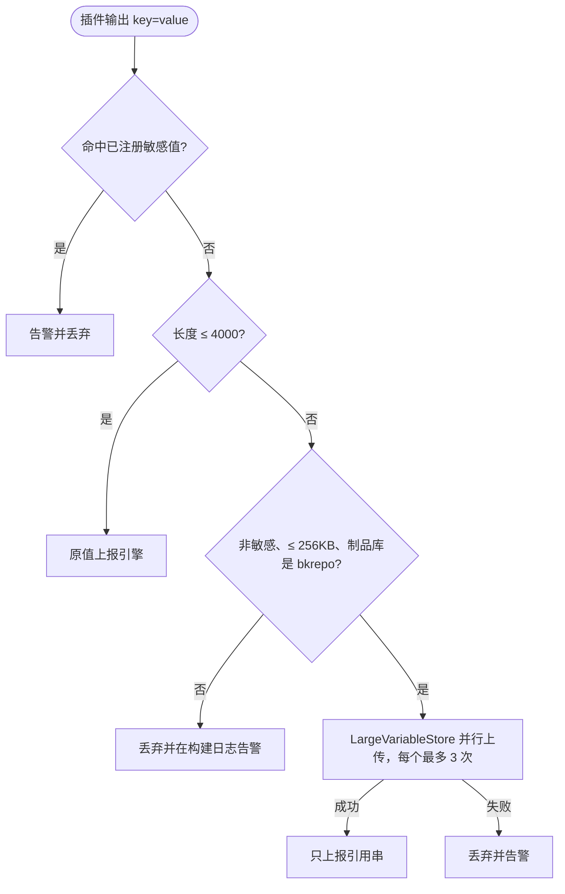
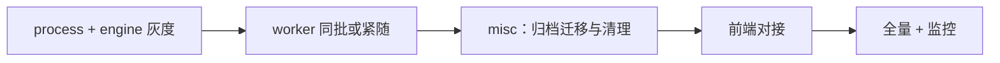
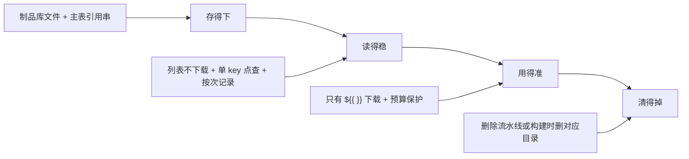

# 流水线大变量（>4K）技术方案

> 面向对象：研发、测试、前端、运维、评审同学  
> 详细设计：[`PIPELINE_LARGE_VARIABLE_TECHNICAL_DESIGN.md`](./PIPELINE_LARGE_VARIABLE_TECHNICAL_DESIGN.md)  
> 前端对接：[`FRONTEND_LARGE_VARIABLE_INTEGRATION.md`](./FRONTEND_LARGE_VARIABLE_INTEGRATION.md)  
> 关联需求：[#12636](https://github.com/TencentBlueKing/bk-ci/issues/12636) 支持超过 4K 的流水线变量  
> 文档版本：2026-10-26（与当前代码一致：真实值存制品库 `variable` 仓库，单值上限 256KB，按执行次数回看走插件执行记录）  
> 方案状态：后端（process / engine / worker / misc）已完成，编译与单测通过；前端 UI 待对接

---

## 1. 一句话说明

超过 4000 字符的**运行期变量**，真实值以文件放进制品库的 `variable` 仓库，数据库里只留一行短引用串。谁要用真实值（`${{ xxx }}` 或用户点查），谁再按引用串去制品库取，而且尽量在构建机上取。

引用串格式：

```text
__BK_OVF__:<原始字符长度>:<写入时的执行次数>:<sha256>
```

例如：

```text
__BK_OVF__:204800:1:9f86d081884c7d659a2feaa0c55ad015a3bf4f1b2b0b822cd15d6c15b0f00a08
```

它不包含真实内容。`$xxx` / `${xxx}` 看到的就是这串；只有 `${{ xxx }}` 会下载真实值。启动参数和保存编排时的默认值仍然不能超过 4000 字符。

---

## 2. 背景与问题

### 2.1 要解决的问题

| 问题 | 具体表现 | 后果 |
|------|----------|------|
| 运行期变量主表限长 | `T_PIPELINE_BUILD_VAR.VALUE` 是 `varchar(4000)` | 插件输出、脚本 `setEnv` 超过 4K 无法入库 |
| 大值进 MySQL | 上一版曾考虑溢出表（mediumtext，单值 4M） | 库容量和 IO 上升，读写都经过 process，服务端内存和带宽被放大 |
| 传统方言在引擎领任务时替换 | 每次 claim 都在服务端做全量变量替换 | 占用引擎 CPU / 内存 |
| 日志和列表打全文 | 插件输出直接进构建日志和变量列表 | 日志膨胀、前端卡顿 |

上一版的两张溢出表（`T_PIPELINE_BUILD_VAR_OVERFLOW`、`T_PIPELINE_BUILD_HISTORY_PARAM_OVERFLOW`）及其 DAO、迁移、清理**没有上线，代码已删除**。分册 `PIPELINE_BUILD_VAR_OVERFLOW_DESIGN.md`、`PIPELINE_BUILD_STARTUP_PARAM_OVERFLOW_DESIGN.md`、`ARCHIVE_BUILD_VARIABLE_MIGRATION_DESIGN.md` 描述的是那一版，请以本文和详细设计为准。`CLASSIC_DIALECT_OVERFLOW_SYNTHETIC_KEY_DESIGN.md`（`${{ }}` 合成键）仍然有效。

### 2.2 目标

| # | 目标 |
|---|------|
| 1 | 运行期变量超过 4000 字符自动识别：库里只存引用串，真实值写入项目 `variable` 仓库 |
| 2 | 大变量单值上限 **256KB**（UTF-8 字节） |
| 3 | 只有 `${{ xxx }}` 能拿到真实值；`$xxx` / `${xxx}` 只见引用串 |
| 4 | 保存编排的默认值、启动时填写的启动参数，上限仍是 **4000 字符** |
| 5 | 用户点查可按 `executeCount` 回看**某一次执行**当时的内容 |
| 6 | 上传和下载主要发生在构建机与制品库之间 |
| 7 | `failIfVariableInvalid` 继续生效；前端 4K 校验保留，文案改为与 256KB 上限对齐 |

### 2.3 非目标

- 不修改 `T_PIPELINE_BUILD_VAR` 列结构，不新增表。
- 启动参数（含重试、重放、子流水线传参）不支持大变量。
- 不改 `${{ }}` 语法，不改方言判定框架。
- 制品库不是 bkrepo 时，运行期变量保持 4K 的历史行为。
- 不回填历史上已经被截断或丢弃的数据。

启动参数在构建全程常驻内存（`BUILD_PARAMETERS`、引擎上下文、每次领任务下发的变量集合）。外置之后每个环节都要再去取文件，收益小于复杂度，因此直接限制 4000。

---

## 3. 总体架构

### 3.1 核心思路

```mermaid
flowchart TB
    A[插件输出 / 脚本 setEnv / 服务端写变量] --> B{字符长度}
    B -->|≤ 4000| C[VAR 表直接存真实值]
    B -->|"> 4000 且 ≤ 256KB<br/>非敏感且制品库是 bkrepo"| D["上传到 variable 仓库<br/>/{pipelineId}/{buildId}/{executeCount}/{sha256}"]
    D --> E["VAR 表只存引用串<br/>__BK_OVF__:长度:执行次数:sha256"]
    B -->|敏感 / 非 bkrepo / "> 256KB" / 上传失败| F[丢弃并告警，与改造前一致]
    G[启动参数 / 编排默认值] --> H{"> 4000?"}
    H -->|是| I["拒绝：启动 2101274 / 保存 2101504"]
    H -->|否| C

    E --> J[列表和详情只展示引用串]
    E --> K["${{ xxx }} 按需下载"]
    E --> L["点查 variables/value?key=&executeCount="]
```

### 3.2 三处各记什么

| 记什么 | 放在哪 | 粒度 |
|--------|--------|------|
| 真实内容 | 制品库 `variable` 仓库的文件 | 按内容摘要；同一次执行里相同内容只存一份 |
| 当前值 | `T_PIPELINE_BUILD_VAR.VALUE` | 每个 key 一行。重试 `onDuplicateKeyUpdate` 覆盖，只留最后一次写入 |
| 每一次执行、每一个组件的引用串 | 该组件记录的 `bkLargeVariables`：插件在 `T_PIPELINE_BUILD_RECORD_TASK.TASK_VAR`，Job 在 `T_PIPELINE_BUILD_RECORD_CONTAINER.CONTAINER_VAR`，Stage 在 `T_PIPELINE_BUILD_RECORD_STAGE.STAGE_VAR` | 按 `(buildId, executeCount, 组件 id, 变量名)` 逐次留存。同名变量在不同组件上各留各的 |

`T_PIPELINE_BUILD_VAR` 和 `T_PIPELINE_BUILD_TASK` 都是分区表，只保留约四周，而且变量表没有执行次数维度。只有 `T_PIPELINE_BUILD_RECORD_*` 按执行次数把记录留下来，所以回看必须走插件执行记录，不能走变量表或任务运行态表。

### 3.3 关键阈值

| 名称 | 默认值 | 含义 |
|------|--------|------|
| 直接入库上限 | 4000 字符 | 超过后进入大变量流程；也是默认值和启动参数的上限 |
| 大变量单值上限 | 256KB（UTF-8 字节） | 配置项 `pipeline.variables.largeValueMaxBytes`。process / engine 走配置中心；构建机用同名环境变量、JVM 参数或 `.agent.properties`。不配则用默认值 |
| 引擎会话缓存 | 1M 字符 | `pipeline.variables.lazyLoad.cacheMax`，按摘要缓存 |
| 引擎加载预算 | 2M 字符 | `pipeline.variables.lazyLoad.budgetMax`，单次求值会话累计上限 |
| 构建机本地缓存 | 8M 字符 | `LargeVariableStore` 进程内 LRU，预取总量也不超过它 |
| 构建机并行度 | 8 线程，上传最多 3 次，单任务 300 秒 | 上传和预取下载共用 |
| 临时令牌 | 4 小时，提前 10 分钟续期 | 授在本次构建目录 `/{pipelineId}/{buildId}`，类型 `ALL` |

`pipeline.*` 配置支持动态刷新。

---

## 4. 存储设计

### 4.1 引用串

| 项 | 说明 |
|----|------|
| 格式 | `__BK_OVF__:<字符长度>:<执行次数>:<64 位小写 sha256>` |
| 合法格式 | `^__BK_OVF__:(\d{1,10}):([1-9]\d{0,5}):([0-9a-f]{64})$`。对不上的值（包括旧的只有长度的两段格式）按普通字符串处理 |
| 执行次数 | 写入时构建的 `executeCount`（重试一次加 1），同时是文件所在子目录 |
| 文件名 | 就是内容 sha256，无后缀。同一执行次数内同值覆盖写，天然幂等；下载后再校验摘要 |
| 作用域 | 只在本构建目录下解析。插件伪造引用也只能读到本构建自己的文件 |
| 协议代码 | `api-process/.../utils/BuildVarOverflowUtils.kt`，引擎、process、Worker 共用 |

长度字段给引擎预算、构建机预取限量和日志展示用。重试后没被覆盖的变量，引用串里仍记着当时的执行次数，所以还能读到上一次执行的文件。

### 4.2 文件放在哪

```text
制品库项目 {projectId}
└── 仓库 variable                 display = false，不出现在仓库列表
    └── {pipelineId}              目录展示名 = 流水线名称
        └── {buildId}             目录展示名 = 构建号
            ├── 1                 首次执行
            │   └── 9f86d081…     文件名 = sha256，内容 = 变量原值（UTF-8）
            └── 2                 重试后的第 2 次执行
                └── 5feceb66…
```

| 规则 | 说明 |
|------|------|
| 仓库 | 与 `pipeline` / `report` / `log` 一样，是项目下的通用仓库。新建项目时随 `createBkRepoResource` 创建；已有项目在服务端第一次上传大变量时补建 |
| 路径 | `/{pipelineId}/{buildId}/{executeCount}/{sha256}` |
| 清理 | CI 进程不删这些文件。删除流水线时删 `/{pipelineId}`，按构建清理时删 `/{pipelineId}/{buildId}`，走 `ProcessRelatedPlatformDataClearService.cleanBuildData` 调用的远程接口 |
| 制品列表 | 文件不带 `pipelineId` / `buildId` 元数据，不会出现在构建制品列表里 |

### 4.3 按执行次数回看：引用串写在插件执行记录里

| 表 | 能不能用来回看某一次执行 |
|----|--------------------------|
| `T_PIPELINE_BUILD_VAR` | 不能。每个 key 一行，重试覆盖，分区表只留约四周 |
| `T_PIPELINE_BUILD_TASK` | 不能。同样是分区表 |
| `T_PIPELINE_BUILD_RECORD_TASK` | 能。按 `(buildId, executeCount, taskId)` 逐次留存 |

写入和读取：

- **写**：`EngineVMBuildService.executeCompleteTaskBus` 从构建机上报的 `buildResult` 里筛出引用串，经 `TaskBuildEndParam.largeVariables` 交给 `TaskBuildRecordService.taskEnd`，写进该任务 `TASK_VAR` 的 `bkLargeVariables`（变量名 → 引用串）。这次写入复用 `taskEnd` 已有的 `PipelineBuildRecordLock`（按 `buildId + executeCount`）和同一次 UPDATE。
- **读**：`getLargeVariableReference(query)` 先按组件点查这一次执行的那一行。task1 的 `a` 和 task2 的 `a` 是两条记录。组件记录里没有，或本来就不带组件 id，再查流水线记录 `MODEL_VAR` 里的 `bkLargeVariables`，那是构建结束时从变量表快照下来的、属于这一次执行的引用串。两处都没有时（构建还没结束、快照还没有）退回变量表里的当前值。
- **不进构建详情模型**：`PipelineRecordModelService.generateFieldRecordModelMap` 在把 `MODEL_VAR` / `STAGE_VAR` / `CONTAINER_VAR` / `TASK_VAR` 合成详情模型时，先摘掉 `bkLargeVariables`。`Model` / `Element` 上都没有这个字段，留着只会被整份序列化一遍再在反序列化成 `Model` 时丢掉，而详情页是最热的读路径。摘掉只作用于这份内存数据，记录行本身不动（`taskEnd`、`buildEnd` 等写回路径都是各自重新读记录，不受影响）。

因此日志点击、变量 Tab、按执行次数看的构建记录，用变量名、执行次数，再加上这条日志所属插件的 `taskId`，就能取回那一次、那一个插件的内容。不必把引用串塞进日志。

构建机上报的插件输出和脚本 `setEnv` 都走任务完成上报，都有按次引用串。

不经插件产生的大变量（Stage 审核入参、Job 级互斥信息、`ServiceVarResource` 写入等）都只经变量表，不写 `CONTAINER_VAR` / `STAGE_VAR`，由构建结束（含取消）时的 `MODEL_VAR` 快照统一覆盖。所以 Job、Stage 记录上的查询口不单独配写入方：传了 `containerId` / `stageId` 查不到时，会自动再查一次流水线级快照，拿到的仍是属于这一次执行的引用串。只有两处都没有（构建进行中、快照还没写）才退回变量表当前值。

### 4.4 矩阵

矩阵每一组都是一个新 Job，不是在父 Job 上改同一行：

| 项 | 分裂后 |
|----|--------|
| `containerId` | `父容器序号 * 1000 + 组内序号` |
| `jobId` | `原 jobId.组内序号`，例如 `build.1` |
| `taskId` | 组内每个插件换新 id |
| `stepId` | 不变，各组相同 |

引用串写在**这一组里那个插件**的 `T_PIPELINE_BUILD_RECORD_TASK` 上，不写在矩阵父 Job 上。日志点查的 `taskId` 用这条日志的 tag（分裂后的插件 id）。用编排里的原 `taskId`、或父 Job 的 `containerId`，查的都不是这一组的记录，会回落到流水线级快照——同名变量在那里只有一份（最后一组写入的），分不出是哪一组。要精确到某一组必须传分裂后的插件 id。

变量表里的上下文键是 `jobs.<原jobId>.<组内序号>.steps.<stepId>.outputs.<name>`，各组不共用这一行。短变量名（输出名、`setEnv` 的名字）在变量表里仍然全局一行，多组并行时后完成的覆盖先完成的，和普通变量一样。要拿某一组的值，用该组的上下文键，或用该组插件的 `taskId` 点查。

### 4.5 后一个插件引用前一个插件的大变量

传递不读执行记录，读变量表里的引用串。前一个插件结束后引用串写入变量表；后一个插件 `claim` 时重新 `getAllVariable`，拿到的仍是引用串。

| 写法 | 后一个插件实际拿到 |
|------|-------------------|
| `${{ jobs.<jobId>.steps.<stepId>.outputs.name }}` | 真实内容。引擎或构建机按引用串下载后再替换 |
| `${{ variables.name }}`（短名还在变量表里） | 真实内容，同上 |
| `$name`、`${name}` | 引用串本身，**不会**下载。不能用这两种写法传递大变量内容 |

同一个 Job 的下一步、后面的 Job、矩阵组内的下一步，都是这条路径。矩阵组内的上下文键带组内序号；表达式解析会把 `jobs.build.1.steps.s1.outputs.k` 收成 `jobs.build[1].steps.s1.outputs.k`，懒加载换的是同一片叶子，组内按这个上下文键能拿到真实内容。

入参日志里的 `input(normal): ...=__BK_OVF__:{length}` 只是不打印正文，不表示插件没拿到内容。下载失败或这次加载超过预算时，替换结果会留下引用串，后一个插件会把它当成普通字符串。

---

## 5. 写入流程

### 5.1 插件输出：构建机上传（主路径）



上报给引擎的字符串都不超过 4000。开启「变量超长时失败」（`failIfVariableInvalid`）时，脚本设置的变量超过 4000 且（环境不支持大变量，或超过 256KB）会判插件失败。

构建日志不打全文，只打长度占位，格式与上一版一致：

```text
output(overflow): {key}=__BK_OVF__:{length}
output(except):   {key}=__BK_OVF__:{length}
input(normal): (label)key=__BK_OVF__:{length}
```

日志里的占位只有长度一段，不能拿去拼文件路径。点查只需要变量名和当前查看的执行次数。

### 5.2 服务端写入（兜底）

新构建机上报的值都已经 ≤ 4000。仍有一些入口没有新构建机参与，写进来的值可能超过 4000。改造前这些值会被直接丢弃（`ABANDON_DATA`）；现在由服务端代为上传。

| 入口 | 典型来源 |
|------|----------|
| `EngineVMBuildService.executeCompleteTaskBus` → `batchUpdateVariable` | 老版本构建机上报的插件输出 |
| `TaskAtomService` | 引擎执行的内置插件输出 |
| 人工审核 / Stage 审核 / 插件暂停继续 | 审核或继续时填写的参数 |
| `ServiceVarResourceImpl.setVariable` | 其它微服务写变量 |
| 引擎 `setVariable` | 系统变量，通常很短，走快路径 |

| 情况 | 结果 |
|------|------|
| 非敏感、bkrepo、≤ 256KB、上传成功 | VAR 表存引用串，文件在 `/{pipelineId}/{buildId}/{executeCount}/{sha256}` |
| 敏感、非 bkrepo、超过 256KB、上传失败 | 丢弃并 WARN `ABANDON_DATA`，与改造前一致 |

上传发生在变量锁和数据库事务之外：内容寻址覆盖写是幂等的，上传成功但入库失败只会留下一个没人引用的文件，随后和构建目录一起被清理。服务端兜底的执行次数取 `BK_CI_RETRY_COUNT + 1`。

### 5.3 启动参数与保存编排：4000 是硬限制

| 来源 | 超过 4000 时 |
|------|----------------|
| 保存流水线 / 模板时，启动参数默认值 | 保存失败 `2101504` |
| 流水线定义的启动参数，非重试启动 | 拒绝启动 `2101274`。可用 `pipeline.startParam.value.checkEnabled=false` 临时关闭 |
| 重试（同一个 buildId） | 沿用已经接受过的参数，不再校验 |
| 触发器或系统注入的其它变量 | 仅在开启 `failIfVariableInvalid` 时拒绝启动；否则 VAR 表丢弃并告警 |

---

## 6. 读取与使用

### 6.1 场景语义

| 场景 | 行为 | 是否下载真实值 |
|------|------|----------------|
| 变量列表 / `getAllVariable` | 小变量真值，大变量引用串 | 否 |
| `${{ xxx }}`：构建机上的插件入参、脚本、Job 环境变量 | 按需下载 | 是 |
| `${{ xxx }}`：Stage / Job / Task 条件，矩阵 strategy / include / exclude | 只加载表达式里出现的大变量 | 是 |
| `${{ xxx }}`：互斥组名、超时、Agent 复用互斥、引擎侧 Job 构建环境版本 | 只见引用串，与改造前一致 | 否 |
| `$xxx` / `${xxx}` | 只见引用串 | 否 |
| `GET .../variables/value?key=&executeCount=` | 下载真值；敏感变量返回 `******` | 是，单个 key |
| 启动参数 Tab / 重试 / 重放 | 启动参数不超过 4000，原样读写 | 否 |
| 子流水线传参 | `${xxx}` 传过去的是引用串；`${{ xxx }}` 传真值时，超过 4000 会被子流水线拒绝启动 | — |

引擎侧保留大变量的只有三类：条件、矩阵、老构建机的 claim 替换（老构建机不会自己替换）。互斥、超时、Agent 复用这些字段的合法值都是短字符串，调度链路上不再为它们增加制品库 IO。

### 6.2 引擎按需加载与预算

条件求值走 `BuildVarExprSession`。表达式文本里出现的大变量才下载；会话内按摘要缓存；累计长度超过 `budgetMax`（默认 2M 字符）抛 `VAR_OVERFLOW_BUDGET_EXCEEDED`。下载失败则回滚预算并保留引用串，构建继续。

新增调用点如果漏接 loader，会在编译期失败，而不是把条件静默算错。

### 6.3 传统方言：替换下放到构建机

新 Worker 领任务时带 `replaceVarOnWorker=true`，引擎把参数原样下发，构建机用 `BuildVarOverflowExprSupport.replaceClassicTaskParams` 替换。老 Worker 不带这个参数，仍由引擎替换。

替换按结构进行：Map / List 和 JSON 文本先还原成容器，变量值落到字符串叶子上，再由 Jackson 序列化。这样值里的引号、换行不会拆坏外层参数 JSON。判定「是不是 JSON」使用 `JsonUtil.getObjectMapper()`，与插件读入参的解析器一致。`${{ 大变量 }}` 先写成合成键再交给原有替换器，因此只有双花括号能拿到真实值。细节见 `CLASSIC_DIALECT_OVERFLOW_SYNTHETIC_KEY_DESIGN.md`。

| 引擎 | Worker | 谁替换 |
|------|--------|--------|
| 新 | 新 | 构建机 |
| 新 | 老 | 引擎 |
| 老 | 新 | 引擎（老引擎忽略该参数） |

### 6.4 用户点查怎么取值

`PipelineBuildFacadeService.getBuildVariableValue`：

1. 校验对该流水线的 VIEW 权限。带了 `executeCount` 时，先从该次插件执行记录取出引用串；取不到则为空。
2. 按变量名读变量表。敏感变量直接返回 `******`，带了 `executeCount` 也一样。
3. 第 1 步拿到引用串就按它下载，否则用变量表里的当前值。
4. 值是引用串就下载真实值。文件已清理或下载失败时，原样返回完整引用串，前端提示「内容已过期或暂不可用」。

不带 `executeCount` 时，取变量表里最后一次写入的值，旧前端不用改。引用串由后端从构建记录里取，前端只传变量名和执行次数。`archiveFlag=true` 时到归档库查引用串，文件仍从制品库下载。

---

## 7. API 与前端交互

### 7.1 后端 API

| 场景 | Method | Path | 返回 |
|------|--------|------|------|
| 运行期变量真实值 | `GET` | `/user/builds/projects/{projectId}/pipelines/{pipelineId}/builds/{buildId}/variables/value?key=&executeCount=&archiveFlag=` | `String?` |
| 启动参数列表 | `GET` | `/user/builds/{projectId}/{pipelineId}/{buildId}/parameters` | `List<BuildParameters>`，行为未改，不会出现引用串 |
| 插件按名取上下文 | `GET` | `/build/variable/get_build_context?contextName=` | 命中引用串时服务端下载还原 |

上一版的 `GET /build/variable/value` 与 `parameters/value` 已删除，请勿对接。网关前缀一般为 `/ms/process/api`。

| 错误码 | 场景 |
|--------|------|
| `2101274` | 启动参数值超过 4000 |
| `2101504` | 保存编排时默认值超过 4000 |

### 7.2 前端怎么展示

列表和详情里的大变量值是完整引用串（三段都在）。用 `startsWith('__BK_OVF__:')` 识别，长度取第一段：`split(':')[0]`。这个取法对日志里只有长度的占位同样适用。

| 拿到的值 | 展示 |
|----------|------|
| 普通字符串 | 原样 |
| `__BK_OVF__:` 开头 | 「约 N 字符」+「查看完整值」，不要当正文复制 |
| 点查成功 | 弹窗或下载真实内容（最长 256KB） |
| 点查返回引用串 | 「内容已过期或暂不可用」 |
| 敏感变量 | `******`，不要再请求明文 |

查看某一次执行时，`executeCount` 传这一次的次数。日志按执行次数分开加载，前端已经有这个值。不带时得到的是最后一次写入。

### 7.3 插件输出日志

| 日志行 | 行为 |
|--------|------|
| `output(normal): key=value` | 照旧 |
| `output(sensitive): key=******` | 照旧，不可点查明文 |
| `output(overflow): key=__BK_OVF__:N` | 「查看完整值」，`key` 与当前 `executeCount` 调 §7.1 |
| `output(except): key=__BK_OVF__:N` | 与 overflow 相同 |
| `input(normal): (label)key=__BK_OVF__:N` | 只展示，不点查 |

---

## 8. 归档与清理

大变量文件不进 MySQL，归档要迁的仍是变量主表里的引用串。

| 数据 | 归档时 | 清理时 |
|------|--------|--------|
| `T_PIPELINE_BUILD_VAR`（含引用串） | 随 `PipelineBuildLinkedDataMigrationStrategy` 迁入归档库 | 按既有构建清理策略删除 |
| `T_PIPELINE_BUILD_RECORD_TASK`（含按次引用串） | 随构建记录归档 | 随构建记录清理 |
| `variable` 仓库里的文件 | 不迁移，仍在制品库 | 删除流水线时删 `/{pipelineId}`，按构建清理时删 `/{pipelineId}/{buildId}` |

归档数据还在、流水线还没被删除时，带 `archiveFlag=true` 的点查仍能下载到文件。流水线或该次构建被清理后，点查和表达式只能拿到引用串。

没有溢出表，因此没有 mediumtext 分批迁移，也没有按月 `DROP PARTITION` 清大值。

---

## 9. 内存与性能

| 风险 | 对策 |
|------|------|
| 大值占用数据库和服务端带宽 | 值只进制品库；插件输出由构建机直传 |
| 启动参数常驻内存 | 启动参数限制 4000，不进入大变量流程 |
| 引擎 claim 全量替换 | 新构建机自己替换传统方言参数 |
| 一次表达式引用过多大变量 | 引擎 `budgetMax` 默认 2M 字符；构建机本地 LRU 8M |
| 多个大变量串行等待 | 构建机 8 线程并行预取，预取失败由真正使用时再下载一次 |
| 构建网关带宽 | 配置了文件网关时，上传下载走文件网关 |
| 下载内容被改写 | sha256 校验失败则保留引用串 |

运行期大变量没有「一次构建的总量闸门」，只有单值 256KB。所以凡是按构建把真实值聚在一起读的路径都必须按需加载：列表只读引用串，表达式受 `budgetMax` 约束。

主表保持 `varchar(4000)`，避免大表变更，也避免默认查询把大值带出来。真实值放制品库而不是 MySQL，是为了让搬运发生在构建机和制品库之间。

---

## 10. 兼容性

| 场景 | 改造前 | 改造后 |
|------|--------|--------|
| 变量 ≤ 4000 | 主表存真实值 | 仍存真实值 |
| 运行期变量 4000～256KB，bkrepo | 丢弃或失败 | 制品库存文件，主表存引用串 |
| 运行期变量 > 256KB，或非 bkrepo | 丢弃或失败 | 丢弃并告警；开启失败开关时脚本插件失败 |
| 启动参数或默认值 > 4000 | 可能入库失败或被丢弃 | 保存 `2101504` / 启动 `2101274` 直接拒绝 |
| 历史构建 | 无引用串 | 快路径原样返回 |
| `$xxx` / `${xxx}` | 只能取小变量 | 大变量得到引用串 |
| `${{ xxx }}` | 大变量可能取不到 | 条件、矩阵、构建机替换按需取真实值 |
| 老 Worker | 输出 > 4K 在构建机丢弃 | 保持该行为；claim 仍由引擎替换 |
| 服务回滚 | — | 旧服务把引用串当普通短字符串，构建可继续，表达式拿不到真值 |
| `failIfVariableInvalid` | 超 4K 可导致失败 | 开关保留。启动参数仍是 4000；运行期上限变为 256KB |

---

## 11. 上线方案

### 11.1 发布顺序

本方案无新增表、无主表 DDL。归档库若还没有 `T_PIPELINE_BUILD_VAR`，按既有归档 DDL 补齐即可，与大变量文件无关。



### 11.2 上线前在目标环境确认

- [ ] 配置了文件网关时，构建机能申请本构建目录的临时令牌（类型 `ALL`），并经文件网关读写 `variable` 仓库
- [ ] 未配置文件网关时，构建机经构建网关读写该仓库（与归档构建产物同一通道）
- [ ] 已有项目第一次上传时能补建 `variable` 仓库（`display = false`）；新建项目随建项一起创建
- [ ] process / engine 能读写该仓库（服务端兜底、表达式、点查）
- [ ] 定时和 webhook 触发的启动人对该仓库有读写权限
- [ ] 制品库仓库列表和构建制品列表里都看不到这些文件
- [ ] 统计存量流水线里启动参数默认值超过 4000 的数量，决定是否先通知用户，或临时关闭 `pipeline.startParam.value.checkEnabled`

### 11.3 冒烟

- [ ] 插件输出 > 4K：VAR 表为 `__BK_OVF__:<len>:<executeCount>:<sha>`，对应路径上的文件存在且无后缀；日志为 `output(overflow):`
- [ ] 重试后新文件在 `/{buildId}/2/`；同一 key 被覆盖时，`executeCount=1` 与 `executeCount=2` 各取到当次内容
- [ ] 变量表那一行已经不在时，带 `executeCount` 仍能取到内容
- [ ] `${{ BIG }}` 得真值，`$BIG` 得引用串；多个大变量并行下载且摘要校验通过
- [ ] 传统方言 `${xxx}` 与改造前一致；老 Worker 仍正常
- [ ] 条件、矩阵 `fromJSON` 正确；互斥组名和超时与改造前一致
- [ ] 点查得真值；敏感变量返回 `******`
- [ ] 超过 256KB 的输出被丢弃并告警；开启失败开关时脚本插件失败
- [ ] 启动参数或默认值 > 4000 被拒绝（`2101274` / `2101504`）
- [ ] 非 bkrepo 环境与改造前一致

### 11.4 监控

| 日志 | 含义 |
|------|------|
| `LARGE_VAR_UPLOAD_RETRY` / `LARGE_VAR_DOWNLOAD_FAIL` / `LARGE_VAR_DIGEST_MISMATCH` | 上传重试、下载失败、摘要不符 |
| `LARGE_VAR_MISS` / `ABANDON_DATA` | 文件不在或值被丢弃 |
| `VAR_OVERFLOW_BUDGET_EXCEEDED` | 一次表达式加载超过预算 |
| `LARGE_VAR_DISPLAY_NAME_FAIL` | 目录展示名设置失败，不影响读写 |
| `CLASSIC_PARAM_REPLACE_FAIL` / `CLASSIC_PARAM_JSON_BROKEN` | 构建机替换参数异常 |
| `2101274` 次数、`variable` 仓库容量 | 上线初期的启动失败和容量 |

### 11.5 回滚

应用回滚即可，没有要回退的 DDL。已写入的引用串对旧版本无害：表达式拿不到真值，构建仍能流转。Worker 与引擎可以分开回滚（claim 握手双向兼容）。启动参数 4K 校验可用 `pipeline.startParam.value.checkEnabled=false` 单独关闭。

---

## 12. 前端改造范围

以 [`FRONTEND_LARGE_VARIABLE_INTEGRATION.md`](./FRONTEND_LARGE_VARIABLE_INTEGRATION.md) 为准，这里只列范围。

| 改造项 | 要求 |
|--------|------|
| 运行日志 | 识别 `output(overflow)` / `output(except)`，用变量名和**当前这次** `executeCount` 点查 |
| 变量 Tab、插件输出等 | 值以 `__BK_OVF__:` 开头时提供查看，点查带上该次 `executeCount` |
| 启动参数 Tab | 无需改造，不会出现引用串；不要对接已删除的 `parameters/value` |
| 设置页开关 | `failIfVariableInvalid` **保留**，文案改为：启动参数 4000 字符，运行中输出 256KB |
| 4K 校验 | **保留**。编辑默认值和启动填写值仍按 4000 拦截，建议与后端统一为 4000（现有 `VAR_MAX_LENGTH = 4096`） |
| 归档 | 点查带 `archiveFlag=true` |
| 敏感变量 | 展示脱敏符，不请求明文 |

| 场景 | 文案 |
|------|------|
| 日志 overflow | 输出过大未展示全文，点击查看 |
| 点查返回引用串 | 内容已过期或暂不可用 |
| 若提示旧语法 | 大变量请使用 `${{ xxx }}` |
| 默认值 / 启动值超长 | 变量值不能超过 4000 字符 |

---

## 13. 关键文件索引

| 文件 | 作用 |
|------|------|
| `PIPELINE_LARGE_VARIABLE_TECHNICAL_DESIGN.md` | 详细设计（存储、读写时序、上线清单） |
| `FRONTEND_LARGE_VARIABLE_INTEGRATION.md` | 前端对接 |
| `CLASSIC_DIALECT_OVERFLOW_SYNTHETIC_KEY_DESIGN.md` | 传统方言 `${{ }}` 合成键，仍然有效 |
| `BuildVarOverflowUtils.kt` | 引用串、路径、仓库名 |
| `LargeVariableStore.kt` | 构建机上传、下载、本地缓存 |
| `TaskBuildRecordService.kt` | 按执行次数写入和读取引用串 |
| `BuildVariableService.kt` / `PipelineBuildFacadeService.kt` | 落库、点查 |
| `PIPELINE_BUILD_VAR_OVERFLOW_DESIGN.md` 等三份分册 | 上一版 MySQL 溢出表方案，已过时 |

---

## 14. 术语

| 术语 | 含义 |
|------|------|
| 大变量 | 运行期变量，字符长度 > 4000，且 UTF-8 不超过 256KB |
| 引用串 | `__BK_OVF__:<长度>:<执行次数>:<sha256>`，VAR 表和插件执行记录里保存的短字符串 |
| `variable` 仓库 | 存放真实值的制品库通用仓库，`display = false` |
| 执行次数 | `executeCount`，首次为 1，重试加 1。决定文件子目录，也是点查参数 |
| 按需加载 | 只有 `${{ xxx }}` 或单 key 点查才下载文件 |
| 懒加载预算 | 引擎单次表达式求值允许累计加载的字符数，默认 2M |
| 传统方言 | 插件入参在派发前做变量替换的流水线方言。新构建机在本机替换，老构建机仍由引擎替换 |

---

## 15. 结论



- 历史构建和不超过 4000 字符的变量保持原行为。
- 运行期大变量单值最大 256KB，真实值不进 MySQL。
- 列表、详情、日志默认不带大文本。
- 带 `executeCount` 可以回看某一次执行的内容，即使变量表里那一行后来被覆盖或被分区清理。
- 启动参数和编排默认值继续限制在 4000 字符。
