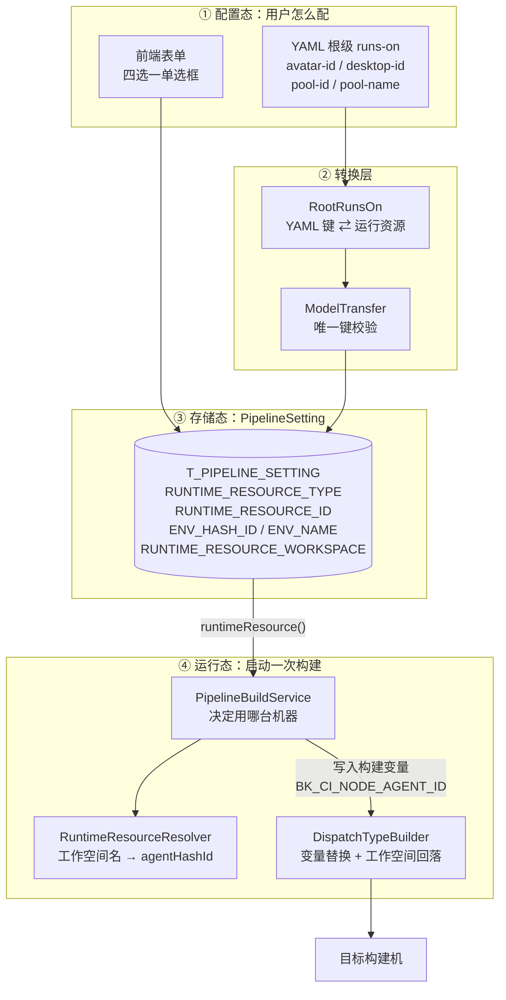
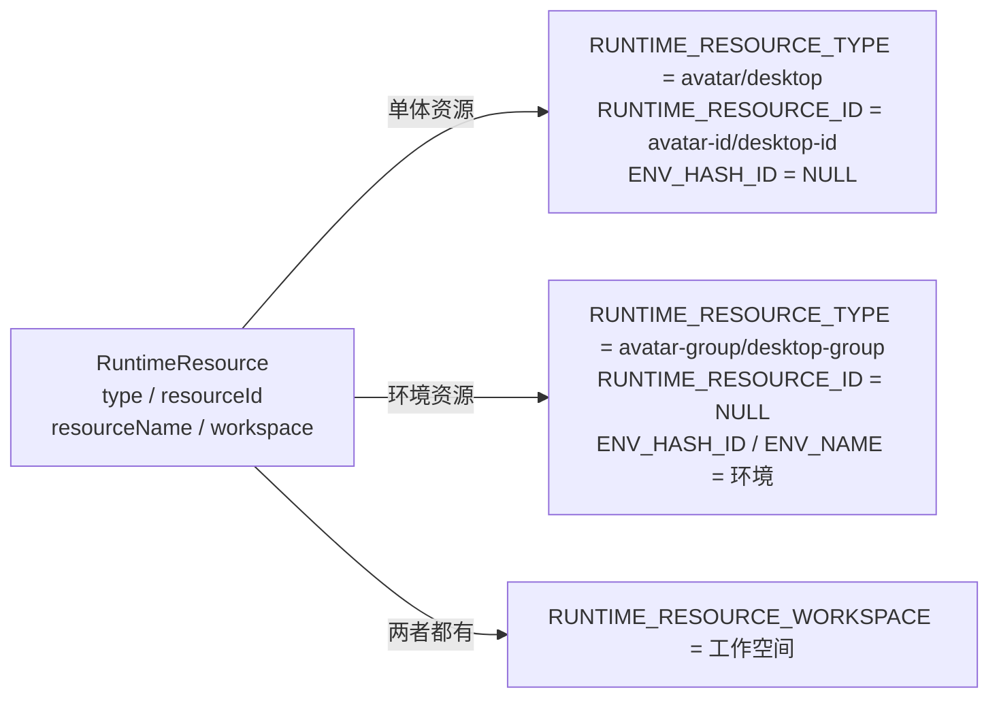
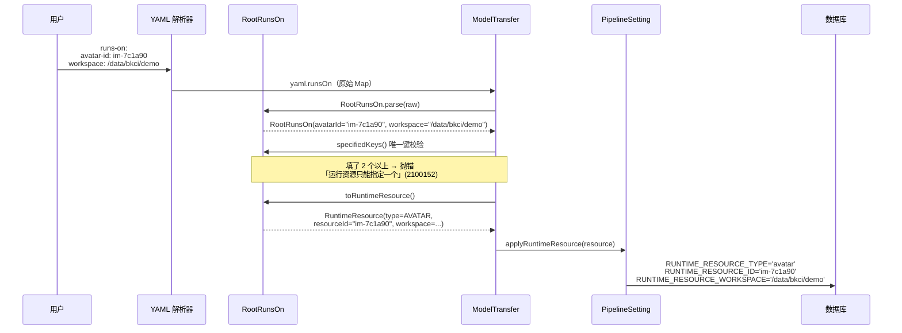
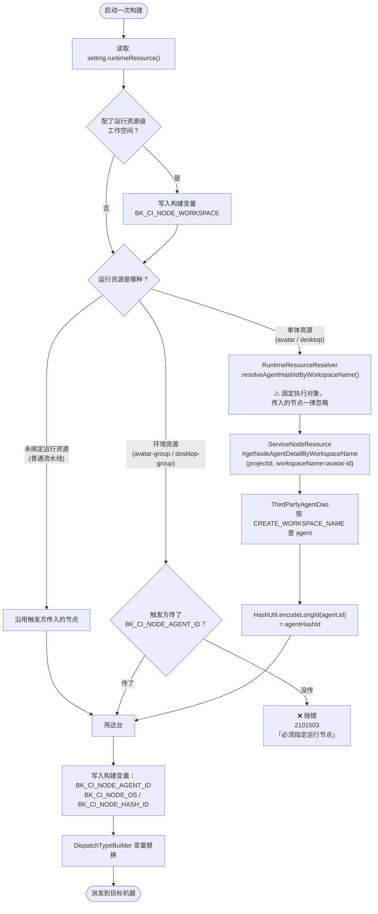
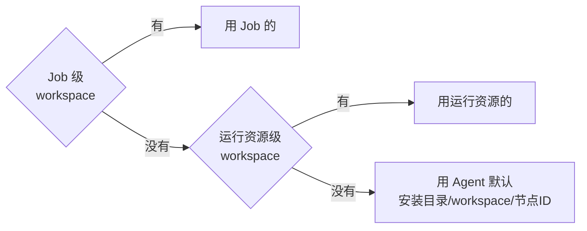

# 流水线运行资源（runtimeResource）技术方案

## 一、这件事要解决什么

过去，流水线只能绑定一个**环境**（`envHashId`），执行时从环境里找一台机器跑。
现在业务需要能直接绑定**一台具体的机器**，并且机器分成两种形态（数字分身、云桌面），于是「创作环境」这个单一概念升级成了**运行资源**，一共四选一：

| 运行资源 | 标识字段（YAML） | 含义 | 执行在哪台机器上？ |
| --- | --- | --- | --- |
| 数字分身 | `avatar-id` | 一位分身，绑定的就是一台机器 | **平台**换算 |
| 云桌面 | `desktop-id` | 一台云桌面 | **平台**换算 |
| 数字分身环境 | `pool-id` / `pool-name` | 一组分身 | **触发方**选定并传入 |
| 云桌面环境 | `pool-id` / `pool-name` | 一组云桌面 | **触发方**选定并传入 |

还有一个附带能力：运行资源上可以配一个**工作空间**（`workspace`），Job 没单独配时用它兜底。

> ⚠️ 这套代码是普通流水线和创作流**共用**的。所以字段名、类名、注释里都不出现"创作流"字样，只讲"运行资源"。

### 一条贯穿全文的分界线

整个方案最重要的一条规则是：

> **单体资源（分身／云桌面）绑的是一台机器，平台能自己算出是哪台；
> 环境资源只圈了一个范围，平台不替你挑，必须由触发方把节点传进来，没传就报错。**

为什么环境资源不让平台随便挑？因为"挑哪台"是有业务语义的——手动执行要让用户选、定时触发要按成员逐台跑、事件触发要落在发出事件的那台。平台如果擅自取"环境里的第一台"，结果就会和触发语义脱节，而且错得很隐蔽。所以宁可报错。

---

## 二、整体架构



四层各管一件事，互不越界：**配置态**只负责收集用户意图，**转换层**负责 YAML 与对象的双向翻译，**存储态**是唯一事实来源，**运行态**才去问环境服务"这台机器到底是谁"。

---

## 三、数据怎么存

运行资源在内存里是一个统一对象 `RuntimeResource`，但落库时拆成了几个字段，因为**环境类资源要继续复用老的 `ENV_HASH_ID` / `ENV_NAME` 列**（存量数据和存量查询都依赖它）：



新增三列（`T_PIPELINE_SETTING` 和 `T_PIPELINE_SETTING_VERSION` 各一份，归档库同步）：

| 列 | 类型 | 说明 |
| --- | --- | --- |
| `RUNTIME_RESOURCE_TYPE` | varchar(32) | `avatar` / `avatar-group` / `desktop` / `desktop-group` |
| `RUNTIME_RESOURCE_ID` | varchar(256) | 单体资源的标识，即 avatar-id 或 desktop-id |
| `RUNTIME_RESOURCE_WORKSPACE` | varchar(512) | 运行资源级工作空间 |

代码里只通过两个方法读写，不直接碰这些字段，避免四选一互相串味：

- `PipelineSetting.runtimeResource()` —— 把散落的列还原成一个 `RuntimeResource`
- `PipelineSetting.applyRuntimeResource(resource)` —— **整组覆盖**写回

> 💡 为什么必须"整组覆盖"？假设用户先选了数字分身（写了 `RUNTIME_RESOURCE_ID`），又改成数字分身环境（写了 `ENV_HASH_ID`）。如果只写不清，两个标识会同时残留，后面谁也说不清该用哪个。所以 DAO 的 `onDuplicateKeyUpdate` 分支也是整组 `set`，而不是逐个 `?.let`。

### 字段命名说明

`PipelineSetting` 里这个工作空间字段叫 `runtimeResourceWorkspace` 而不是 `workspace`，数据库列同理叫 `RUNTIME_RESOURCE_WORKSPACE`。因为流水线上下文里"workspace"至少有三层含义（Job 级、运行资源级、Agent 默认），光叫 `workspace` 读代码的人没法判断是哪一层。而在 `RuntimeResource` 这个对象内部仍叫 `workspace`，因为那里上下文已经自明了。

---

## 四、YAML 里的 avatar-id 是在哪儿、怎么变成机器的？

这是整个方案里链路最长的一段，拆成**两个阶段**看最清楚：保存时做"语义翻译"，启动时才做"实际换算"。

### 阶段一：保存 YAML（翻译成存储字段，不碰环境服务）



**关键点：这个阶段完全不调用环境服务。** `avatar-id` 原样存进库，没有任何远程调用，保存 YAML 的性能不受影响。

涉及代码：
- `RootRunsOn.parse / specifiedKeys / toRuntimeResource`（`common-pipeline-yaml`）
- `ModelTransfer.parseRuntimeResource`、`yaml2Setting`

反向（UI 转 YAML）走 `RootRunsOn.fromRuntimeResource` + `toYaml()`，只绑了环境名且没有工作空间时，仍输出历史的 `runs-on: <环境名>` 字符串写法，保证老流水线转出来的 YAML 不变样。

### 阶段二：启动构建（真正换算成 agentHashId）



**`avatar-id` → `agentHashId` 的换算就发生在"单体资源"这一条分支上**，入口是 `ServiceNodeResource#getNodeAgentDetailByWorkspaceName`，接口的 `workspaceName` 参数接收的就是 avatar-id 或 desktop-id（底层对应 `T_ENVIRONMENT_THIRDPARTY_AGENT.CREATE_WORKSPACE_NAME` 列）。

### 阶段三：Job 派发（变量替换成真实机器）

流水线模型里，创作流 Job 的派发类型是 `CreateAgentIdDispatchType`，它的 `value` 存的是一个**变量占位符**而不是真实机器：

```
CreateAgentIdDispatchType(value = "${{variables.BK_CI_NODE_AGENT_ID}}")
```

到 `DispatchTypeBuilder.getDispatchType` 这一步，才用上一阶段写入的构建变量把占位符替换成真实 agentHashId，最后 `ThirdPartyDispatchService` 把它转成 `ThirdPartyAgentIDDispatchType` 派发出去。

这一步还顺带做两件事：

1. **工作空间两级回落**：Job 级没配，就用运行资源级（`BK_CI_NODE_WORKSPACE`）；都没配，用 Agent 默认工作空间。
2. **清理 envHashId 占位符**：`CreateAgentIdDispatchType.envHashId` 的默认值也是个变量占位符，而绑定单台分身/云桌面时压根没有所属环境、这个变量不会被设置。不处理的话占位符会被原样带到下游，被 `AllCreateNodeEnv.hashIdToId` 当成环境 hashId 解码出一个错误的环境。所以这里按变量实际值重设，取不到就置空。

### 工作空间优先级总览



---

## 五、各触发渠道怎么配合

因为环境资源要求触发方传节点，这里把各渠道的现状列清楚：

| 触发渠道 | 节点从哪来 | 状态 |
| --- | --- | --- |
| 手动执行 | 前端拉环境节点列表让用户选，随启动参数传入 | ✅ 已有 |
| Webhook / 事件 | `CreateStreamTriggerSupportService.externalWebhookStartParams` 代为选定后写入启动参数 | ✅ 已有 |
| 子流水线调用 | 父流水线保存所选节点；若子流水线绑的是单体资源则不展示"运行节点"，由子构建自己换算 | ✅ 已有 |
| 市场事件触发 | `MarketEventTriggerBuildService` 从节点列表中选一台 | ✅ 已有 |
| 定时触发 | 本期不做 | ⏸ 暂缓 |
| 云桌面事件 | 本期不做 | ⏸ 暂缓 |

单体资源对所有渠道都一样：触发方什么都不用传，平台自己换算。而且**传了也会被忽略**——绑定一台分身/云桌面就意味着执行对象固定不可改派，不能让某个接入方通过启动参数把构建挪到别的机器上。万一换算失败（比如环境服务不可用），平台会把传入的节点一并清掉、宁可不派发，而不是退回到那台任意指定的机器。

### 启动接口怎么传值

启动接口 `/process/api/user/builds/{projectId}/{pipelineId}` 的 `values`：

| 运行资源 | 要传 `BK_CI_NODE_AGENT_ID` 吗 | 值从哪来 |
| --- | --- | --- |
| 数字分身环境 / 云桌面环境 | **必须传**，不传报错 | `listNodesNew` 返回的 `agentHashId` |
| 数字分身 / 云桌面 | 不用传，传了也忽略 | —— |

手动执行的前端不需要自己判断：预览接口只在环境资源时才下发一个 `id = BK_CI_NODE_AGENT_ID`、`required = true` 的表单项，`payload` 里带好了 `listNodesNew` 的地址和 `paramId = agentHashId`；单体资源时这一项不会出现。照着 `params` 渲染并回传即可。

其他渠道（openapi、子流水线、事件）按流水线详情里返回的 `runtimeResource.type` 判断：`-group` 结尾的要传节点。工作空间不用传，平台从设置里读。

---

## 六、兼容性

**存量数据**：老流水线只有 `ENV_HASH_ID`，`RUNTIME_RESOURCE_TYPE` 为空。`RuntimeResource` 把"类型为空"一律当作环境资源处理（`group = type?.group ?: true`），行为与 `avatar-group` 完全一致，不需要刷数据。

**旧版前端**：`PipelineVersionWithModel` 和 `TemplateInstanceCreateRequest` 都保留了 `envHashId` 字段，新建流水线时若只传了 `envHashId`，按环境资源兼容处理。

**一个已知限制**：YAML 里只写 `pool-id` / `pool-name` 时，无法区分这个环境是"数字分身环境"还是"云桌面环境"，存下来的类型为空，前端回显会落到"原创作环境"那一档。**运行行为不受影响**（类型为空按环境资源处理），只影响单选框的回显精度。

产品规则里「已有创作流按环境内节点还原成数字分身 / 数字分身环境」这一条**本期不做**。要做的话需要能区分节点是分身（`NodeType.CREATE`）还是云桌面（`NodeType.DEVX`），而 `NodeBaseInfo.nodeType` 在 `EnvService` 里存的是翻译后的文案、在 `NodeStringIdUtils` 里存的是原始值，两边不一致，得先补一个明确的类型编码字段。

---

## 七、改动清单

**新增**
- `RuntimeResource.kt`（`common-pipeline`）——运行资源值对象与类型枚举
- `RootRunsOn.kt`（`common-pipeline-yaml`）——根级 `runs-on` 的双向转换
- `RuntimeResourceResolver.kt`（`process/biz-base`）——工作空间名换 agentHashId
- `ServiceNodeResource#getNodeAgentDetailByWorkspaceName` + `NodeService` 实现（`environment`）

**改造**
- `PipelineSetting` / `PipelineSettingVersion` + 两个 DAO —— 新字段与整组覆盖
- `ModelTransfer` / `ContainerTransfer` —— YAML 双向转换、Job 级工作空间保全
- `PipelineBuildService` —— 启动时决定机器、环境资源缺节点报错
- `DispatchTypeBuilder` —— 工作空间回落、envHashId 占位符清理
- `PipelineRunEnvOsChangeResolver` —— 单体资源的操作系统取自那台机器
- `CreativeFlowCopyService` / `PipelineVersionFacadeService` 等调用方适配

**SQL**：`T_PIPELINE_SETTING`、`T_PIPELINE_SETTING_VERSION` 各加 3 列（主库 + 归档库，共 4 个脚本）

**i18n**：`2100152`（运行资源只能指定一个）、`2101503`（必须指定运行节点），中英日三语

---

## 八、上线前必做

1. **执行 DDL**：`2026_ci_process-update_v4.1_mysql.sql` 与 `2026_ci_archive_process-update_v4.1_mysql.sql`，脚本带 `COLUMN_NAME` 存在性判断，可重复执行。**DDL 必须先于应用发布**，否则 jOOQ 查询会报列不存在。
2. **还原 `gradle.properties`**：当前工作区里混入了本地数据库地址和账号密码，提交前务必改回默认值。
3. **跑通一次 CI 编译**：本地 `common-pipeline`、`api-process`、`biz-environment` 均编译通过；`common-pipeline-yaml` 及其下游模块因本地 Kotlin 版本比 CI 严格，在两个**本次未改动**的历史文件上报 smart cast 错误，无法在本地完成全量编译，需由 CI 验证。
4. **回归重点**：存量环境流水线手动执行、Webhook 触发、子流水线调用三条链路；新建单体资源流水线的 YAML ⇄ UI 往返；工作空间两级优先级。
