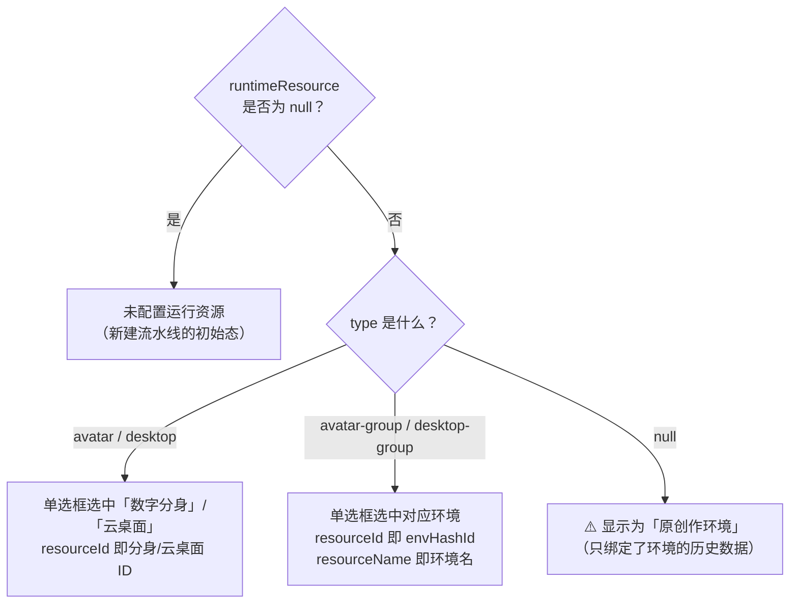
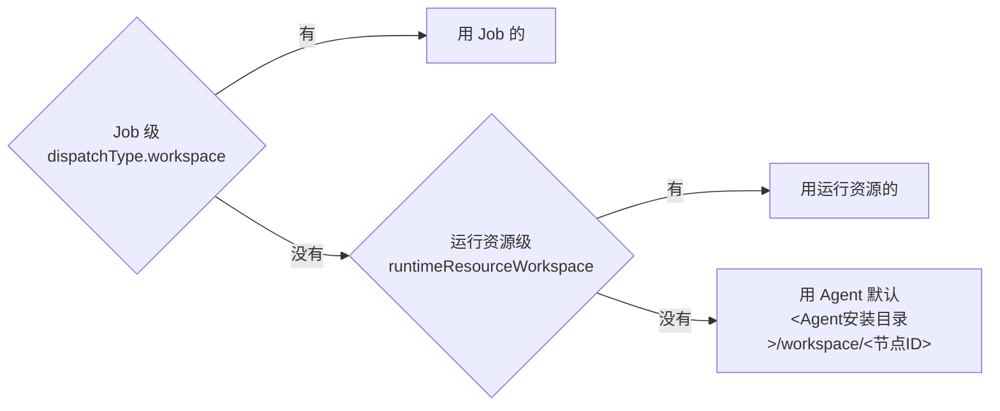

# 运行资源（runtimeResource）前端对接文档

> 面向前端：原来流水线只能绑定一个「环境」，现在升级为**运行资源四选一**。
> 本文只讲前端要改什么：字段怎么填、怎么回显、启动时传什么、报错怎么提示。

---

## 1. 四种运行资源

| 展示名 | `runtimeResourceType` | 绑定的是什么 | 启动时要不要选运行节点 |
| --- | --- | --- | --- |
| 数字分身 | `avatar` | 一位分身 = 一台机器 | ❌ 不用，也不展示 |
| 云桌面 | `desktop` | 一台云桌面 | ❌ 不用，也不展示 |
| 数字分身环境 | `avatar-group` | 一组分身 | ✅ **必选** |
| 云桌面环境 | `desktop-group` | 一组云桌面 | ✅ **必选** |

一句话记住这个分界：

> **绑定单台（avatar / desktop）→ 执行对象固定，前端不展示运行节点，后端自己算。
> 绑定环境（-group 结尾）→ 只圈了范围，必须让用户选一台，前端把 agentHashId 传回来。**

---

## 2. 候选列表：四种资源分别调哪个接口

网关前缀是 `/ms/environment/api`，`{projectId}` 换成当前项目。四种资源各有自己的列表，选中后再按第 3 节回填。

| 用户选的 | 接口 | 回填到 |
| --- | --- | --- |
| 数字分身（数字同事节点） | `POST /user/envnode/{projectId}/fetchNodes?nodeSource=REMOTEDEV` | `runtimeResourceId = createWorkspaceId` |
| 云桌面节点 | `POST /user/envnode/{projectId}/fetchNodes?nodeSource=CLOUD_DESKTOP_NODE` | `runtimeResourceId = createWorkspaceId` |
| 数字分身环境（数字同事环境） | `GET /user/environment/{projectId}?nodeSource=REMOTEDEV` | `envHashId`、`envName = name` |
| 云桌面环境 | `GET /user/environment/{projectId}?nodeSource=CLOUD_DESKTOP_NODE` | `envHashId`、`envName = name` |
| 某个环境下的节点（启动时选运行节点） | `GET /user/environment/{projectId}/{envHashId}/listNodesNew` | 启动参数 `BK_CI_NODE_AGENT_ID = agentHashId` |

示例（项目 `_carlyin`）：

```text
GET  /ms/environment/api/user/environment/_carlyin?nodeSource=REMOTEDEV
GET  /ms/environment/api/user/environment/_carlyin?nodeSource=CLOUD_DESKTOP_NODE

POST /ms/environment/api/user/envnode/_carlyin/fetchNodes?nodeSource=REMOTEDEV
POST /ms/environment/api/user/envnode/_carlyin/fetchNodes?nodeSource=CLOUD_DESKTOP_NODE

GET  /ms/environment/api/user/environment/_carlyin/-rqjpbamv/listNodesNew
```

`listNodesNew` 的路径和参数都不变，只用来查**某一个环境**下面的节点。`nodeSource` 只加在环境列表和节点列表上，用来区分数字同事和云桌面。

### 回填时用哪个字段

环境列表返回 `data[]`（`EnvWithPermission`）：

| 返回字段 | 用途 |
| --- | --- |
| `envHashId` | 存 `envHashId`，也是 YAML 的 `pool-id` |
| `name` | 存 `envName`，下拉展示用这个 |
| `nodeCount` | 可选，用来提示这个环境里有多少台 |

节点列表（`fetchNodes`）是分页，列表在 `data.records`（`NodeWithPermission`）：

| 返回字段 | 用途 |
| --- | --- |
| `createWorkspaceId` | **存 `runtimeResourceId`**。数字分身就是 avatar-id，云桌面就是 desktop-id |
| `displayName` | 下拉展示名 |
| `ip` | 辅助展示 |
| `agentHashId` | 配置运行资源时**不要用它** |

> 单体资源保存的是 `createWorkspaceId`，不是 `agentHashId`。`agentHashId` 只出现在启动参数里，而且只来自 `listNodesNew`。后端启动时会拿 `createWorkspaceId` 自己换成 agentHashId。

`listNodesNew` 返回 `data.records`（`NodeBaseInfo`），启动时：

| 返回字段 | 用途 |
| --- | --- |
| `agentHashId` | 写入 `values.BK_CI_NODE_AGENT_ID` |
| `displayName` | 运行节点下拉里显示 |

手动执行预览接口下发的「运行节点」表单项，`payload.url` 就是这条 `listNodesNew`，`paramId` 已经指定为 `agentHashId`，照着渲染即可。

---

## 3. 保存：字段怎么填

运行资源保存在 `PipelineSetting` 里（即 `modelAndSetting.setting`）。涉及 5 个字段：

| 字段 | 类型 | 说明 |
| --- | --- | --- |
| `runtimeResourceType` | string | 四个枚举值之一，**必填** |
| `runtimeResourceId` | string | 单体资源的标识：avatar-id 或 desktop-id |
| `envHashId` | string | 环境资源的环境 hashId（沿用老字段） |
| `envName` | string | 环境资源的环境名称（沿用老字段） |
| `runtimeResourceWorkspace` | string | 运行资源级工作空间，选填 |

### 四种情况的填法

```jsonc
// ① 数字分身
{
  "runtimeResourceType": "avatar",
  "runtimeResourceId": "im-7c1a90",      // 分身在 iMate 中的唯一 ID
  "envHashId": null,
  "envName": null,
  "runtimeResourceWorkspace": "D:/bkci/avatar-demo"   // 选填
}

// ② 云桌面
{
  "runtimeResourceType": "desktop",
  "runtimeResourceId": "cd-310001",      // 云桌面在云桌面系统中的唯一 ID
  "envHashId": null,
  "envName": null
}

// ③ 数字分身环境
{
  "runtimeResourceType": "avatar-group",
  "runtimeResourceId": null,
  "envHashId": "e101",
  "envName": "所有创作节点环境-Windows"
}

// ④ 云桌面环境
{
  "runtimeResourceType": "desktop-group",
  "runtimeResourceId": null,
  "envHashId": "e202",
  "envName": "时尚化云桌面环境"
}
```

> ⚠️ **务必带上 `runtimeResourceType`**。后端是以它为开关做"整组覆盖"的：带了就把 5 个字段整组写入（含置空），没带则走旧逻辑只更新 `envHashId`/`envName`。
> 如果切换资源类型时漏传 `runtimeResourceType`，上一次选择的标识会残留在库里，导致"界面显示 A，实际跑在 B"。

新建创作流时如果一个运行资源都没选，后端会拦截并返回 `ERROR_NEED_PARAM_`，参数名为 `runtimeResourceType`。

---

## 4. 回显：怎么判断当前选的是哪一个

流水线详情接口返回的 `runtimeResource` 对象直接可用，不需要前端自己拼：

```jsonc
"runtimeResource": {
  "type": "avatar",            // 四个枚举值之一，可能为 null（见下）
  "resourceId": "im-7c1a90",   // 单体资源=avatar-id/desktop-id；环境资源=envHashId
  "resourceName": null,        // 环境资源=环境名称；单体资源为 null
  "workspace": "D:/bkci/avatar-demo"
}
```

回显判断：



**关于 `type` 为 null**：这是只绑定了环境、但分不清是分身环境还是云桌面环境的历史数据（包括老流水线，以及 YAML 里只写了 `pool-id`/`pool-name` 保存回来的情况）。按产品约定展示为「原创作环境」这一档，新建时不提供这个选项。它的运行行为等同于环境资源。

> 产品规则里「已有创作流按环境内节点还原成数字分身 / 数字分身环境」这一条**本期不做**，存量数据一律落到「原创作环境」。

> `PipelineVersionWithModel` 里还保留了一个顶层的 `envHashId` 字段，仅为兼容旧前端，新代码请统一用 `runtimeResource`。

---

## 5. 启动：values 里传什么

启动接口：`POST /process/api/user/builds/{projectId}/{pipelineId}`

| 运行资源 | `BK_CI_NODE_AGENT_ID` | 值从哪来 |
| --- | --- | --- |
| `avatar-group` / `desktop-group` | **必传**，不传后端报错 | `listNodesNew` 返回的 `agentHashId` |
| `avatar` / `desktop` | **不要传**（传了也会被忽略） | —— |

```jsonc
// 环境资源
{ "values": { "BK_CI_NODE_AGENT_ID": "eb47f8c0a1d2", "其他变量": "..." } }

// 单体资源
{ "values": { "其他变量": "..." } }
```

工作空间**不需要传**，后端从设置里读。

> 为什么单体资源传了也忽略？因为「绑定一台分身/云桌面」意味着执行对象固定不可改派。后端会无条件用绑定对象换算出的机器，并把传入的值丢弃，防止通过启动参数把构建挪到别的机器上。

### 手动执行：前端不用自己判断

手动执行前调的预览接口（`buildManualStartupInfo`）返回的 `params` 已经把差异表达出来了：

- **绑定环境**时，`params` 里会**多出**一项：

```jsonc
{
  "id": "BK_CI_NODE_AGENT_ID",
  "required": true,
  "valueNotEmpty": true,
  "type": "ENUM",
  "label": "运行节点",
  "payload": {
    "type": "remote",
    "url": "/environment/api/user/environment/{projectId}/{envHashId}/listNodesNew?page=-1",
    "dataPath": "data.records",
    "paramName": "displayName",   // 下拉里显示这个
    "paramId": "agentHashId"      // 回传这个
  }
}
```

- **绑定单台**时，这一项**根本不会出现**。

所以照常按 `params` 渲染表单、把用户填的塞回 `values` 即可，不需要额外读运行资源类型做分支。这也正好实现了需求里「单个对象不展示运行节点」。

---

## 6. 子流水线调用 / 事件触发

| 场景 | 被调用流水线绑定单台 | 被调用流水线绑定环境 |
| --- | --- | --- |
| 子流水线调用 | 不展示「运行节点」，父流水线不保存节点，调用时按被调用方当时的运行资源执行 | 展示「运行节点」且必填，占位「请选择」，从该环境成员中选一个写入父流水线 |
| 事件触发 | 后端自行换算 | 由事件来源确定节点后随启动参数传入 |

子流水线调用时，被调用方的可选节点通过现有的 `listNodesNew` 获取；绑定单台时后端不会返回环境信息，前端据此隐藏该行即可。

---

## 7. YAML 模式

运行资源写在**根级** `runs-on`，四个键**只能写一个**：

```yaml
# 方式 1：单个数字分身
runs-on:
  avatar-id: im-7c1a90
  workspace: /data/bkci/avatar-demo   # 选填

# 方式 2：单台云桌面
runs-on:
  desktop-id: cd-310001

# 方式 3：环境（按环境 ID）
runs-on:
  pool-id: e101

# 方式 4：环境（按环境名称）
runs-on:
  pool-name: 时尚化云桌面环境
```

Job 级 `runs-on` 只保留 `workspace`，不再写运行资源：

```yaml
jobs:
  job1:
    runs-on:
      workspace: /data/bkci/job-level
```

兼容写法：`runs-on: <环境名>` 的字符串形式仍然支持，等价于 `pool-name`。UI 转 YAML 时，若只绑了环境名且没配工作空间，后端仍输出这种字符串形式，保证老流水线转出来的 YAML 不变样。

> 注意：YAML 只写 `pool-id`/`pool-name` 时后端区分不出分身环境还是云桌面环境，保存后 `type` 为 null，回显会落到「原创作环境」。这是已知限制，不影响运行。

---

## 8. 工作空间优先级

工作空间有两级，存在两个地方，运行时 Job 级优先。

**运行资源级**写在 setting 的 `runtimeResourceWorkspace`，对应库表 `T_PIPELINE_SETTING.RUNTIME_RESOURCE_WORKSPACE`。页面上就是运行资源面板那个输入框。

**Job 级**没有单独的字段和接口。页面保存整份 model 时，写在每个 Job 的 `dispatchType.workspace` 上：

```jsonc
"containers": [{
  "@type": "vmBuild",
  "dispatchType": {
    "buildType": "CREATE_AGENT_ENV",
    "value": "${{variables.BK_CI_NODE_AGENT_ID}}",
    "workspace": "/data/bkci/job-level"
  }
}]
```

整份 model 序列化进 `T_PIPELINE_RESOURCE_VERSION.MODEL`。YAML 里 Job 的 `runs-on.workspace` 保存时也会转成同一个 `dispatchType.workspace`，所以页面和 YAML 最终落在同一处。



启动后 `DispatchTypeBuilder` 先做变量替换。Job 没填时，用启动阶段写入的构建变量 `BK_CI_NODE_WORKSPACE`（值来自 `runtimeResourceWorkspace`）补上。两级都空，派发时 workspace 为空，构建机用自己的默认目录。

两级都不填时，界面提示语沿用：`默认为 <Agent安装目录>/workspace/<节点 ID>`。工作空间不承诺路径在新机器上存在，也不承诺磁盘空间。

---

## 9. 错误码

| 错误码 | 文案 | 触发场景 | 前端处理建议 |
| --- | --- | --- | --- |
| `2101503` | 运行资源为环境[{0}]，启动时必须指定运行节点 | 绑定环境但 `values` 里没传 `BK_CI_NODE_AGENT_ID` | 正常流程不该出现；出现说明表单项没回传，定位前端 |
| `2100152` | 运行资源只能指定一个，当前同时指定了 [{0}] | YAML 根级 `runs-on` 里填了两个及以上互斥键 | 在 YAML 编辑器上标红提示 |
| `2100014`（参数名 `runtimeResourceType`） | 缺少参数: {0} | 新建创作流没选运行资源 | 表单必填校验兜住 |

---

## 10. 联调自查清单

- [ ] 四种资源类型各建一条流水线，保存后刷新页面，单选框和标识都能正确回显
- [ ] 数字分身 / 云桌面保存的是 `fetchNodes` 的 `createWorkspaceId`，不是 `agentHashId`
- [ ] 数字分身环境走 `nodeSource=REMOTEDEV`，云桌面环境走 `nodeSource=CLOUD_DESKTOP_NODE`，两边列表互不串
- [ ] 从「数字分身」切到「数字分身环境」再切回来，确认不会出现标识残留（这是最容易出问题的点，务必带 `runtimeResourceType`）
- [ ] 绑定环境的流水线手动执行，确认出现「运行节点」下拉且必填
- [ ] 绑定单台的流水线手动执行，确认**没有**「运行节点」这一行，且能正常启动
- [ ] 老流水线（只有 `envHashId`）打开编辑页，确认显示为「原创作环境」且可正常执行
- [ ] 运行资源级工作空间填/不填，Job 级工作空间填/不填，四种组合下构建的实际工作目录符合预期
- [ ] YAML ⇄ UI 往返：四种写法转成 UI 再转回 YAML，内容不丢不变样
