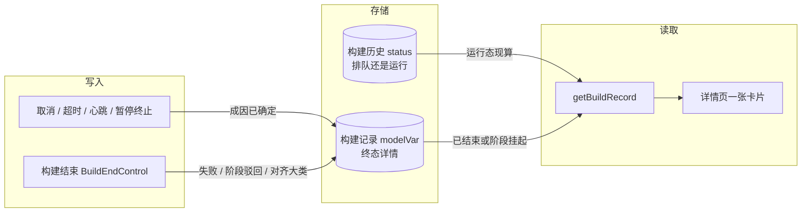
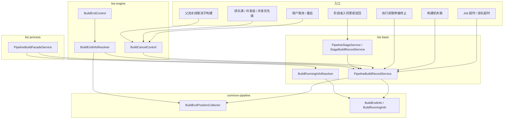
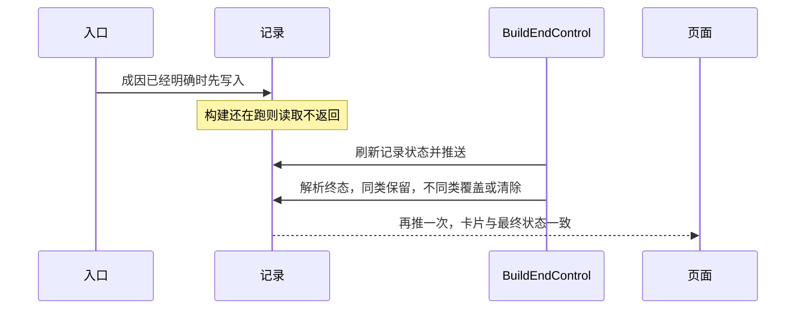
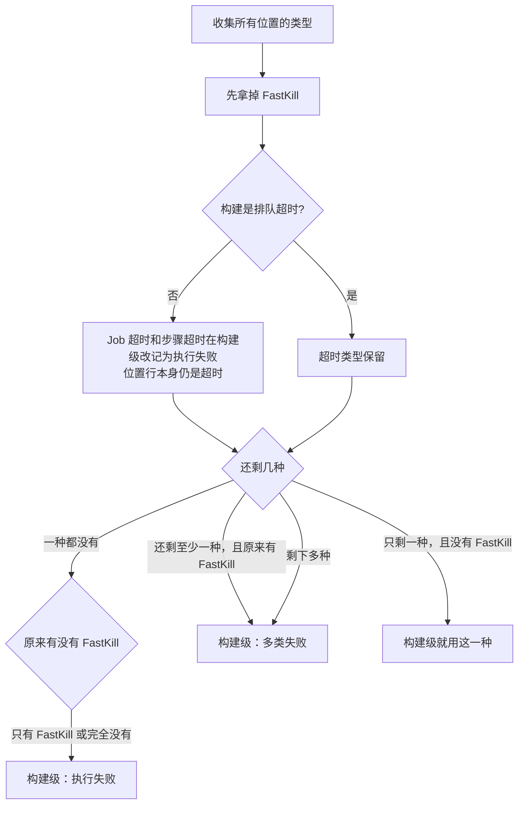
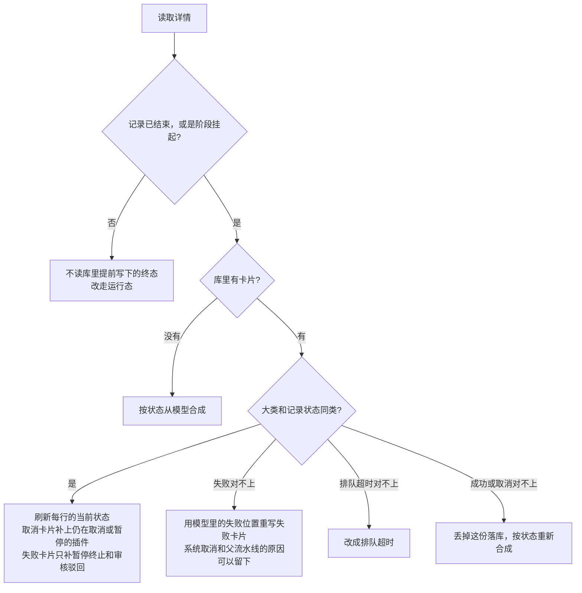
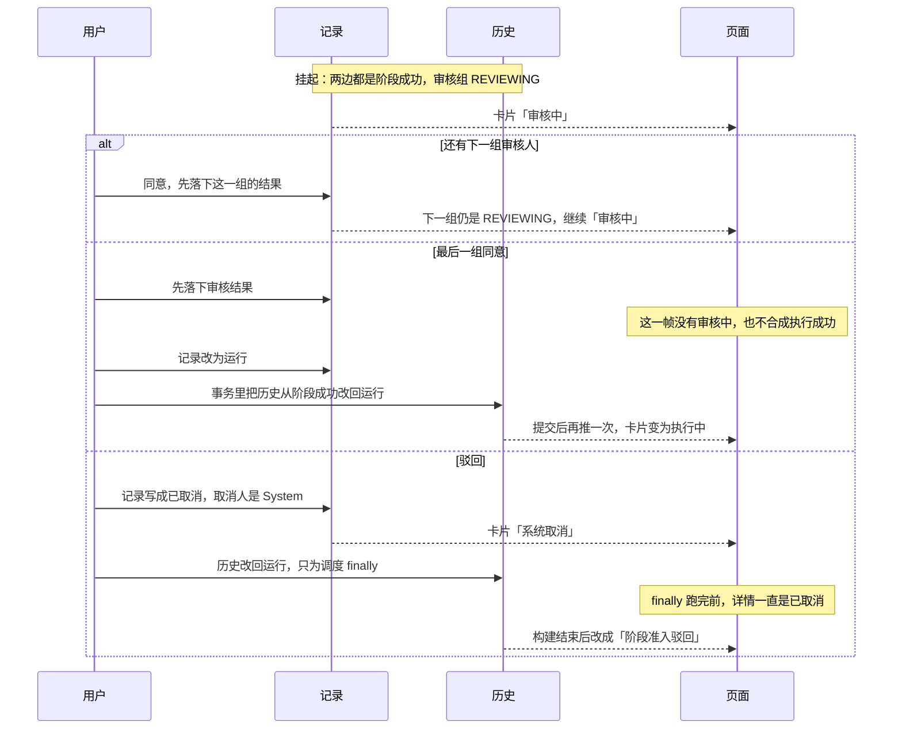
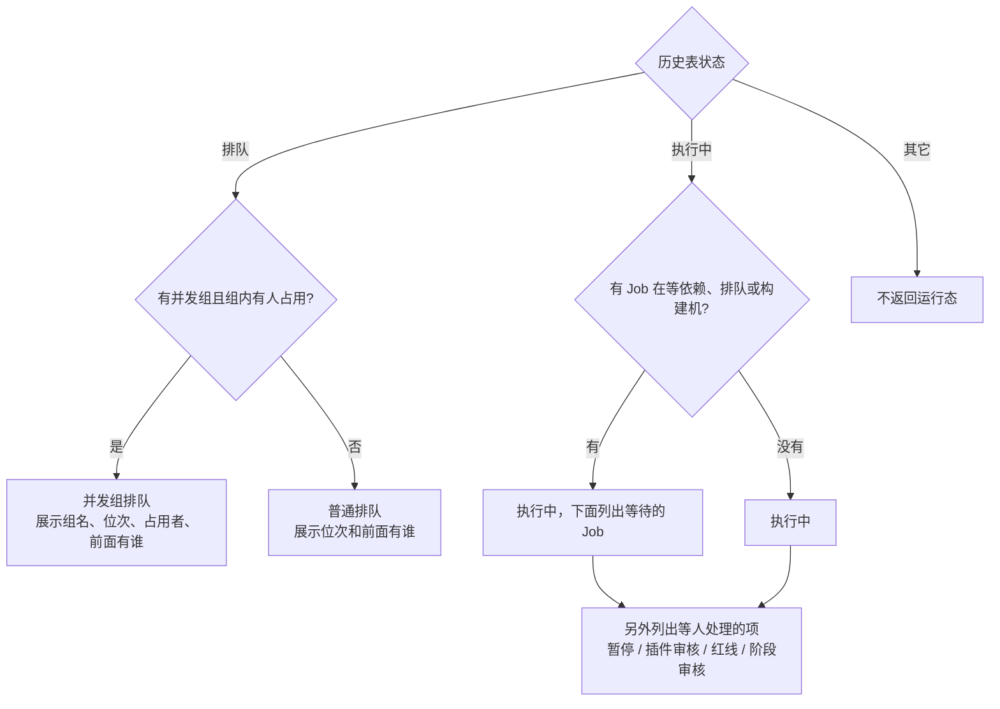
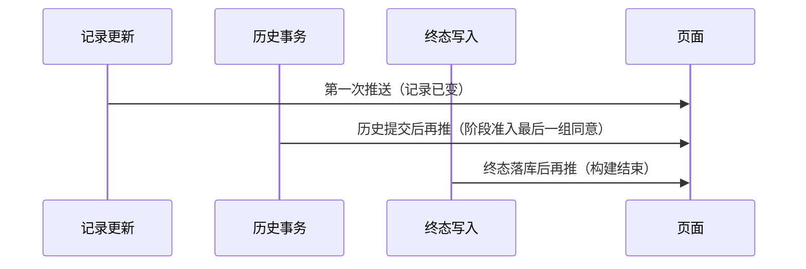

# 构建详情状态小结方案设计

对应需求 #13477，实现见 PR 13705（分支 `issue_13477_detail_reason_ing`）。

适用接口：`getBuildRecordByExecuteCount`（`ModelRecord`，不新增接口）。
字段含义、文案和跳转见 [BUILD_END_INFO_FRONTEND_API.md](./BUILD_END_INFO_FRONTEND_API.md)、[BUILD_RUNNING_INFO_FRONTEND_API.md](./BUILD_RUNNING_INFO_FRONTEND_API.md)。
本文讲清设计思路和当前实现，作为上线方案。

上线结论：可以上线。终态大类与页面状态对齐，FastKill、阶段准入和取消人的口径与实现一致。第 11 节的三段展示窗口是推送时序，不是状态写错。`biz-base` 编译依赖 jOOQ 连库生成，需在 CI 再编一次。

## 1. 要解决什么

详情页原来只有一个状态词，例如「失败」「已取消」「运行中」。用户还要自己翻编排图，才能知道是谁取消的、哪一个插件失败、是在排队还是在等构建机。

这次在同一条详情接口上多给一张小结卡片：

- 还没结束：现在卡在哪，前面有谁，要不要人处理。
- 已经结束：为什么结束，影响了哪些 Stage / Job / 插件。

前端按后端给出的大类和文案渲染，不自己猜成因。

## 2. 设计思路

四条原则，后面的流程图都从这里来。

**一张卡片，两种寿命。** 结束原因确定之后不再变，写入记录的 `modelVar["buildEndInfo"]`。排队和执行中的等待每秒都在变，不落库，打开详情时现算 `buildRunningInfo`。同一时刻只返回其中一张，避免两张卡片叠在一起。

**构建级大类跟着页面状态走。** 页面左上角的状态来自记录表。卡片大类必须和它是同一类：取消对取消，失败对失败，排队超时对超时，成功对成功。Job 超时、步骤超时、构建机失联发生在某一个位置上，构建本身往往以失败或取消收尾，所以构建级卡片不叫「超时」，超时分钟数写在原因和那一行位置上。

**能提前记下来的成因提前记，但运行中不展示。** 用户一点取消，取消人、在途插件就固定了。Job 超时、构建机失联也是在当时才知道影响了哪个容器。这些先写入记录。构建还在跑时，读取直接不返回这张卡片。等构建真正结束后，再按最终状态决定保留、覆盖或清掉。

**阶段准入把「记录」和「历史」拆开看。** 审核挂起时，记录和历史都是 `STAGE_SUCCESS`，卡片是「审核中」。最后一组点同意后，记录会先变成运行，历史表要等事务提交才变成运行。运行态看的是历史表，所以要等历史提交后再推一次详情。驳回时记录必须保持 `CANCELED`，finally 才能在「这条构建已经被取消」的前提下把收尾阶段跑完；历史表另外改回运行，只为了把 finally 调度起来。



## 3. 页面上到底出哪张卡片

```mermaid
flowchart TD
    start[打开构建详情] --> status{记录表状态}
    status -->|排队或执行中| run[现算 buildRunningInfo]
    status -->|STAGE_SUCCESS 且仍有审核组在 REVIEWING| review[合成「审核中」]
    status -->|STAGE_SUCCESS 但审核已经处理完| empty[两张卡片都空<br/>等下一次推送]
    status -->|已结束| end{记录里有终态详情?}
    end -->|有，且大类和状态一致| keep[刷新位置后返回]
    end -->|有，但大类和状态不一致| fix[改写成与状态同类<br/>或丢掉后重算]
    end -->|没有| synth[按模型合成一张]
    run --> one[只返回运行态]
    review --> two[只返回终态]
    keep --> two
    fix --> two
    synth --> two
```

| 用户看到的页面 | 记录状态 | 返回 |
|----------------|----------|------|
| 在排队、在执行 | `QUEUE` / `QUEUE_CACHE` / 运行中 | `buildRunningInfo` |
| 阶段准入等人审核 | `STAGE_SUCCESS`，审核组仍是 `REVIEWING` | `buildEndInfo`，类型 `SUCCESS_STAGE_REVIEWING` |
| 成功、失败、取消、排队超时 | 对应终态 | `buildEndInfo` |
| 最后一组点同意后，卡片先空一下 | 审核结果已经写下。历史表仍是阶段挂起。记录表还停在阶段挂起，或刚被改成运行中 | 这一下不给卡片：审核已经结束，不再显示「审核中」；历史还不是运行中，也还不能显示「执行中」。历史改为运行并再推一次后，页面才是执行中。见第 11 节 |

## 4. 模块怎么分工



| 模块 | 负责 |
|------|------|
| `common-pipeline` | 卡片数据结构；从编排模型采集失败/取消位置；读取时重算失败类型 |
| `biz-engine` | 取消、超时、心跳、构建结束时决定写什么 |
| `biz-base` | 把卡片写入记录、按状态读出来；现算运行态；阶段准入改记录并推送 |
| `biz-process` | 组装详情。终态为空才算运行态 |
| `support-files/i18n` | `buildEndType.*`、`buildRunningType.*` 和各条 `reasonCode` |

## 5. 终态怎么写下来

取消在取消事件里写。失败、阶段驳回、排队超时的最终对齐在构建结束时写。普通成功不写库，打开详情时合成，避免每次成功都多写一次。



| 场景 | 谁写入 | 当时写下的类型 | 构建结束后页面看到的 |
|------|--------|----------------|----------------------|
| 用户点取消 | 详情取消入口 → `BuildCancelControl` | `CANCEL_USER`，手动取消 | 取消。收集到在途插件后，文案改成「N 处在途被终止」 |
| 60 秒后再点一次，强制停掉 | 同上，`terminateFlag = true` | `CANCEL_USER`，强制终止 | 仍是强制终止，不改成在途计数 |
| 重启前先取消旧的那次 | 重启入口 | `CANCEL_USER`，因重启取消 | 取消 |
| 执行前暂停点被终止 | `PipelineTaskPauseListener`，已有卡片则不覆盖 | `CANCEL_USER` | 构建以取消结束就保留；后来变成失败或成功，则按最终状态改掉 |
| 排队满、并发组挤掉、并发优先级挤掉 | `QueueInterceptor`、运行时服务 | `CANCEL_SYSTEM` | 系统取消，原因写明是哪一种 |
| 父流水线取消，连带取消子构建 | 任务服务 | `CANCEL_PARENT_PIPELINE` | 父流水线取消。父构建先同步写下取消人，子构建再读，卡片上有父流水线名、构建号和操作人 |
| 某个 Job 执行超时 | 监控，并入已有取消卡片 | `CANCEL_SYSTEM`，带超时分钟数 | 构建还在跑时不展示。结束后若是失败，卡片改成失败，超时原因留下来，位置仍标 Job 超时 |
| 构建机失联 | 心跳，已有卡片则不覆盖 | `CANCEL_SYSTEM`，失联 | 与 Job 超时相同：跑的时候不展示，结束后按最终状态对齐 |
| 在排队队列里等超时 | 监控 | `TIMEOUT_QUEUE` | 超时卡片，这是唯一的构建级超时 |
| 插件失败、红线、人工审核驳回、子流水线失败、步骤超时 | 构建结束时解析 | 按第 6 节汇总 | 失败卡片，原因在每一行位置上 |
| 阶段准入被驳回，finally 跑完且整体算成功 | 构建结束时解析 | `SUCCESS_STAGE_ABORT` | 成功卡片，原因是驳回意见。只有一条意见时直接展示，多条用兜底文案 |
| 普通成功 | 不写 | 无 | 读取时合成「执行成功」，没有位置列表 |
| 服务关闭、删除流水线、编排不存在 | 各入口先写系统取消 | `CANCEL_SYSTEM` | 不改这些入口原来的构建状态。最终状态若不是取消，结束时改成与状态同类，关机或删除的原因留在 `reason` |

取消人在发出取消事件之前就写入记录。父流水线级联因此能读到真实操作人。没有真实操作人时，记录更新会写入字面量 `System`，读取把它当成系统取消，不展示成某个用户取消的。

Job 超时可能连续打到多个 Job。后一次把模型里仍处于取消或暂停的插件并进已有取消卡片，不把已经是失败的卡片改回取消，也不覆盖用户取消。

运行中重试沿用同一次执行的记录行。重试一开始就清掉本轮已经写下的终态，避免上一轮的失联或 Job 超时挡住这次结束时的写入。

子流水线启动时，把子流水线名称和构建号一并记下。旧数据没有名称时，失败行用兜底文案。构建号不写进原因句子，前端用子流水线信息做跳转。

插件被强制终止、自己又没有错误码时，用事件里带来的终止原因替换引擎的占位错误码。插件已经报了自己的错误码，就保留插件的。这样，被失败即停连带停掉的人工审核，不会被说成「审核驳回」。

## 6. 失败时构建级类型怎么定

每一行位置先按插件自己的终态归类：执行失败、质量红线、人工审核驳回、子流水线、步骤超时、Job 超时。失败即停（FastKill，错误码 2199010）只在写入时能看到终止原因的那些行上标出来。从编排模型现扫时，标不出这一类。

构建级类型不是「数一数有几种失败」这么简单。FastKill 那一行如果跟构建级用同一种单一失败，页面会把整行画成错误码 2199010，设计稿里的「因失败即停被终止」出不来。所以只要 FastKill 和别的失败同时存在，构建级就写成「多类失败」。这是页面开关，不是说有很多个互不相关的根因。



举例：

| 位置上有什么 | 构建级 |
|--------------|--------|
| 只有一个插件执行失败 | 执行失败 |
| 只有步骤超时，构建状态是失败 | 执行失败。这一行仍写「步骤超时」和分钟数 |
| 步骤超时 + Job 超时 | 执行失败。两行位置各自保留超时类型 |
| 一个插件失败，同阶段其它 Job 被失败即停终止 | 多类失败。失败行写插件错误，被终止的行写「因失败即停被终止」 |
| 只有失败即停、没有别的失败行 | 执行失败 |
| 红线未达标 + 插件失败 | 多类失败 |
| 一个位置都收集不到，例如互斥锁没抢到 | 仍给一张执行失败卡片，否则详情打不开 |
| 构建状态本身是排队超时 | 排队超时。不走上面这张图的失败汇总 |

失败卡片的构建级原因留空，因为同一次构建可能有多处失败，取其中一条会和位置列表打架。每行自己的驳回意见、红线指标、子流水线名、超时分钟数写在该行上。排队超时的原因对整次构建只有一份，留在构建级。

读取重算用同一套规则，出现在三个地方：老构建没有落库、取消卡片被按失败重写、失败卡片又补上了暂停或审核位置。模型现扫补不进 FastKill；已经落库的位置里如果带着它，重算时仍然会得到「多类失败」。

位置最多 50 条。单条原因最长 512 字。给页面展示时，卡片原因压缩空白后截到 200 字，插件原始错误只放 tooltip。

## 7. 打开详情时怎么读

状态以记录表为准。构建结束的瞬间，记录已经是终态，历史表可能还显示运行中。若用历史表，这一下推送会算不出终态卡片。



取消合成时：取消人有值，且不是 `System`，就是用户取消；否则是系统取消。用户取消文案里的「N 处」与卡片上的位置条数对齐。执行前暂停被终止的那一行，状态文案用「暂停/终止」，不用一个笼统的「取消」。

`reasonCode` 在读的时候按请求语言翻译。库里存的是码和参数，不是某一门语言的句子。

## 8. 阶段准入

阶段准入是这张卡片里最容易看错的一段，因为记录表和历史表会短暂不一致。



挂起时详情不走运行态。位置从 1 开始编，触发器阶段不算。卡片上有审核组序号、组名、待审核人和已经等待的时长。

驳回不能把记录改成运行。记录一旦进入已取消，后续普通更新改不动这个状态，finally 期间详情才能稳定停在已取消。历史表改回运行，是原有调度需要，和详情卡片用的不是同一张表。

构建真正结束时，`buildEnd` 直接写成最终状态，不受「已取消之后不能再 update」这条限制。若阶段上有驳回记录且整体成功，写入 `SUCCESS_STAGE_ABORT`。

## 9. 运行态现算什么

运行态只看历史表。排队是 `QUEUE` / `QUEUE_CACHE`，执行中是运行中的那些状态。阶段挂起、触发待审核、已经结束，这里直接返回空。计算抛错也返回空，详情页仍然打得开。



排队列表按并发组或当前流水线查，只取展示用的列，正式构建和未删除的调试构建合在一起。排序用入队时间，同一毫秒再看构建号。位次从 1 开始；列表里找不到自己（例如并发组配置刚改过）就给 0，前端不显示「第几位」。明细最多 10 条，多出来的只计数。并发上限与流水线设置一致，单条流水线锁和并发组锁都是 1。

执行中，准备环境的前 15 秒视为构建机正常拉起，不报「在等资源」。构建机复用互斥按照复用配置直接给出等待原因，不必等满 15 秒。等人处理的项目不改卡片标题，也不改当前阶段名。等待的 Job 和待处理项最多各 50 条。

时长是服务端算出快照的那一刻。前端用详情上的 `currentTimestamp` 自己每秒加。

## 10. 什么时候推给页面

记录变更等事务提交后再推，避免推送读到还没提交的状态。终态详情若在记录状态更新之后才写入，会再推一次，否则用户要手动刷新才看得到卡片。

谁打开着这个构建详情，谁就在这个页面的会话里，推送会发给这些会话。点同意的审核人当时就在详情页上，所以会收到。启动人、其它正在看同一页的人也会收到。事件上要带一个用户名，这里沿用构建启动人，只用于日志，不用来挑选接收人。审核人不是启动人，所以第二次推送不把审核人填进这个字段，而是回查历史表上的启动人。换成审核人也不会少推给谁、多推给谁。



## 11. 已知的三段空窗

最终落库是对的。这三段只影响中间某一帧，QA 按这个预期看：

1. 最后一组审核人点同意后，页面会先空一下，再变成执行中。审核组已经处理完，不能再显示「审核中」，也不会显示「执行成功」。执行中卡片看的是历史表，而历史表还是阶段挂起，所以这一下也没有执行中。记录表在这一刻可能仍是阶段挂起，也可能已经改成运行中，两种情况都是空的。历史改为运行后再推一次，才出现执行中。
2. 驳回之后、finally 跑完之前，详情是「已取消 / 系统取消」。历史列表可能已经显示运行中。构建结束后才变成「阶段准入驳回」。
3. 驳回并以阶段成功收尾时，构建结束会先推一次。这时终态还没写入，历史仍是运行中，可能先闪一张运行中卡片。同一次结束流程里的下一次推送才是阶段准入驳回。

## 12. 明确不改的行为

- 不在构建结束时去扫仍停在 `QUEUE` / `QUEUE_CACHE` 的任务并改引擎状态。那次扫描赶不上取消后已经卡住的 Job，也会和还在认领任务的构建机不一致。
- 单个插件变成取消时，不删 `CANCEL_ACTION_TIME`。60 秒后第二次取消会不会升级成强制终止，靠这个标记。
- 服务关闭、删除流水线、编排不存在，维持原来的构建状态，只补原因。
- `stageCancel` 继续把记录写成已取消。这是取消动作，记录需要停在终态上。

## 13. 上线与验证

发布：`common-pipeline`、`biz-base`、`biz-engine`、`biz-process`，以及 `support-files/i18n` 里新增的词条。

无数据库单测已通过：`BuildEndPositionCollectorTest`、`BuildEndInfoAlignTest`、`BuildEndInfoResolverTest`。`biz-base` / `biz-engine` 的 jOOQ 生成需要 MySQL，本机未编，以 CI 编译为准。

建议 QA 按页面走一遍：

1. 用户取消、60 秒后强制终止、重启前取消、父流水线连带取消、排队超时。卡片大类和左上角状态一致。父流水线卡片能跳到父构建。
2. 失败构建里只有步骤超时或 Job 超时。构建级是执行失败，对应那一行仍是超时。构建还在跑时不出现取消卡片。
3. 一个插件失败，同阶段开启了失败即停。卡片是多类失败，被终止的那一行是「因失败即停被终止」，不是错误码 2199010。
4. 两个 Job 先后超时。位置会补齐，且不会盖掉用户取消。执行前暂停被终止的状态文案是「暂停/终止」。
5. 阶段准入。等人时是「审核中」。最后一组同意不出现「执行成功」，空一帧后变为执行中。驳回后详情保持已取消和系统取消，成功结束后是阶段准入驳回。
6. 排队能看到第几位、谁占用、前面有谁。找不到自己时不显示位次。执行中的等待 Job、等人处理不改卡片标题。准备环境 15 秒内不报资源排队。
7. 运行中重试之后，上一轮的失联或 Job 超时卡片不再出现。
