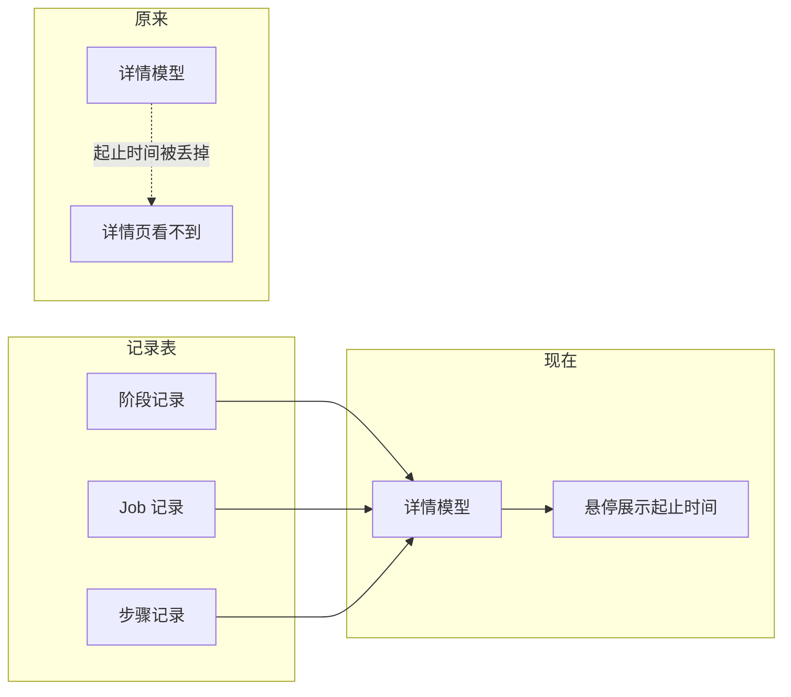
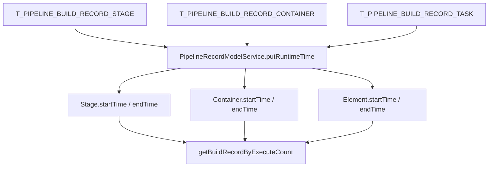
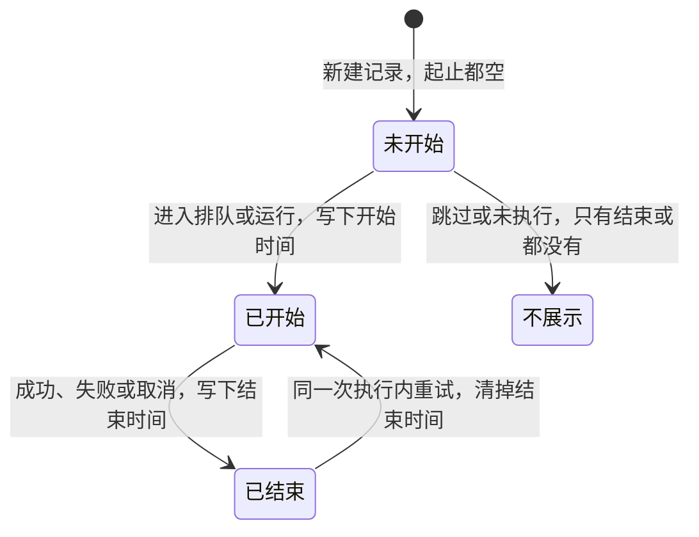
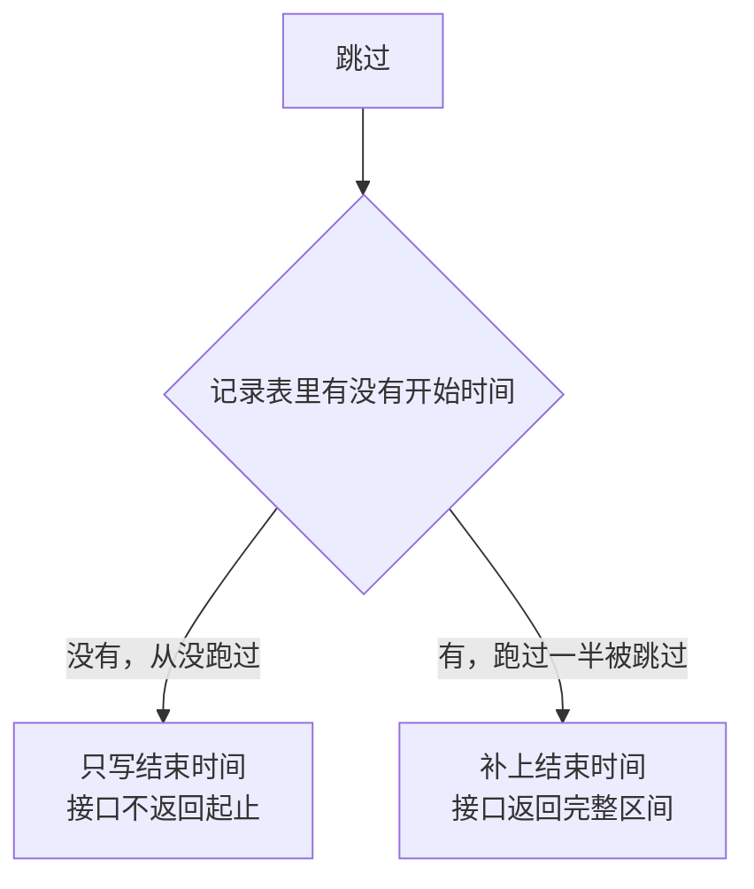
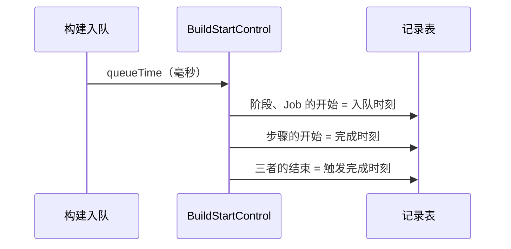
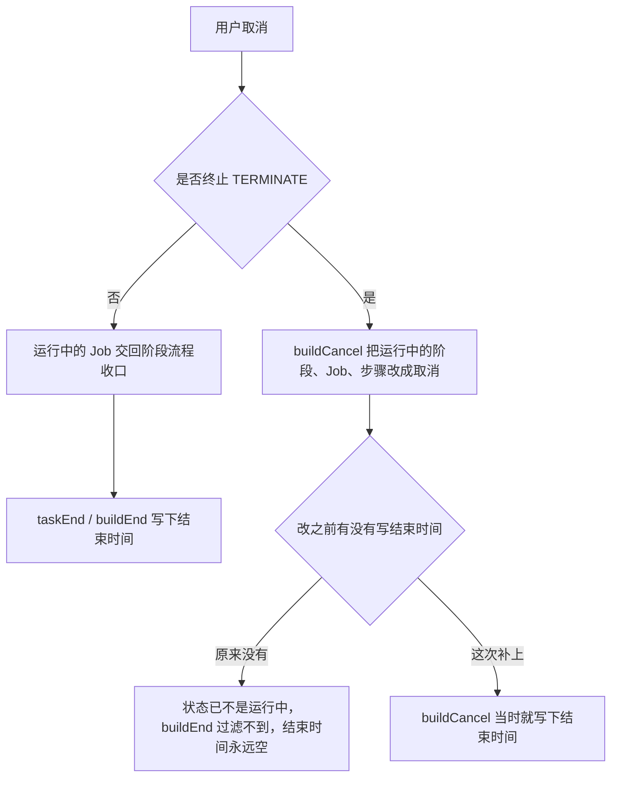
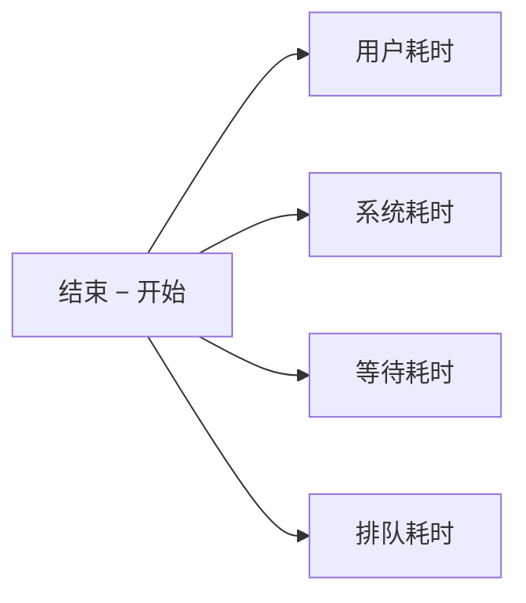

# 构建详情起止时间技术方案

对应需求 [#13760](https://github.com/TencentBlueKing/bk-ci/issues/13760)。不新增接口，在现有的 `UserBuildResource#getBuildRecordByExecuteCount` 上，给阶段、Job、步骤补上开始时间和结束时间。

适用对象：构建详情页悬停时展示的「起止时间」。耗时数字（用户耗时、系统耗时、等待耗时、排队耗时）沿用原来的算法，这次不改计算方式。

## 1. 要解决什么

详情页悬停要显示一段起止时间，例如 `16:10 – 16:12`。记录表里其实已经有 `START_TIME` / `END_TIME`，但拼详情模型时把它们丢掉了，接口返回的阶段和步骤模型上也没有这两个字段。

产品对齐后的口径：

- 阶段、Job、步骤都要有起止时间。
- 以记录表里存的开始、结束时间为准，不从耗时反推，也不改耗时字段。
- 没真正跑起来的（跳过、未执行）不硬凑一个开始时间。



## 2. 数据怎么流到页面

三张记录表各有一列开始时间和一列结束时间，类型是数据库时间。详情接口把它们换成毫秒时间戳，写进对应模型的 `startTime` / `endTime`。



读取规则三层共用，写在 `putRuntimeTime`：

1. 记录表的时间原样转成毫秒，不从 `timeCost` 倒推。
2. 没有开始时间时，结束时间也不返回。跳过、未执行常常只有结束时间，单独返回会让前端算出一段没有意义的区间。
3. 进行中只有开始时间，结束时间为空，前端可以只显示开始。

| 记录表里的情况 | 接口返回 |
| --- | --- |
| 开始、结束都有 | 两个毫秒时间戳都返回 |
| 只有开始（还在跑，或已取消但当时没记下结束） | 只返回开始 |
| 只有结束（跳过、未执行） | 两个都不返回 |
| 都没有 | 两个都不返回 |

字段是可空的，JSON 序列化时 null 不输出。已保存的流水线编排、模板对比里不会多出这两个字段。Job 的 `resetBuildOption` 会把这两个字段清掉；阶段只在 `resetBuildOption(init = true)` 时清掉。步骤的起止时间只放在执行记录里，不写进编排。

## 3. 什么时候写入

三层都是「写一次，不再覆盖」：开始时间空着才写，结束时间空着才写。重试会把上一轮的结束时间清掉，下一轮重新记。



各层「开始」的触发点不完全一样，这是记录表原有行为，这次保持不动。

| 层级 | 开始时间何时写下 | 结束时间何时写下 |
| --- | --- | --- |
| 阶段 | 状态变成运行中（含暂停、审核中） | 状态变成结束 |
| Job | 进入排队（准备运行）或变成运行中，谁先到谁写 | 状态变成结束 |
| 步骤 | 插件真正启动 `taskStart`，或状态变成运行中 | 插件结束 `taskEnd`，或状态变成结束 |

因此：Job 的开始时间含排队；阶段的开始时间从真正跑起来算。悬停上看到的区间，和「用户耗时 + 系统耗时」不是同一个数，见第 7 节。

## 4. 跳过

跳过的难点是「有没有真的跑过」这两种情况混在一起。



开始时间一律不补。从没跑过就跳过的记录没有真实开始时刻，写成「跳过那一刻开始、同一刻结束」会在详情上出现一段 0 秒区间。

结束时间按终态补，不看有没有开始时间。和单条更新同一个写法：`END_TIME` 为空才写成当前时间，已有的不覆盖。

- 阶段、Job、步骤自身被跳过，走 `updateStageRecord` / `updateContainerRecord` / `updateTaskRecord`。`SKIP` 是终态，结束时间为空就写下。
- 跳过整个阶段时，该阶段下的 Job 和步骤原来只改 `STATUS`。`BuildRecordContainerDao.updateRecordStatus`、`BuildRecordTaskDao.updateRecordStatus` 在 `buildStatus.isFinish()` 时执行 `END_TIME = coalesce(END_TIME, now)`。
- 跳过整个 Job 时，底下的步骤走同一条步骤批量更新。

没开始时间的行也会因此多一个结束时间。读取时 `putRuntimeTime` 看到没有开始时间就两个都不返回，页面上仍然不显示起止。

未执行（`UNEXEC`）是 `isNeverRun()`，不是 `isFinish()`。取消时把还没轮到的步骤标成未执行，不会进这段补结束时间的逻辑。

| 跳过时所处的状态 | 记录表 | 详情接口 |
| --- | --- | --- |
| 阶段、Job 或步骤自身被跳过，从没开始 | 只写结束时间，开始仍空 | 不返回起止 |
| 阶段被跳过，底下 Job、步骤已经跑过 | 保留开始时间，结束时间为空则补上 | 返回完整区间 |
| 阶段被跳过，底下 Job、步骤从没开始 | 开始仍空，结束时间为空则补上 | 不返回起止 |
| Job 被跳过，底下步骤已经跑过 | 保留开始时间，结束时间为空则补上 | 返回完整区间 |
| Job 被跳过，底下步骤从没开始 | 开始仍空，结束时间为空则补上 | 不返回起止 |
| 单个步骤被跳过，已经跑过 | 单条更新写下结束时间 | 返回完整区间 |
| 取消时标成未执行 | 起止都不变 | 不返回起止 |

## 5. 触发阶段

流水线第一个阶段（触发阶段、触发 Job、触发步骤）没有「运行中」这一下，引擎一次就把它们标成成功。改之前记录表只有结束时间，详情页起止是空的。

触发阶段的耗时本来就是「入队时刻到触发完成」。这次让阶段和 Job 的开始时间取同一个入队时刻，并按毫秒还原。`Long?.toLocalDateTime()` 会先把毫秒整除成秒，最多丢掉 999 毫秒，和旁边用完整毫秒算的耗时对不齐，所以不用它。

触发步骤本身是瞬间完成的，开始时间取完成那一刻，不把整段排队算到步骤上。



触发 Job 的 `timeCost` 维持全 0，没有为了让等式成立去改它。详情页和状态广播的时长都读这个字段，改了会让原来显示为 0 的耗时变成排队时长。

补充的开始时间只在记录本身还没有开始时间时生效，已有开始时间不会被覆盖。普通阶段、Job、步骤不传这个参数，行为与原来一致。

## 6. 取消和终止

用户点取消时有两条路，结束时间的归宿不一样。



问题出在终止这条路。`buildCancel` 把还在跑的阶段、Job、步骤改成取消，却不写结束时间。随后的 `buildEnd` 只处理「仍是运行中」的记录，这些已经被改成取消，于是结束时间再也没人写。详情页会一直显示「有开始、没有结束」，读耗时时用「现在」代替结束时间，数字还会一直变大。

修复只补空着的结束时间，不改开始时间，也不改已经写过的结束时间。还没跑到的步骤仍按原来批量标成未执行，不写时间；读取时因为没有开始时间，接口不返回起止。

| 取消时步骤所处的状态 | 记录表 | 详情接口 |
| --- | --- | --- |
| 正在跑，用户终止 | 保留原开始时间，补上结束时间 | 返回起止 |
| 正在跑，普通取消后正常收口 | 原有 `taskEnd` / `buildEnd` 写结束时间 | 返回起止 |
| 还没轮到，被标成未执行 | 起止仍空，或只有结束 | 不返回起止 |

## 7. 起止时间和耗时的关系

记录表里 Job 的耗时是这么拆的：

```text
结束 − 开始 = 用户耗时 + 系统耗时 + 等待耗时 + 排队耗时
```

用户耗时是插件真正执行的时间（`executeCost`），系统耗时是扣掉执行、等待、排队之后剩下的时间（`systemCost`）。等待含人工审核，排队含互斥、构建机等。

所以「结束 − 开始」等于「用户耗时 + 系统耗时」，只在这次没有排队、也没有人工等待时成立。有排队或审核时，多出来的那段就是等待加排队。



阶段的算法用各 Job 的时间线做并集、交集，不是简单相加，但「总耗时 = 结束 − 开始」这一点相同。步骤没有系统和排队两项，用户耗时 = 总耗时 − 等待耗时。

系统耗时算出来是负数时会被收成 0，极端情况下左边会略小于右边。

触发 Job 是例外：起止区间约等于入队到触发完成，`timeCost` 仍是全 0。这个 Job 上，区间和「用户耗时 + 系统耗时」对不上。触发阶段在第一次写开始时间的那次更新里，耗时计算读的还是更新前的记录（开始时间为空），所以当时不算阶段耗时。

如果产品希望悬停上的等式始终成立，需要前端把等待、排队也展示出来，或从区间里减掉。这是展示决策，后端这次没有改耗时算法。

## 8. 改动范围

| 位置 | 做了什么 |
| --- | --- |
| `Stage`、`Element`、四种 `Container` | 增加可空的 `startTime` / `endTime`（毫秒） |
| `ModelVarRefUtils` | 变量扫描跳过这两个字段，避免被当成变量引用 |
| `PipelineRecordModelService` | 三层记录的起止时间写入详情模型 |
| 阶段 / Job / 步骤的记录更新 | 增加可选的补开始时间，默认不传 |
| `BuildStartControl` | 触发阶段、触发 Job 用入队时间补开始；触发步骤用完成时刻 |
| `PipelineBuildRecordService.buildCancel` | 终止时给仍在跑的阶段、Job、步骤补结束时间 |
| `BuildRecordContainerDao.updateRecordStatus`、`BuildRecordTaskDao.updateRecordStatus` | 传入状态是终态时，`END_TIME = coalesce(END_TIME, now)`。跳过会走到；未执行不是终态，不走 |

不改表结构。历史构建只要记录表里有起止时间，发版后打开详情就能看到。

## 9. 兼容和上线

- 老客户端不认识新字段时会忽略，老流水线 JSON 里没有这两个字段也能反序列化。
- 耗时的计算公式和 `timeCost` 的写入没改。触发 Job 的 `timeCost` 仍是全 0。
- 记录表上多写了三类时间，都是原先空着的格子，不覆盖已有值：
  - 触发阶段、触发 Job 补开始时间（入队时刻）；触发步骤补开始时间（完成时刻）。
  - 终止构建时，仍在跑的阶段、Job、步骤补结束时间。
  - 跳过把状态批量改成终态时，结束时间为空的 Job、步骤补结束时间。没开始时间的行也会写下结束时间，接口不返回。
- `common-pipeline` 覆盖了三层合并、缺省为空、重置清空。`Element` 的 JSON 字段顺序测试在 Windows 上会因换行符失败，与本次字段无关（null 不输出，编排 JSON 里没有起止时间）。
- `biz-base`、`biz-engine` 在部分环境会卡在 `common-pipeline-yaml` 原有编译错误上，与本次改动无关。需要在 CI 上编译，并在测试环境做三件事：打开一次已结束的构建看三层起止时间；终止一次正在跑的构建，核对仍在跑的阶段、Job、步骤都有结束时间；跳过一个已经跑起来的阶段，核对底下已开始的 Job、步骤结束时间已补上，从没开始的不出现在详情里。

上线前需要产品确认一件事：悬停若只展示用户耗时和系统耗时，有排队或审核的 Job，以及触发 Job，区间长度不会等于这两项之和。
